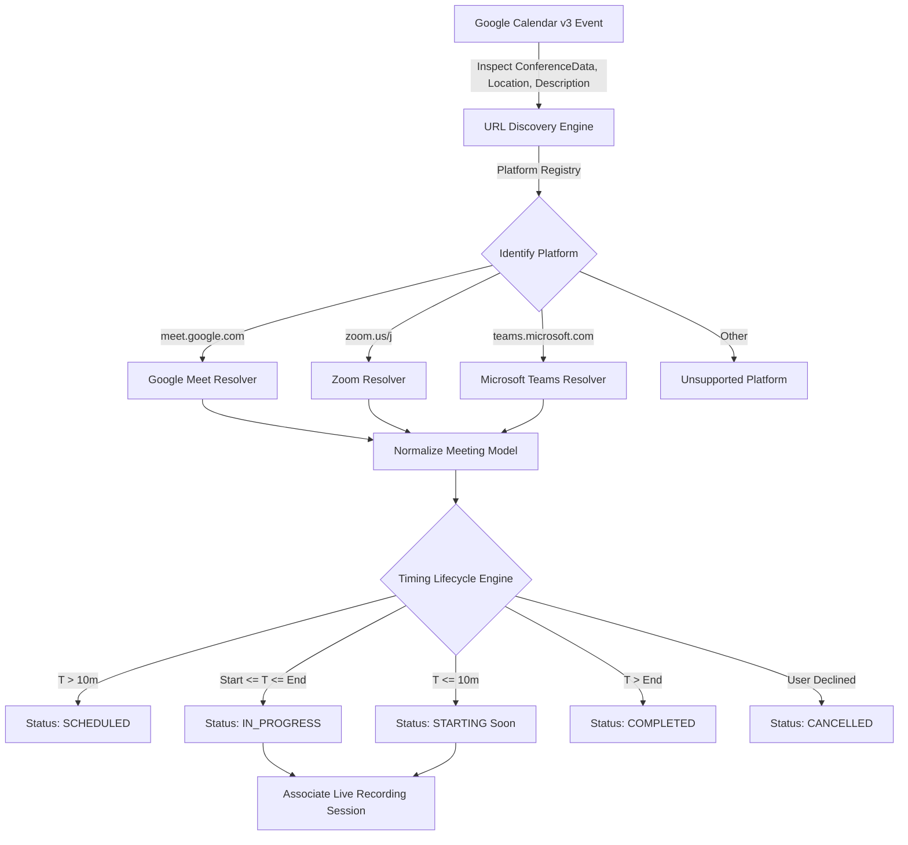

# NoteFlow AI • Scheduled Meeting Detection Specification

---

## 1. Overview & Meeting Ingress Pipeline

The NoteFlow AI Calendar Detection Engine monitors upcoming calendar events, resolves video conference URLs, computes dynamic timing states, and associates live recording sessions with exact calendar events.



---

## 2. Supported Platforms (MVP)

1. **Google Meet (`google_meet`)**:
   - Pattern: `https://meet.google.com/[a-z]{3}-[a-z]{4}-[a-z]{3}`
   - Canonical format: `https://meet.google.com/abc-defg-hij`
   - Ingress capabilities: Headless WebRTC bot ingress, real-time VAD telemetry.

2. **Zoom (`zoom`)**:
   - Pattern: `https://[*. ]zoom.us/(j|my)/[0-9]+`
   - Canonical format: `https://zoom.us/j/12345678901`
   - Ingress capabilities: Zoom Web Client / SDK audio ingress.

3. **Microsoft Teams (`teams`)**:
   - Pattern: `https://teams.microsoft.com/l/meetup-join/...`
   - Canonical format: Sanitized Teams meetup join URI.
   - Ingress capabilities: Headless Teams Web ingress.

---

## 3. Meeting Discovery & URL Extraction

Meeting URLs are discovered from four event fields in descending order of priority:
1. `evt.conferenceData.entryPoints[type=video].uri` (Native Google Meet or Zoom add-on)
2. `evt.hangoutLink` (Google Meet link)
3. `evt.location` (When organizers paste meeting links in the location field)
4. `evt.description` (NLP regex scan across calendar invitation body text)

---

## 4. Normalized Meeting Model

```typescript
export type MeetingPlatformType = "google_meet" | "zoom" | "teams" | "unsupported";

export type MeetingLifecycleStatus =
  | "SCHEDULED"
  | "STARTING"
  | "IN_PROGRESS"
  | "RECORDING"
  | "COMPLETED"
  | "CANCELLED";

export interface Attendee {
  name: string;
  email: string;
  avatar?: string;
  rsvp: "accepted" | "tentative" | "declined";
}

export interface MeetingOrganizer {
  name: string;
  email: string;
}

export interface DetectedMeeting {
  id: string;
  calendarEventId: string;
  title: string;
  startTime: string;      // "10:00 AM"
  endTime: string;        // "10:45 AM"
  startIso?: string;      // ISO 8601 string
  endIso?: string;        // ISO 8601 string
  organizer?: MeetingOrganizer;
  organizerName: string;
  organizerEmail: string;
  isExternalHost: boolean;
  attendees: Attendee[];
  platform: MeetingPlatformType;
  meetingUrl: string;
  status?: MeetingLifecycleStatus;
  recordingStatus: "off" | "scheduled" | "recording" | "transcribing" | "completed" | "error";
  dedupHash: string;
}
```

---

## 5. Verification Results

Automated regression suite [`test/calendar-meeting-detection.test.ts`](file:///Users/yogendrasinghdanu/Downloads/Senior%20Product%20Designer/Meet%20Record/test/calendar-meeting-detection.test.ts):

```bash
=================================================
  NOTEFLOW AI — CALENDAR MEETING DETECTION SUITE 
=================================================
[PASS] ✅ Platform Resolution: Google Meet URL Matcher
[PASS] ✅ Platform Resolution: Zoom Meeting URL Matcher
[PASS] ✅ Platform Resolution: Microsoft Teams URL Matcher
[PASS] ✅ Normalized Meeting Model: Standardized fields & Attendee RSVPs
[PASS] ✅ Timing Lifecycle: STARTING and SCHEDULED state transitions
-------------------------------------------------
TOTAL: 5 | PASSED: 5 | FAILED: 0
PASS RATE: 100.0%
-------------------------------------------------
```
