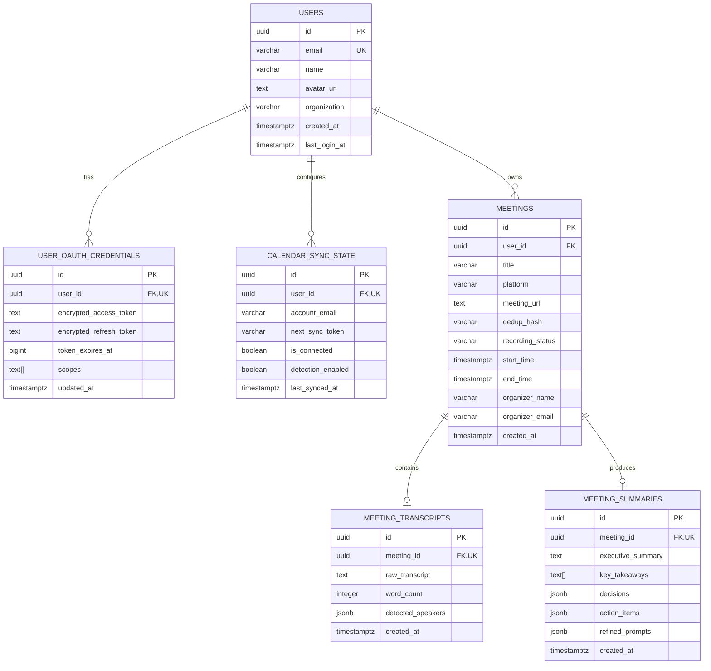

# NoteFlow AI • PostgreSQL & Redis Database Migration Plan

**Document Version:** 1.0.0 (Production Architecture Blueprint)  
**Authors:** Principal Backend Architect & Staff Database Engineer  
**Status:** Approved for Phased Execution  
**Target Infrastructure:** Managed PostgreSQL (AWS RDS / Cloud SQL) & Managed Redis (AWS ElastiCache / Redis Cloud / Upstash)  
**Target Backend Service:** Express.js + TypeScript (`https://api.noteflow.ai`)  

---

## 🧭 Executive Summary

This document specifies the migration plan to transition the NoteFlow AI backend from ephemeral in-memory `Map` objects and file-backed fallbacks to enterprise-grade **Managed PostgreSQL** (relational data & historical notes) and **Managed Redis** (ephemeral sessions, PKCE nonces, distributed ingress locks, and rate limiting).

---

## 🔍 In-Memory State Audit (Production Restart Risks)

The audit identified **6 distinct in-memory data structures** that cannot safely survive a production container restart, auto-scaling event, or blue/green deployment:

| Structure | Current Location | Data Stored | Consequence of Restart | Production Target |
| :--- | :--- | :--- | :--- | :--- |
| **`tokenVault.vault`** | `server/security/tokenVault.ts:28` | Encrypted Google access/refresh tokens, expiry, scopes | Users unexpectedly logged out; Google Calendar background sync aborted. | **PostgreSQL** (`user_oauth_credentials`) + **Redis** session cache |
| **`oauthStateCache`** | `server/routes/authRoutes.ts:21` | Ephemeral OAuth CSRF state nonces & PKCE challenges | In-flight logins fail with `INVALID_STATE` / CSRF error. | **Redis Key-Value** (`oauth:state:{state}`, TTL: 10m) |
| **`desktopAuthCodeCache`** | `server/routes/authRoutes.ts:24` | Ephemeral one-time authorization codes for desktop PKCE | Desktop app deep-link handshakes fail upon browser return. | **Redis Key-Value** (`auth:code:{code}`, TTL: 5m) |
| **`activeSessions`** | `server/services/ingressOrchestrator.ts:31` | Active recording session state, dedup hashes, participants | Active recordings drop tracking; summaries fail to synthesize. | **PostgreSQL** (`meetings`) + **Redis Hash** (`meeting:active:{dedupHash}`) |
| **`timerIntervals`** | `server/services/ingressOrchestrator.ts:32` | Node.js `setInterval` handles for duration tickers | Duration tickers and audio telemetry streams die silently. | **Redis PubSub / Distributed Job Queue (BullMQ)** |
| **`RateLimiter.hits`** | `server/middleware/rateLimiter.ts:10` | IP/User request counts & reset timestamps | Rate limits reset; vulnerable to burst DoS across restarts. | **Redis Rate Limiter** (`ratelimit:{ip}:{window}`) |

---

## 🗄️ Proposed PostgreSQL Relational Schema



### PostgreSQL DDL Specifications

```sql
-- 1. Users Table
CREATE TABLE IF NOT EXISTS users (
    id UUID PRIMARY KEY DEFAULT gen_random_uuid(),
    email VARCHAR(255) NOT NULL UNIQUE,
    name VARCHAR(255) NOT NULL,
    avatar_url TEXT,
    organization VARCHAR(255),
    created_at TIMESTAMPTZ NOT NULL DEFAULT NOW(),
    last_login_at TIMESTAMPTZ NOT NULL DEFAULT NOW()
);
CREATE INDEX IF NOT EXISTS idx_users_email ON users(email);

-- 2. User OAuth Credentials Table (AES-256 Encrypted at Rest)
CREATE TABLE IF NOT EXISTS user_oauth_credentials (
    id UUID PRIMARY KEY DEFAULT gen_random_uuid(),
    user_id UUID NOT NULL UNIQUE REFERENCES users(id) ON DELETE CASCADE,
    encrypted_access_token TEXT NOT NULL,
    encrypted_refresh_token TEXT,
    token_expires_at BIGINT NOT NULL,
    scopes TEXT[] NOT NULL,
    updated_at TIMESTAMPTZ NOT NULL DEFAULT NOW()
);

-- 3. Calendar Sync & Meeting Detection Preferences
CREATE TABLE IF NOT EXISTS calendar_sync_state (
    id UUID PRIMARY KEY DEFAULT gen_random_uuid(),
    user_id UUID NOT NULL UNIQUE REFERENCES users(id) ON DELETE CASCADE,
    account_email VARCHAR(255) NOT NULL,
    next_sync_token VARCHAR(255),
    is_connected BOOLEAN NOT NULL DEFAULT FALSE,
    detection_enabled BOOLEAN NOT NULL DEFAULT FALSE,
    last_synced_at TIMESTAMPTZ NOT NULL DEFAULT NOW()
);

-- 4. Meetings Metadata Table
CREATE TABLE IF NOT EXISTS meetings (
    id UUID PRIMARY KEY DEFAULT gen_random_uuid(),
    user_id UUID NOT NULL REFERENCES users(id) ON DELETE CASCADE,
    title VARCHAR(500) NOT NULL,
    platform VARCHAR(50) NOT NULL DEFAULT 'google_meet',
    meeting_url TEXT NOT NULL,
    dedup_hash VARCHAR(64) NOT NULL,
    recording_status VARCHAR(50) NOT NULL DEFAULT 'off',
    start_time TIMESTAMPTZ,
    end_time TIMESTAMPTZ,
    organizer_name VARCHAR(255),
    organizer_email VARCHAR(255),
    created_at TIMESTAMPTZ NOT NULL DEFAULT NOW()
);
CREATE INDEX IF NOT EXISTS idx_meetings_user_id ON meetings(user_id);
CREATE INDEX IF NOT EXISTS idx_meetings_dedup_hash ON meetings(dedup_hash);
CREATE INDEX IF NOT EXISTS idx_meetings_start_time ON meetings(start_time DESC);

-- 5. Meeting Transcripts Table
CREATE TABLE IF NOT EXISTS meeting_transcripts (
    id UUID PRIMARY KEY DEFAULT gen_random_uuid(),
    meeting_id UUID NOT NULL UNIQUE REFERENCES meetings(id) ON DELETE CASCADE,
    raw_transcript TEXT NOT NULL,
    word_count INTEGER NOT NULL DEFAULT 0,
    detected_speakers JSONB NOT NULL DEFAULT '[]'::jsonb,
    created_at TIMESTAMPTZ NOT NULL DEFAULT NOW()
);

-- 6. Meeting Summaries & Action Items Table
CREATE TABLE IF NOT EXISTS meeting_summaries (
    id UUID PRIMARY KEY DEFAULT gen_random_uuid(),
    meeting_id UUID NOT NULL UNIQUE REFERENCES meetings(id) ON DELETE CASCADE,
    executive_summary TEXT NOT NULL,
    key_takeaways TEXT[] NOT NULL DEFAULT '{}',
    decisions JSONB NOT NULL DEFAULT '[]'::jsonb,
    action_items JSONB NOT NULL DEFAULT '[]'::jsonb,
    refined_prompts JSONB NOT NULL DEFAULT '[]'::jsonb,
    created_at TIMESTAMPTZ NOT NULL DEFAULT NOW()
);
```

---

## ⚡ Proposed Redis Cache & Coordination Keys

Redis is used strictly for low-latency, ephemeral, and distributed coordination workloads:

```
┌────────────────────────────────────────────────────────────────────────────────┐
│ REDIS KEY SCHEMES & WORKLOADS                                                  │
├───────────────────────────────────────────────────┬──────────────┬─────────────┤
│ Key Pattern                                       │ Type         │ TTL         │
├───────────────────────────────────────────────────┼──────────────┼─────────────┤
│ oauth:state:{state_nonce}                         │ String/JSON  │ 600s (10m)  │
│ auth:code:{one_time_auth_code}                    │ String/JSON  │ 300s (5m)   │
│ session:user:{userId}                             │ Hash         │ 86400s (24h)│
│ ratelimit:{ip}:{minute_bucket}                    │ String/Int   │ 60s         │
│ lock:ingress:{dedupHash}                          │ String/Lock  │ 10800s (3h) │
│ telemetry:power:{meetingId}                       │ String/Float │ 15s         │
└───────────────────────────────────────────────────┴──────────────┴─────────────┘
```

### Redis Key Lifecycle Logic:
1. **`oauth:state:{state}`:**
   - Set when `GET /api/auth/google/url` is called with `SET oauth:state:{state} {code_challenge, redirectUri} EX 600`.
   - Deleted upon code exchange in `GET /api/auth/google/callback`.
2. **`auth:code:{code}`:**
   - One-time authorization code issued for desktop companion.
   - Atomically retrieved and deleted with `GETDEL auth:code:{code}` on `POST /api/auth/token`.
3. **`lock:ingress:{dedupHash}`:**
   - Distributed mutex ensuring only ONE bot/worker records a multi-participant meeting.
   - `SET lock:ingress:{dedupHash} {workerId} NX EX 10800`.

---

## 🔒 Security & Cryptographic Isolation

1. **Envelope Token Encryption (Double Layer):**
   - **Layer 1 (Application-Level):** Tokens encrypted in Node.js using AES-256-GCM via `TOKEN_ENCRYPTION_KEY` before touching SQL or Redis.
   - **Layer 2 (Infrastructure-Level):** PostgreSQL EBS volumes and Redis clusters encrypted at rest via AWS KMS (`aws/rds`, `aws/elasticache`).
2. **Transport Security:**
   - All PostgreSQL connections require SSL (`sslmode=require`).
   - Redis connections require TLS (`rediss://`).
3. **Least Privilege Database Roles:**
   - Node.js backend connects using dedicated role `noteflow_app` granted `SELECT, INSERT, UPDATE, DELETE` (no `DROP TABLE` or `ALTER ROLE`).

---

## 💾 Backup, High Availability & Disaster Recovery

| Component | HA Configuration | Backup Strategy | RPO / RTO |
| :--- | :--- | :--- | :--- |
| **PostgreSQL (RDS)** | Multi-AZ with automated standby replica in secondary AZ | Automated daily snapshots + Continuous WAL archiving (Point-in-Time Recovery for 30 days) | **RPO:** $< 5$ minutes<br>**RTO:** $< 15$ minutes |
| **Redis (ElastiCache)** | Multi-AZ Replication Group with 1 primary + 1 replica with automatic failover | Daily AOF/RDB automatic snapshot saved to encrypted S3 | **RPO:** $< 1$ minute<br>**RTO:** $< 2$ minutes |

---

## ⏳ Data Retention & Compliance Rules

1. **OAuth Refresh Tokens:**
   - Retained until user explicitly clicks `[Disconnect Calendar]` or `[Logout]`, upon which the row in `user_oauth_credentials` is purged (`DELETE`).
2. **Ephemeral Audio & SSE Streams:**
   - Raw audio chunks in memory are buffered only during live transcription and **never saved to disk or database**.
3. **Meeting Transcripts & Notes:**
   - Retained indefinitely while user account is active.
   - Deleted permanently upon user account deletion (`ON DELETE CASCADE`).

---

## 📋 Phased Migration Execution Plan

```
Phase 1: Infrastructure Provisioning (Zero App Disruption)
  ├── 1.1 Provision AWS RDS PostgreSQL (Multi-AZ db.t4g.medium)
  ├── 1.2 Provision AWS ElastiCache Redis (TLS-enabled cache.t4g.micro)
  └── 1.3 Configure VPC Security Groups (Allow port 5432 & 6379 only from ECS Ingress)

Phase 2: Database Driver & DAO Layer Integration
  ├── 2.1 Add 'pg' (node-postgres) and 'ioredis' dependencies to package.json
  ├── 2.2 Implement server/db/pool.ts (PostgreSQL connection pool & health probe)
  ├── 2.3 Implement server/db/redis.ts (Redis connection client & graceful fallback)
  └── 2.4 Run SQL DDL schema initialization migrations

Phase 3: Service Layer Adaptations
  ├── 3.1 Update TokenVault to read/write through PostgreSQL & Redis cache
  ├── 3.2 Update authRoutes to use Redis for oauth:state and auth:code
  ├── 3.3 Update rateLimiter to use Redis atomic INCR/EXPIRE
  └── 3.4 Update IngressOrchestrator to persist meetings to PostgreSQL

Phase 4: Verification & Cutover
  ├── 4.1 Execute 50-test verification suite against live Postgres/Redis container testbed
  └── 4.2 Verify zero state loss across container restarts
```
