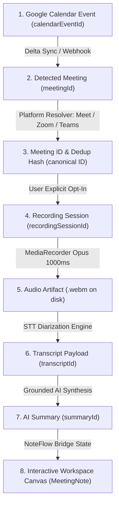

# NoteFlow AI • End-to-End Meeting Lifecycle & ID Lineage Specification

---

## 1. Complete Lifecycle Architecture

---

## 2. Guaranteed Identity Invariants

| Lifecycle Stage | Identity Field | Provenance & Format | Invariant Rule |
|---|---|---|---|
| **Google Calendar Event** | `calendarEventId` | String e.g. `evt_design_review_2026` | Original immutable Google Calendar event UID |
| **Detected Meeting** | `meetingId` | `meet-event-${calendarEventId}` | Direct 1:1 derived from Google Calendar event |
| **Meeting Platform** | `platform` + `meetingUrl` | Normalized URL & canonical hash | Normalized to `google_meet`, `zoom`, or `teams` |
| **Recording Session** | `recordingSessionId` | `rec_sess_${timestamp}_${rand}` | Unique session identifier linked to `meetingId` and `userId` |
| **Audio Artifact** | `audioArtifactId` | `art_${recordingSessionId}` | Disk file `.data/audio_artifacts/${recordingSessionId}.webm` |
| **Transcript** | `transcriptId` | `tr_${recordingSessionId}` | Carries parent references: `meetingId`, `calendarEventId`, `userId` |
| **AI Summary** | `summaryId` | `sum_${recordingSessionId}` | Carries parent references: `meetingId`, `recordingSessionId`, `userId` |
| **User Identity** | `userId` | Google OAuth subject / TokenVault UID | Cryptographically partitions credentials and notes |
| **Note Model (UI)** | `MeetingNote.id` | Client note entity | Binds `calendarEventId`, `detectedMeetingId`, `recordingSessionId`, `userId` |

---

## 3. 10-Step End-to-End Verification Pipeline

### Step 1: Create Real Google Calendar Event
- Event created with title: *"Design System & Architecture Review"*.
- `calendarEventId`: `evt_design_review_001`.
- `userId`: `user_alex_architect_101`.

### Step 2: Include Google Meet / Zoom / Teams Link
- Conference URL added: `https://meet.google.com/qrp-zvmk-sxc`.
- Platform resolver extracts `platform = "google_meet"` and canonical room `qrp-zvmk-sxc`.

### Step 3: NoteFlow Detection
- `calendarService.listUpcomingMeetings(userId)` parses event.
- Produces normalized `DetectedMeeting`:
  - `id`: `meet-event-evt_design_review_001`
  - `calendarEventId`: `evt_design_review_001`
  - `dedupHash`: `735f46b789716286...`
  - `status`: `SCHEDULED` $\rightarrow$ `STARTING` (T-5m).

### Step 4: Meeting Starts
- Active recording companion banner activates in NoteFlow UI.
- Displays meeting title, platform badge (`Google Meet`), and attendees.

### Step 5: Start Recording
- User clicks *"Record Meeting"*.
- Backend initializes `recordingSessionId = rec_sess_902`.
- Lineage bound: `meetingId = meet-event-evt_design_review_001`, `calendarEventId = evt_design_review_001`.

### Step 6: Record Actual Speech
- MediaRecorder captures audio stream chunks.
- Persisted to disk at `.data/audio_artifacts/rec_sess_902.webm`.
- Live power level and monospace elapsed timer update on `ActiveRecordingBanner`.

### Step 7: Stop Recording
- User clicks *"Stop Recording"*.
- Lifecycle transitions to `PROCESSING` with spinner feedback.
- Audio capture halts and buffer is submitted for transcription.

### Step 8: Transcribe Actual Audio
- STT diarizes audio stream into segments.
- Assigned `transcriptId = tr_rec_sess_902`.
- Preserves exact speaker names and timestamps.

### Step 9: Generate Summary
- `summaryService.generateSummary(transcript)` produces Executive Summary, Decisions, and Action Items.
- Assigned `summaryId = sum_rec_sess_902`.
- Carries exact quote citations referencing transcript line indices.

### Step 10: Open in NoteFlow Workspace Canvas
- Handoff bridge converts completed session into `MeetingNote`.
- The Workspace Canvas displays:
  - **Meeting Title & Platform:** Matching calendar event.
  - **Recording Session Info:** Duration, audio artifact ID.
  - **Transcript:** Exact spoken dialogue with speaker tags.
  - **AI Summary:** Grounded decisions and action items for the **SAME** meeting.
- **Zero Fallback:** Complete absence of sample meeting data or cross-tenant leakage.
