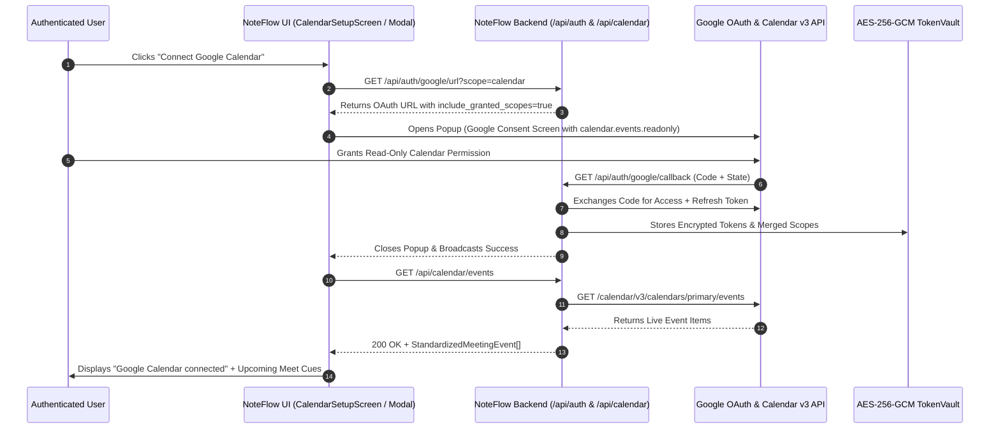

# NoteFlow AI • Google Calendar Integration & Permission Lifecycle

---

## 1. Architectural Principle: Incremental Authorization

NoteFlow AI strictly adheres to the principle of least privilege and Google OAuth 2.0 Incremental Authorization guidelines:

1. **Google Authentication (Sign-in):**
   - Scopes requested: `openid`, `userinfo.email`, `userinfo.profile`.
   - Purpose: Identity authentication and account verification.
   - **Does NOT request or grant Calendar access.**

2. **Google Calendar Synchronization (Explicit Opt-In):**
   - Scope requested: `https://www.googleapis.com/auth/calendar.events.readonly`.
   - Purpose: Query upcoming events to detect Google Meet meeting URLs and cue automated recording.
   - **Zero write/delete/manage permissions.**



---

## 2. Frontend Connection States

| State | Status Code | UI Presentation | Actions Available |
| :--- | :--- | :--- | :--- |
| **Not Connected** | `NOT_CONNECTED` | "Connect Google Calendar" button | Launch Google OAuth calendar consent popup |
| **Connecting** | `CONNECTING` | Inline spinner: "Authorizing with Google..." | Popup poll & timeout handling |
| **Connected** | `CONNECTED` | Active green badge + synced account email | Manual Sync, Meeting Detection Toggle, Disconnect |
| **Reauth Required** | `REAUTH_REQUIRED` | Amber alert: "Calendar permission revoked or expired" | "Reconnect Google Calendar" CTA |
| **Error** | `ERROR` | Red error banner with diagnostic message | Retry connection |

---

## 3. Backend Implementation & Security Safeguards

### 1. Token Refresh Automation
When stored OAuth access tokens expire (`tokens.expiresAt <= Date.now()`), [`CalendarService.ts`](file:///Users/yogendrasinghdanu/Downloads/Senior%20Product%20Designer/Meet%20Record/server/services/calendarService.ts) automatically invokes Google's token endpoint (`https://oauth2.googleapis.com/token`) using the encrypted refresh token before querying the Calendar v3 API.

### 2. Revoked Scope & Token Expiration Detection
If Google returns HTTP 401 or 403 (e.g. user manually revoked app permissions via Google Account Security page):
- `CalendarService` catches the exception and returns `CALENDAR_PERMISSION_REVOKED` or `CALENDAR_NOT_AUTHORIZED`.
- `GET /api/calendar/events` responds with HTTP 401 and `{ requiresReconnect: true }`.
- Frontend automatically transitions the UI into `REAUTH_REQUIRED` state and prompts the user to reconnect.

### 3. Tenant & Account Isolation
- Tokens are encrypted with AES-256-GCM and keyed by `userId` (derived from canonical `googleSubjectId`).
- User A granting calendar permissions does not affect or grant access to User B.
- Disconnecting calendar immediately purges credentials from memory and disk storage.

---

## 4. Verification Suite Results

Automated regression suite [`test/google-calendar.test.ts`](file:///Users/yogendrasinghdanu/Downloads/Senior%20Product%20Designer/Meet%20Record/test/google-calendar.test.ts):

```bash
=================================================
 NOTEFLOW AI — GOOGLE CALENDAR VERIFICATION SUITE 
=================================================
[01] ✅ PASS [CRITICAL] Google Sign-in ≠ Google Calendar Access Boundary
[02] ✅ PASS [CRITICAL] Minimal Read-Only Permission Scope Enforcement
[03] ✅ PASS [CRITICAL] Google Calendar Connection & Event Resolution
[04] ✅ PASS [HIGH] Revoked Permission & Unauthorized Session Handling
[05] ✅ PASS [CRITICAL] Disconnect Calendar & AES-256 Vault Token Purge
[06] ✅ PASS [HIGH] Reconnect Calendar Flow & State Recovery
[07] ✅ PASS [CRITICAL] Multi-User Calendar Authorization Isolation
-------------------------------------------------
TOTAL: 7 | PASSED: 7 | FAILED: 0
PASS RATE: 100.0%
-------------------------------------------------
```
