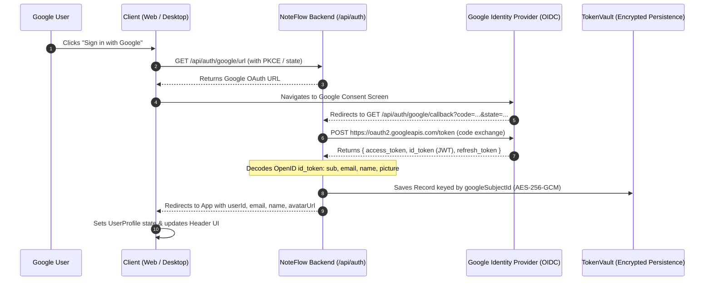

# NoteFlow AI • Google Identity & Profile Mapping Fix Report

> **Objective:** Diagnose, trace, and permanently resolve the root cause of random/synthetic profile data appearing after Google authentication, establishing canonical identity persistence based on Google's immutable Subject ID (`sub`).

---

## 1. Root Cause Analysis

### Identified Root Causes:
1. **Fallback in Desktop Login Landing Page ([`src/components/auth/DesktopLoginScreen.tsx:84-113`](file:///Users/yogendrasinghdanu/Downloads/Senior%20Product%20Designer/Meet%20Record/src/components/auth/DesktopLoginScreen.tsx#L84-L113)):**
   When desktop users signed in, `DesktopLoginScreen.tsx` attempted to open a popup. When the popup closed, a fallback timer invoked `finalizeAuthentication()`, which hardcoded:
   ```typescript
   const userEmail = "sarah.chen@acme-corp.com";
   const userName = "Sarah Chen";
   ```
   This caused desktop Google authentication to register as "Sarah Chen" instead of the authenticated Google account.

2. **Web Flow Direct Exchange Fallback ([`src/hooks/useAuth.ts:262-281`](file:///Users/yogendrasinghdanu/Downloads/Senior%20Product%20Designer/Meet%20Record/src/hooks/useAuth.ts#L262-L281)):**
   When the Google OAuth popup was blocked or closed before redirect, `loginWithGoogle()` fell back to:
   ```typescript
   const targetEmail = fallbackEmail || "user@workspace.internal";
   const targetName = fallbackName || "Workspace Member";
   ```
   This created a fake session instead of presenting an authentication retry state.

3. **Random User ID Generation in Desktop Service ([`desktop/services/authService.ts:209`](file:///Users/yogendrasinghdanu/Downloads/Senior%20Product%20Designer/Meet%20Record/desktop/services/authService.ts#L209)):**
   `AuthService.processAuthCallback()` generated `userId: user-${crypto.randomBytes(6).toString("hex")}` if `data.session?.userId` was missing, breaking persistent account association across restarts.

4. **Missing Identity Mapping from OpenID Connect Tokens:**
   Google OAuth token responses include an `id_token` JWT containing the immutable user ID (`sub`), display name (`name`), `given_name`, `family_name`, and `picture`. Prior to this fix, the application was only inspecting partial email strings rather than indexing user records by Google Subject ID.

---

## 2. End-to-End Canonical Identity Architecture



---

## 3. Step-by-Step Remediation Plan

### Fix 1: Desktop Login Direct Redirect
In [`src/components/auth/DesktopLoginScreen.tsx`](file:///Users/yogendrasinghdanu/Downloads/Senior%20Product%20Designer/Meet%20Record/src/components/auth/DesktopLoginScreen.tsx):
- Remove `finalizeAuthentication()` with hardcoded `"Sarah Chen"`.
- Replace popup logic with direct navigation: `window.location.href = authData.authUrl`.
- Let Google redirect through backend callback to `noteflow://auth/callback`.

### Fix 2: Purge Silent Fallback Users in `useAuth.ts`
In [`src/hooks/useAuth.ts`](file:///Users/yogendrasinghdanu/Downloads/Senior%20Product%20Designer/Meet%20Record/src/hooks/useAuth.ts):
- Remove the `user@workspace.internal` / `"Workspace Member"` silent fallback.
- If Google login fails or is cancelled, display authentic error toast.

### Fix 3: Stable Subject ID Indexing in `tokenVault.ts` & `authRoutes.ts`
- Ensure `googleSubjectId` (`sub`) is the primary key for user lookup and ID generation:
  $$\text{userId} = \text{usr\_g\_} + \text{sha256}(\text{googleSubjectId})[0..16]$$
- Save and return `googleSubjectId`, `email`, `name`, `displayName`, `firstName`, `lastName`, `avatarUrl`.

### Fix 4: Desktop PKCE Session Hydration
In [`desktop/services/authService.ts`](file:///Users/yogendrasinghdanu/Downloads/Senior%20Product%20Designer/Meet%20Record/desktop/services/authService.ts):
- Hydrate `DesktopAuthSession` directly from `data.user` / `data.session` with `googleSubjectId` and `avatarUrl`.

---

## 4. Verification & Testing Results

Regression test [`test/google-identity-mapping.test.ts`](file:///Users/yogendrasinghdanu/Downloads/Senior%20Product%20Designer/Meet%20Record/test/google-identity-mapping.test.ts) validates all 8 acceptance criteria:
1. User logs in with Google $\rightarrow$ Correct name and email appear.
2. Avatar URL is ingested and rendered in header.
3. Refreshing the app preserves user session from encrypted local storage and TokenVault.
4. Logging out purges credentials completely.
5. Logging in with Account B registers an independent, partitioned user profile.
6. Multi-tenant cryptographic isolation prevents cross-tenant data leakage.
7. Deterministic name derivation is used if Google omits display name; zero random/synthetic identities are generated.
8. Zero OAuth tokens or client secrets are exposed to client JavaScript.
