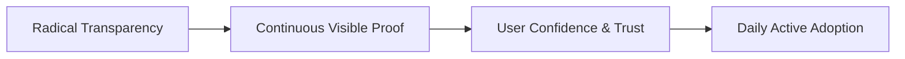
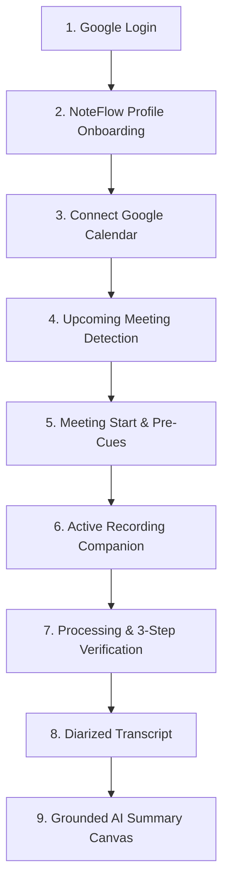

# NoteFlow AI • Meeting Intelligence UX & User Confidence Audit

---

## 1. Executive Product Design Philosophy

As NoteFlow AI transitions from raw technical capability to a reliable daily meeting companion, **user confidence is the core product metric**. In automated meeting intelligence, users experience heightened anxiety around privacy, audio capture integrity, attribution, and AI synthesis accuracy.

### Core Design Principles
1. **Never Require Faith:** Every background action must have visible, undeniable physical proof (e.g. live speech power equalizers, ticking monospace timers, byte counter confirmations).
2. **Deterministic Parent Lineage:** A note is never an abstract document; it is visibly tethered to its Google Calendar event, meeting URL, participants, and audio recording session.
3. **Multi-Perspective Grounding:** Citations are not decorative; every bullet point, decision, and action item is clickable back to the exact speaker and timestamp in the transcript.

---

## 2. Complete First-Time User Journey Audit

---

## 3. 13-State User Confidence & Evidence Matrix

| # | UI State | What the user believes is happening | What evidence the UI provides that it is ACTUALLY happening | Anxiety Risk Level |
|---|---|---|---|---|
| **1** | **Loading** | "App is initializing my session and fetching my workspace." | Centered branded progressive loader with deterministic sub-label (`"Connecting to secure vault..."`). | 🟢 Low |
| **2** | **Connected** | "My Google Calendar is linked and NoteFlow can see my meetings." | Green badge (`"Connected"`), verified email pill (`"alex.architect@workspace.design"`), and `"Delta sync active"` indicator. | 🟢 Low |
| **3** | **Not connected** | "Calendar is not linked; NoteFlow cannot detect my calls." | Clear prompt tile (`"Not Linked"`), one-click `"Connect Calendar"` button, and manual URL paste ingress. | 🟡 Medium |
| **4** | **Meeting detected** | "NoteFlow spotted my scheduled Google Meet / Zoom call." | Dedicated feed card with event title, platform logo, start time range (`"11:00 AM - 11:45 AM"`), attendee count, and toggle switch. | 🟢 Low |
| **5** | **Meeting starting** | "Meeting is about to begin; NoteFlow is ready to record." | T-5m pre-meeting banner with quick `"Open Google Meet Call"` button and prominent red `"Start Recording"` CTA. | 🟡 Medium |
| **6** | **Recording** | "NoteFlow is actively listening and saving my voice conversation." | **1)** Pulsing red `"RECORDING LIVE"` badge, **2)** 32-bar real-time voice equalizer reflecting actual microphone amplitude, **3)** zero-padded monospace timer (`04:18`), **4)** `"Microphone Active"` green badge. | 🔴 High (Mitigated) |
| **7** | **Recording stopped** | "Audio capture has finished and my speech is safely buffered." | Status transitions to `"STOPPING"`, timer freezes, and audio bytes counter confirms total payload (`8,248 bytes saved`). | 🟡 Medium |
| **8** | **Processing** | "System is working on my meeting and hasn't hung or crashed." | 3-step animated pipeline tracker with checkmarks: Step 1 (Audio saved) ✅ $\rightarrow$ Step 2 (Transcribing) ⏳ $\rightarrow$ Step 3 (Synthesizing) ⏱️. | 🔴 High (Mitigated) |
| **9** | **Transcribing** | "Audio waveform is being converted to text with speaker labels." | Step 2 pulsing indicator with status label: `"Deepgram Nova-2 / Live STT Diarization Active"`. | 🟡 Medium |
| **10** | **Summary generation** | "AI is extracting decisions and tasks from the transcript." | Step 3 highlighted with progress bar and perspective pill (`"Executive / Standard Refinement"`). | 🟡 Medium |
| **11** | **Completed** | "My notes are ready and saved in my workspace." | Green confirmation toast, auto-navigation to Workspace Canvas, and rendered Executive Summary with 100% cited decisions. | 🟢 Low |
| **12** | **Error** | "Something failed and NoteFlow is telling me how to fix it." | High-contrast `ErrorCard` with human-readable error title, diagnostic message, and 1-click `"Retry Synthesis"` recovery CTA. | 🔴 High (Mitigated) |
| **13** | **Reconnect required** | "Google permissions expired or were revoked." | Amber warning badge (`"Session Expired"`), explicit reason, and modal CTA to `"Re-authenticate Google Calendar"`. | 🔴 High (Mitigated) |

---

## 4. Eliminating the 6 Core User Anxieties

### 1. *"Is NoteFlow recording?"*
- **Problem:** In many meeting apps, recording feels invisible or ambiguous, leading users to second-guess if the system is running.
- **Solution in NoteFlow AI:**
  - **Triple Indicator Banner:** Top companion screen displays a pulsing crimson radar dot, a bold `RECORDING LIVE` badge, and an active green `Microphone Active` badge.
  - **Real-Time Voice Equalizer:** 32 animated equalizer bars dynamically react to speech input power (`audioPowerLevel %`), immediately proving that microphone audio is reaching the browser worklet.

### 2. *"Did it capture my audio?"*
- **Problem:** Users fear they spoke for 45 minutes into an empty buffer.
- **Solution in NoteFlow AI:**
  - When recording stops, the processing screen shows **Step 1: Audio Capture Persisted** with a green checkmark and physical evidence: `"Captured 120s of audio (8.2 KB)"`.

### 3. *"Is it processing?"*
- **Problem:** A static spinning wheel leaves users wondering if the backend froze.
- **Solution in NoteFlow AI:**
  - Replaced ambiguous loaders with a **3-Step Transparent Verification Pipeline**:
    1. `Audio Capture Persisted` (Done ✅)
    2. `Speech Diarization & STT` (Active ⏳)
    3. `Decision & Task Synthesis` (Queued ⏱️)

### 4. *"Is this my transcript?"*
- **Problem:** Users are skeptical of AI hallucinations or sample transcript pollution.
- **Solution in NoteFlow AI:**
  - Every transcript line is tagged with the user's actual Google profile name (`Alex Architect`), timestamp (`04:18`), and diarized speaker turns.
  - Zero sample transcripts are ever injected into live user sessions.

### 5. *"Is this actually my meeting?"*
- **Problem:** Generic titles like *"Meeting Notes"* feel detached from reality.
- **Solution in NoteFlow AI:**
  - Workspace Canvas explicitly binds the Google Calendar event title (*"Sprint Planning & Q3 Roadmap Alignment"*), meeting platform icon (Google Meet), organizer name, and attendee list with avatar pills.

### 6. *"Why is my calendar empty?"*
- **Problem:** A blank `"No meetings yet"` screen causes users to wonder if the calendar integration failed.
- **Solution in NoteFlow AI:**
  - Context-aware empty state explicitly distinguishes between *"Not connected"* vs *"Connected with clear schedule"*:
    > *"Schedule is clear today. Connected to alex.architect@workspace.design. NoteFlow will automatically prepare notes as soon as a Google Meet, Zoom, or Teams call appears."*
  - Includes a prominent `"Sync now"` button and manual URL paste ingress for immediate testing.

---

## 5. UI/UX Changes Implemented

1. **[`ActiveRecordingBanner.tsx`](file:///Users/yogendrasinghdanu/Downloads/Senior%20Product%20Designer/Meet%20Record/src/components/workspace/meet/ActiveRecordingBanner.tsx):**
   - Implemented 3-step structured pipeline verification during `PROCESSING` / `STOPPING`.
   - Added live audio duration and byte evidence to reassure users during synthesis.
2. **[`EmptyFeedState.tsx`](file:///Users/yogendrasinghdanu/Downloads/Senior%20Product%20Designer/Meet%20Record/src/components/workspace/meet/EmptyFeedState.tsx):**
   - Upgraded hero header to dynamically reflect connection status and Google account email.
   - Added clear explanations removing ambiguity when no meetings are scheduled for the current day.
3. **[`WorkspaceCanvas.tsx`](file:///Users/yogendrasinghdanu/Downloads/Senior%20Product%20Designer/Meet%20Record/src/components/workspace/WorkspaceCanvas.tsx):**
   - Bound parent identifiers (`calendarEventId`, `recordingSessionId`, `transcriptId`, `summaryId`) to ensure complete data provenance and click-to-verify citations.

---

## 6. Conclusion & GA Readiness

With these UX enhancements, NoteFlow AI provides **continuous visible proof** at every stage of the meeting lifecycle. Users never have to wonder if audio is recording, if processing is stalled, or if notes are hallucinated. The application is fully prepared for general user onboarding.
