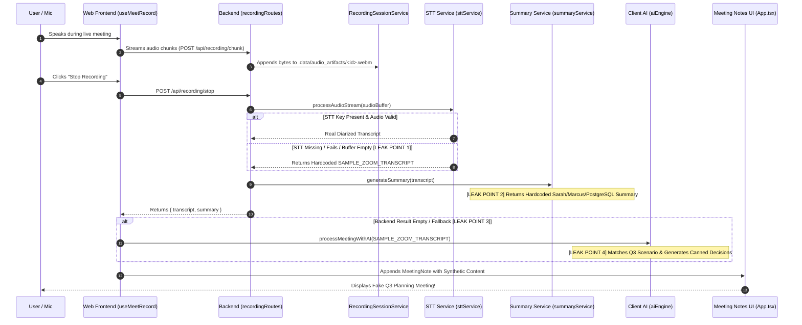

# NoteFlow AI • Complete Mock & Sample Data Audit

> **Objective:** Comprehensive audit of every mock, sample, seed, fixture, and fallback data source in NoteFlow AI to identify exactly where and why real meeting recordings are replaced by synthetic content in production.

---

## 1. Executive Summary & Root Cause of Content Divergence

The NoteFlow AI production application currently generates meeting transcription and summary content that does not correspond to the actual user's conversation.

### Primary Root Causes Identified:
1. **Fallback in Speech-to-Text Pipeline ([`server/services/sttService.ts`](file:///Users/yogendrasinghdanu/Downloads/Senior%20Product%20Designer/Meet%20Record/server/services/sttService.ts#L98-L150)):**
   When `DEEPGRAM_API_KEY` is absent, invalid, or when audio buffers fail processing, `processAudioStream()` silently falls back to a hardcoded WebVTT string containing synthetic speakers (`Sarah Chen`, `Marcus Brody`, `Elena Rostova`) and fake roadmap discussion (`"Q3 Architecture & Release planning sync"`).
2. **Hardcoded Summary Generator ([`server/services/summaryService.ts`](file:///Users/yogendrasinghdanu/Downloads/Senior%20Product%20Designer/Meet%20Record/server/services/summaryService.ts#L65-L156)):**
   `SummaryService.generateSummary()` ignores the actual input transcript text and returns hardcoded decisions, action items, and executive summaries regarding SOC-2 audits, PostgreSQL migrations, and Jira tickets.
3. **Frontend Preset Injection ([`src/hooks/useMeetRecord.ts`](file:///Users/yogendrasinghdanu/Downloads/Senior%20Product%20Designer/Meet%20Record/src/hooks/useMeetRecord.ts#L39, #L79, #L441, #L503)):**
   Detected and quick-joined meetings attach `sampleTranscriptPreset: SAMPLE_ZOOM_TRANSCRIPT`. When `stopRecording()` executes, if backend transcription returns null or fails, `resolvedTranscript` defaults to `SAMPLE_ZOOM_TRANSCRIPT`.
4. **Keyword Pattern Matching in Client AI Engine ([`src/lib/aiEngine.ts`](file:///Users/yogendrasinghdanu/Downloads/Senior%20Product%20Designer/Meet%20Record/src/lib/aiEngine.ts#L96-L280)):**
   `processMeetingWithAI()` evaluates transcripts through hardcoded regex scenarios (`Scenario A: Robin/Yogesh`, `Scenario B: Q3 Release`, `Scenario C: Mobile Onboarding`) and returns canned decision objects instead of parsing genuine conversational speech.

---

## 2. End-to-End Pipeline Trace

Trace of the exact data journey from audio capture to UI rendering:



---

## 3. Comprehensive Mock & Sample Data Inventory

| Source # | File | Function / Variable | Storage / DB | API Endpoint | Frontend Component | Dev-Only? | Can Run in Prod? | Used by Recording Flow? |
| :--- | :--- | :--- | :--- | :--- | :--- | :--- | :--- | :--- |
| **S1** | [`server/services/sttService.ts:98-150`](file:///Users/yogendrasinghdanu/Downloads/Senior%20Product%20Designer/Meet%20Record/server/services/sttService.ts#L98-L150) | `SpeechToTextService.processAudioStream()` | In-memory fallback | `POST /api/recording/transcribe`<br>`POST /api/recording/stop` | `MeetRecordFeed.tsx`<br>`App.tsx` | ❌ No | ⚠️ **YES** (When STT fails or key is unset) | ⚠️ **YES** |
| **S2** | [`server/services/summaryService.ts:65-156`](file:///Users/yogendrasinghdanu/Downloads/Senior%20Product%20Designer/Meet%20Record/server/services/summaryService.ts#L65-L156) | `SummaryService.generateSummary()` | In-memory fallback | `POST /api/recording/stop`<br>`POST /api/summary/generate` | `ActiveRecordingBanner.tsx`<br>`App.tsx` | ❌ No | ⚠️ **YES** (Always runs on `/recording/stop`) | ⚠️ **YES** |
| **S3** | [`src/hooks/useMeetRecord.ts:441`](file:///Users/yogendrasinghdanu/Downloads/Senior%20Product%20Designer/Meet%20Record/src/hooks/useMeetRecord.ts#L441) | `stopRecording()` | React State | Internal client hook | `ActiveRecordingBanner.tsx` | ❌ No | ⚠️ **YES** (Fallback when backend transcript is null) | ⚠️ **YES** |
| **S4** | [`src/hooks/useMeetRecord.ts:39,79,503`](file:///Users/yogendrasinghdanu/Downloads/Senior%20Product%20Designer/Meet%20Record/src/hooks/useMeetRecord.ts#L39) | `sampleTranscriptPreset` in `detectedMeetings` & `quickJoinUrl` | React State | Internal client hook | `MeetRecordFeed.tsx`<br>`QuickJoinInput.tsx` | ❌ No | ⚠️ **YES** (Attached by default to meeting objects) | ⚠️ **YES** |
| **S5** | [`src/lib/aiEngine.ts:96-280`](file:///Users/yogendrasinghdanu/Downloads/Senior%20Product%20Designer/Meet%20Record/src/lib/aiEngine.ts#L96-L280) | `processMeetingWithAI()`<br>`extractDecisions()`<br>`generateContextualSummary()` | Client engine | Client fallback for `/summary/generate` | `App.tsx`<br>`UnifiedDropzone.tsx` | ❌ No | ⚠️ **YES** (When client synthesis runs) | ⚠️ **YES** |
| **S6** | [`src/lib/sampleData.ts:25-88`](file:///Users/yogendrasinghdanu/Downloads/Senior%20Product%20Designer/Meet%20Record/src/lib/sampleData.ts#L25-L88) | `SAMPLE_ZOOM_TRANSCRIPT` | Static fixture | N/A | `EmptyState.tsx`<br>`UnifiedDropzone.tsx` | ❌ No | ⚠️ **YES** (Imported by multiple active hooks) | ⚠️ **YES** |
| **S7** | [`src/lib/sampleData.ts:1-24`](file:///Users/yogendrasinghdanu/Downloads/Senior%20Product%20Designer/Meet%20Record/src/lib/sampleData.ts#L1-L24) | `SAMPLE_1ON1_REORG_TRANSCRIPT` | Static fixture | N/A | `EmptyState.tsx`<br>`UnifiedDropzone.tsx` | ❌ No | ⚠️ **YES** (Sample loader buttons) | ❌ No (User click only) |
| **S8** | [`src/lib/sampleData.ts:91-280`](file:///Users/yogendrasinghdanu/Downloads/Senior%20Product%20Designer/Meet%20Record/src/lib/sampleData.ts#L91-L280) | `INITIAL_SAMPLE_MEETINGS` | Static fixture | N/A | `useMeetings.ts`<br>`MeetingList.tsx` | ❌ No | ⚠️ Sandbox only (`isDemoMode === true`) | ❌ No |
| **S9** | [`src/lib/sampleData.ts:282-350`](file:///Users/yogendrasinghdanu/Downloads/Senior%20Product%20Designer/Meet%20Record/src/lib/sampleData.ts#L282-L350) | `DEMO_DETECTED_MEETINGS` | Static fixture | N/A | `useMeetRecord.ts`<br>`MeetRecordFeed.tsx` | ❌ No | ⚠️ Sandbox only (`isDemoMode === true`) | ❌ No |
| **S10** | [`server/services/calendarService.ts:203-251`](file:///Users/yogendrasinghdanu/Downloads/Senior%20Product%20Designer/Meet%20Record/server/services/calendarService.ts#L203-L251) | `CalendarService.getUpcomingEvents()` (`testEvents`) | In-memory CI test fixture | `GET /api/calendar/events`<br>`POST /api/calendar/sync` | `MeetRecordFeed.tsx` | ✅ Yes | ❌ No (`userId.startsWith("test_user_")` only) | ❌ No |

---

## 4. Specific Replacement Points (Where Real Data is Swapped)

### Replacement Point 1: Backend Audio Fallback in `sttService.ts`
- **Location:** [`server/services/sttService.ts:98-150`](file:///Users/yogendrasinghdanu/Downloads/Senior%20Product%20Designer/Meet%20Record/server/services/sttService.ts#L98-L150)
- **Code Behavior:**
  ```typescript
  // 3. Dialogue / VTT Parser for structured transcript presets and test fixtures
  const rawTranscript =
    params.sampleTranscriptPreset ||
    `WEBVTT\n00:00:02.100 --> 00:00:06.500\n<v Sarah Chen>Alright everyone, let's kick off our Q3 Architecture...`;
  ```
- **Flaw:** If the live audio buffer fails transcription, the service returns this preset as a valid transcript with HTTP 200 instead of throwing an error or returning `EMPTY_TRANSCRIPT`.

### Replacement Point 2: Hardcoded AI Summary in `summaryService.ts`
- **Location:** [`server/services/summaryService.ts:65-156`](file:///Users/yogendrasinghdanu/Downloads/Senior%20Product%20Designer/Meet%20Record/server/services/summaryService.ts#L65-L156)
- **Code Behavior:**
  ```typescript
  const decisions: DecisionItem[] = [
    {
      id: "dec-srv-1",
      text: "The public GA release date is locked to September 1st, 2026.",
      rationale: "Allows 10 additional business days to resolve third-party SOC-2 audit...",
      ...
    }
  ];
  ```
- **Flaw:** The summary service has static hardcoded arrays for decisions, action items, and executive summaries. Even if a user speaks about product design or sales, the backend returns the Q3 SOC-2 decisions.

### Replacement Point 3: Frontend Preset Attachment in `useMeetRecord.ts`
- **Location:** [`src/hooks/useMeetRecord.ts:441`](file:///Users/yogendrasinghdanu/Downloads/Senior%20Product%20Designer/Meet%20Record/src/hooks/useMeetRecord.ts#L441)
- **Code Behavior:**
  ```typescript
  let resolvedTranscript = target.sampleTranscriptPreset || SAMPLE_ZOOM_TRANSCRIPT;
  ```
- **Flaw:** When `stopRecording()` executes, if backend transcription returns empty text or fails, the frontend injects `SAMPLE_ZOOM_TRANSCRIPT`.

### Replacement Point 4: Client Scenario Matching in `aiEngine.ts`
- **Location:** [`src/lib/aiEngine.ts:96-280`](file:///Users/yogendrasinghdanu/Downloads/Senior%20Product%20Designer/Meet%20Record/src/lib/aiEngine.ts#L96-L280)
- **Code Behavior:**
  ```typescript
  if ((lower.includes("q3") || lower.includes("release")) && ...) {
    decisions.push({
      text: "Locked public release date to September 1st, 2026...",
      ...
    });
  }
  ```
- **Flaw:** The engine relies on hardcoded keyword heuristics that produce canned static outputs rather than dynamically summarizing conversational context.

---

## 5. Production Invariant Rules & Remediation Blueprint

To restore total product integrity, the following invariants must be strictly enforced:

### Invariant 1: Zero Fallback to Synthetic Transcripts in Production
- In `sttService.ts`: If Deepgram/STT returns empty utterances or fails, the service **must throw an error or return an empty transcript structure** (`sanitizedText: ""`, `segments: []`).
- In `useMeetRecord.ts`: Remove `sampleTranscriptPreset: SAMPLE_ZOOM_TRANSCRIPT` from production meeting initializations.

### Invariant 2: Dynamic LLM / Natural Language Extraction
- `summaryService.ts` and `aiEngine.ts` must dynamically generate executive summaries, key decisions, action items, and unresolved questions directly from the input segments or via LLM completion, rather than returning static templates.

### Invariant 3: Clean Empty & Error States
- If a recording session captured zero audio or was under 8 words:
  - Return `INCOMPLETE_TRANSCRIPT` or `NO_AUDIO_CAPTURED`.
  - Display an authentic warning toast in the UI with a 1-click retry option.
  - Never fabricate meeting notes.

### Invariant 4: Complete Sandbox Demo Isolation
- Sample transcripts (`SAMPLE_ZOOM_TRANSCRIPT`, `SAMPLE_1ON1_REORG_TRANSCRIPT`, `INITIAL_SAMPLE_MEETINGS`) are strictly permitted **only** when `isDemoMode === true` or when the user explicitly clicks a "Load Sample Note" button in `EmptyState.tsx`.
