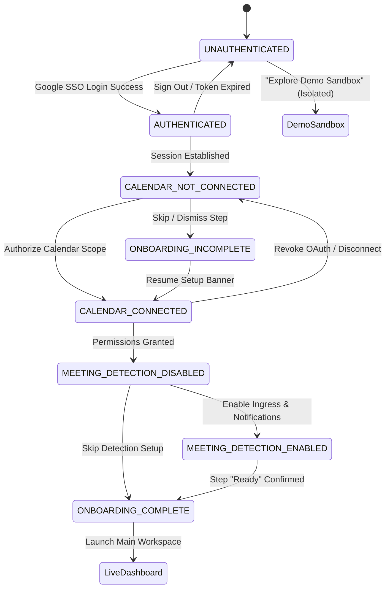

# NoteFlow AI • First-Time User Experience (FTUX) & Onboarding Flow Specification

> **Document Type:** Product Architecture & User Journey Specification  
> **Frameworks Applied:** `@brainstorming`, `@product-manager-toolkit`  
> **Status:** Approved Specification  
> **Date:** August 2026  
> **Target Platforms:** Web Application & Desktop Companion (macOS & Windows)  

---

## 1. Executive Summary & Journey Vision

The primary goal of NoteFlow AI's onboarding is to deliver **instant time-to-value within 60 seconds** of first launch, guiding the user from an unauthenticated zero-state to an active meeting intelligence hub with explicit trust, zero friction, and clear privacy boundaries.

### The Canonical First-Time Journey
```
┌────────────────────┐
│ Fresh Installation │
└─────────┬──────────┘
          ▼
┌────────────────────┐
│      Welcome       │ ── Value proposition & privacy guarantees
└─────────┬──────────┘
          ▼
┌────────────────────┐
│Continue with Google│ ── One-tap OAuth entry
└─────────┬──────────┘
          ▼
┌────────────────────┐
│Google Authenticate │ ── Identity verification (PKCE / OIDC)
└─────────┬──────────┘
          ▼
┌────────────────────┐
│Calendar Connection │ ── Read-only calendar scope consent
└─────────┬──────────┘
          ▼
┌────────────────────┐
│Calendar Permission │ ── Token exchange & AES-256 vaulting
└─────────┬──────────┘
          ▼
┌────────────────────┐
│Meeting Detection   │ ── Audio / OS notification opt-in & bot preferences
└─────────┬──────────┘
          ▼
┌────────────────────┐
│   Ready Screen     │ ── T-0 confirmation of next upcoming meeting
└─────────┬──────────┘
          ▼
┌────────────────────┐
│  Live Dashboard    │ ── Production workspace (0 mock notes)
└─────────┬──────────┘
          ▼
┌────────────────────┐
│   Real Meetings    │ ── Ingress, recording cues, grounded AI summaries
└────────────────────┘
```

---

## 2. Formal User State Machine

NoteFlow AI models user lifecycle through eight discrete states across three orthogonal dimensions: **Identity**, **Integration**, and **Automation**.

### State Definitions

| State Name | Category | Definition | Allowed User Capabilities |
| :--- | :--- | :--- | :--- |
| `UNAUTHENTICATED` | Identity | No active session or cached credentials exist on the device. | View Welcome Screen, explore Demo Sandbox, initiate SSO login. |
| `AUTHENTICATED` | Identity | User identity is verified via Google OIDC or Enterprise SSO. | Access base workspace shell, view account settings, initiate calendar link. |
| `CALENDAR_NOT_CONNECTED` | Integration | User is authenticated but Google Calendar OAuth scope is unlinked or revoked. | Create manual notes, paste raw transcripts, drag-and-drop `.vtt`/`.txt` files. |
| `CALENDAR_CONNECTED` | Integration | Read-only Google Calendar scope is active with encrypted refresh tokens in vault. | Fetch live calendar events, match Google Meet URLs, view daily schedule. |
| `MEETING_DETECTION_DISABLED` | Automation | Calendar is connected, but automated meeting ingress polling and OS alerts are muted. | View calendar schedule in feed; manual recording trigger only. |
| `MEETING_DETECTION_ENABLED` | Automation | Background daemon polls delta sync; T-5m notifications and opt-in prompts are active. | Automated pre-meeting notification, 1-click recording opt-in, live ingress. |
| `ONBOARDING_INCOMPLETE` | Lifecycle | User has completed identity authentication but exited before configuring calendar/detection. | Prompted with persistent, non-blocking banner to resume onboarding. |
| `ONBOARDING_COMPLETE` | Lifecycle | User has completed all stages or explicitly dismissed optional setup to reach production workspace. | Full production capabilities; onboarding checklist dismissed. |

---

### State Transition Diagram



---

### State Transition Matrix

| Current State | Trigger / Event | Conditions / Validation | Next State | Persisted Payload |
| :--- | :--- | :--- | :--- | :--- |
| `UNAUTHENTICATED` | User clicks "Continue with Google" | PKCE flow initiated | `AUTHENTICATING` (Transient) | `oauth_code_verifier` (SessionStorage) |
| `AUTHENTICATING` | Google OIDC Callback Success | Valid ID token + user profile returned | `AUTHENTICATED` + `CALENDAR_NOT_CONNECTED` | `user_profile`, `auth_token` |
| `CALENDAR_NOT_CONNECTED` | User clicks "Authorize Calendar" | OAuth consent grant received | `CALENDAR_CONNECTING` (Transient) | `oauth_state_nonce` |
| `CALENDAR_CONNECTING` | Backend exchanges code for refresh token | Tokens validated & encrypted in AES-256 vault | `CALENDAR_CONNECTED` + `MEETING_DETECTION_DISABLED` | `calendar_state = { isConnected: true }` |
| `MEETING_DETECTION_DISABLED` | User toggles "Enable Detection & Alerts" | OS notification permission granted | `MEETING_DETECTION_ENABLED` | `detection_preferences = { enabled: true }` |
| `MEETING_DETECTION_ENABLED` | User clicks "Enter NoteFlow Workspace" | All checks complete | `ONBOARDING_COMPLETE` | `onboarding_status = "completed"` |
| `CALENDAR_NOT_CONNECTED` | User clicks "Skip for now" | None | `ONBOARDING_INCOMPLETE` | `onboarding_status = "incomplete"` |
| Any State | User clicks "Sign Out" | Explicit user intent | `UNAUTHENTICATED` | `localStorage` and token vault cleared |

---

## 3. Step-by-Step First-Time User Experience (FTUX)

---

### Step 1: Fresh Installation (Zero-State Boot)

* **User Goal:** Launch NoteFlow AI and experience an instant, trustworthy, lightning-fast boot without confusion or bloat.
* **System Behaviour:**
  - Detect platform (Web vs macOS Desktop vs Windows Desktop).
  - Check local storage and OS keychain for existing session credentials.
  - Find 0 existing sessions $\rightarrow$ mount clean `UNAUTHENTICATED` root state.
  - Apply system theme (light/dark) automatically.
* **Primary Action:** None (automatic system render of Step 2).
* **Secondary Action:** None.
* **Required Permission:** None.
* **Loading State:** Instant splash (< 150ms) displaying NoteFlow brand mark with subtle shimmer.
* **Success State:** Transitions seamlessly into Step 2 (Welcome Screen).
* **Error State:** Corrupted local cache detected.
* **Retry Behaviour:** Auto-purge corrupted cache and initialize fresh memory storage.
* **Back / Cancel Behaviour:** N/A (root entry).
* **Data Persisted:** `noteflow_theme_preference: "system"`.

---

### Step 2: Welcome Screen & Privacy Pledge

* **User Goal:** Understand the core value proposition (AI meeting intelligence + automatic decision capture) and verify data privacy guarantees before signing in.
* **System Behaviour:**
  - Render sleek, distraction-free Welcome screen.
  - Display verified trust badges: *"Zero training on private notes"*, *"Client-side encryption"*, *"Read-only calendar access"*.
  - Provide a zero-friction entry point for Google Workspace accounts.
* **Primary Action:** `[Continue with Google Workspace]` (High-contrast Indigo primary button).
* **Secondary Action:**
  - `[Continue with Work Email]` (Magic link alternative).
  - `[Explore Demo Sandbox]` (Zero-auth isolated playground).
* **Required Permission:** None.
* **Loading State:** Subtle hover and press micro-interactions.
* **Success State:** Proceeds to Step 3 upon clicking primary action.
* **Error State:** Network offline error banner: *"NoteFlow requires an internet connection to sign in."*
* **Retry Behaviour:** Auto-detect network reconnection via `navigator.onLine` and re-enable button.
* **Back / Cancel Behaviour:** N/A.
* **Data Persisted:** `ftux_step_reached: "welcome"`.

---

### Step 3: Google Authentication (OIDC SSO)

* **User Goal:** Authenticate identity securely using corporate Google Workspace credentials.
* **System Behaviour:**
  - **Web:** Redirect or popup to Google OAuth2 accounts URL with `response_type=code`, `scope=openid email profile`.
  - **Desktop:** Open system default browser with PKCE challenge; listen on `noteflow://auth/callback` custom scheme.
  - Validate state parameter to prevent CSRF attacks.
* **Primary Action:** Select Google account in Google's native consent dialog.
* **Secondary Action:** Cancel sign-in on Google's portal.
* **Required Permission:** `openid`, `https://www.googleapis.com/auth/userinfo.email`, `https://www.googleapis.com/auth/userinfo.profile`.
* **Loading State:** Modal spinner with text: *"Authenticating with Google Workspace..."*.
* **Success State:** Identity verified $\rightarrow$ user profile created (`name`, `email`, `avatarUrl`) $\rightarrow$ transitions to Step 4.
* **Error State:**
  - `OAUTH_ACCESS_DENIED`: User closed Google login window.
  - `OAUTH_STATE_MISMATCH`: Security token verification failed.
* **Retry Behaviour:** Re-display Welcome screen with toast: *"Google sign-in was cancelled. Please try again."*
* **Back / Cancel Behaviour:** User returns to Step 2 without state modification.
* **Data Persisted:**
  - In Memory / Safe Storage: `user_profile = { id, email, name, avatarUrl }`.
  - State Transition: `AUTHENTICATED` + `CALENDAR_NOT_CONNECTED`.

---

### Step 4: Calendar Connection Value Pitch & Scope Clarification

* **User Goal:** Understand why NoteFlow AI needs calendar access and verify that the application cannot delete, write, or inspect unrelated private emails.
* **System Behaviour:**
  - Display dedicated permission onboarding card.
  - Highlight 3 explicit scope promises:
    1. ✅ **Read-Only Access:** Only inspects event titles, start/end times, and meeting URLs.
    2. ❌ **Zero Calendar Modifying:** Cannot create, edit, or delete events.
    3. ❌ **Zero Mailbox Access:** Cannot read or send emails.
* **Primary Action:** `[Connect Google Calendar]` (Primary action button).
* **Secondary Action:** `[Skip for Now (Manual Mode)]` (Text link; drops into manual note workspace with `ONBOARDING_INCOMPLETE`).
* **Required Permission:** None at this step (pre-permission priming).
* **Loading State:** Instant transition with fade-in animation.
* **Success State:** Opens Google Calendar consent screen on primary action click.
* **Error State:** N/A.
* **Retry Behaviour:** N/A.
* **Back / Cancel Behaviour:** Clicking "Skip" flags onboarding as incomplete and routes directly to Step 8.
* **Data Persisted:** `ftux_step_reached: "calendar_pitch"`.

---

### Step 5: Google Calendar OAuth Consent & Token Vaulting

* **User Goal:** Authorize read-only calendar scope via Google's secure consent screen.
* **System Behaviour:**
  - Request OAuth2 scope: `https://www.googleapis.com/auth/calendar.events.readonly`.
  - Backend receives authorization code $\rightarrow$ exchanges for access token + refresh token.
  - Encrypt tokens with AES-256-GCM using tenant-isolated vault key in `server/security/tokenVault.ts`.
  - Return sanitised safe session payload (`isConnected: true`, `accountEmail`, `lastSyncedAt`) to client.
* **Primary Action:** Click "Allow" on Google's OAuth consent screen.
* **Secondary Action:** Click "Deny" / Close window.
* **Required Permission:** `https://www.googleapis.com/auth/calendar.events.readonly`.
* **Loading State:** Shimmering calendar sync card with status: *"Securing encrypted connection to Google Calendar..."*.
* **Success State:**
  - Token successfully vaulted.
  - State transitions to `CALENDAR_CONNECTED`.
  - Automatically advances to Step 6.
* **Error State:**
  - `SCOPE_NOT_GRANTED`: User deselected calendar checkbox.
  - `TOKEN_EXCHANGE_FAILED`: Backend network timeout.
* **Retry Behaviour:** Display error card: *"Calendar permission was not granted. NoteFlow needs read-only event access to detect meetings automatically."* with `[Grant Permission]` retry button.
* **Back / Cancel Behaviour:** Transitions to `CALENDAR_NOT_CONNECTED` with manual mode fallback.
* **Data Persisted:**
  - Backend Vault: AES-256-GCM encrypted refresh token.
  - Frontend Storage: `noteflow_calendar_state_v1: { isConnected: true, accountEmail, lastSyncedAt }`.

---

### Step 6: Meeting Detection & Notification Setup

* **User Goal:** Configure how and when NoteFlow AI notifies the user before meetings and controls recording ingress.
* **System Behaviour:**
  - Request OS Notification permission (`Notification.requestPermission()` on Web; macOS UserNotifications / Windows Toast API on Desktop).
  - Present user with intelligent defaults:
    - 🔔 Pre-meeting notification: **5 minutes before start**.
    - 🎙️ Automatic recording cue: **Ask for explicit 1-click confirmation**.
    - 🔒 External host policy: **Warn before recording meetings hosted by external organizations**.
* **Primary Action:** `[Enable Smart Meeting Detection]` (Primary button).
* **Secondary Action:** `[Keep Notifications Disabled]` (Secondary button).
* **Required Permission:** OS System Notification Permission (`granted`).
* **Loading State:** OS-native permission prompt banner.
* **Success State:**
  - OS permission granted $\rightarrow$ background daemon starts delta sync $\rightarrow$ state becomes `MEETING_DETECTION_ENABLED`.
* **Error State:**
  - User denies OS notification dialog (`Notification.permission === "denied"`).
* **Retry Behaviour:** Non-blocking notice: *"Notifications are blocked by your browser/OS. You can still trigger recordings manually from the dashboard."*
* **Back / Cancel Behaviour:** Allows user to proceed with `MEETING_DETECTION_DISABLED`.
* **Data Persisted:**
  - `noteflow_detection_settings_v1: { notificationsEnabled: true, preMeetingMinutes: 5, explicitOptInRequired: true, warnExternalHosts: true }`.

---

### Step 7: "You're All Set" Confirmation & Next Meeting Preview

* **User Goal:** Receive immediate confirmation of successful setup and see their actual next upcoming meeting scheduled for today.
* **System Behaviour:**
  - Execute instantaneous delta-sync with Google Calendar API.
  - Retrieve real events for today.
  - If meetings found: Render real upcoming meeting card with Google Meet link and start countdown.
  - If 0 meetings found: Render positive status: *"No remaining meetings today. NoteFlow is on standby for tomorrow."*
  - Trigger subtle success celebration (confetti micro-particle burst).
* **Primary Action:** `[Go to Dashboard]` (Primary Indigo button).
* **Secondary Action:** `[Quick Test: Record Instant Meet]` (Opens ad-hoc meet room tester).
* **Required Permission:** None (uses active calendar session).
* **Loading State:** Skeleton card syncing today's schedule (300ms).
* **Success State:** Displays verified badge: `● All Systems Connected & Ready`.
* **Error State:** Calendar API sync throttled.
* **Retry Behaviour:** Auto-retry after 1.5s exponential backoff.
* **Back / Cancel Behaviour:** N/A.
* **Data Persisted:**
  - `noteflow_onboarding_completed: "true"`.
  - `onboarding_status: "ONBOARDING_COMPLETE"`.

---

### Step 8: Live Dashboard Arrival (Production State)

* **User Goal:** Land on a calm, clean, uncluttered workspace ready for actual work.
* **System Behaviour:**
  - Sidebar contains `0` notes (no mock clutter).
  - Main canvas displays context-aware empty state guidance:
    - Card A: **Next Calendar Meeting** (with 1-click "Pre-approve Recording").
    - Card B: **Paste Transcript / Notes** (drag-and-drop `.vtt`, `.txt`, `.md`).
    - Card C: **Quick Join Google Meet URL** (ad-hoc room input).
  - AppHeader displays verified user profile and active Google Calendar connection pill.
* **Primary Action:** Paste raw transcript OR pre-approve next upcoming meeting.
* **Secondary Action:** Switch between *Meet Record Feed* and *Summary Canvas*.
* **Required Permission:** None.
* **Loading State:** Instant (< 50ms).
* **Success State:** Production dashboard active.
* **Error State:** N/A.
* **Retry Behaviour:** N/A.
* **Back / Cancel Behaviour:** N/A.
* **Data Persisted:** `noteflow_meetings_v1: []`.

---

### Step 9: Real Meeting Ingress & Live Recording Flow

* **User Goal:** Attend a real meeting and let NoteFlow AI capture audio, detect active speakers, and display live recording status with zero disruption.
* **System Behaviour:**
  - T-5m: Display OS notification: *"Upcoming: Sprint Planning in 5m. Record with NoteFlow AI?"*
  - User clicks `[Record Meeting]` $\rightarrow$ registers explicit opt-in in `server/services/ingressOrchestrator.ts`.
  - T-0m: Launch floating `LiveRecordingWidget` showing elapsed timer, audio power telemetry (VAD), pause/resume, and emergency stop.
* **Primary Action:** `[Pre-Approve Recording]` on notification or feed card.
* **Secondary Action:** `[Mute / Skip Recording]`.
* **Required Permission:** Microphone / Audio Ingress Entitlement (macOS Hardened Runtime).
* **Loading State:** Widget transitions from `scheduled` $\rightarrow$ `connecting` $\rightarrow$ `recording`.
* **Success State:** Captures audio stream continuously; logs audio packets to secure RAM ring buffer.
* **Error State:**
  - `MICROPHONE_ACCESS_DENIED`: System audio entitlement blocked.
  - `UNSUPPORTED_PLATFORM`: URL is not a supported Google Meet / Zoom link.
* **Retry Behaviour:** 1-click prompt to grant OS audio permission in System Settings.
* **Back / Cancel Behaviour:** Clicking "Cancel" immediately deletes recording job and purges RAM buffer.
* **Data Persisted:** `ingress_session_active: { meetingId, startedAt, isPaused }`.

---

### Step 10: Meeting Completion, Grounded AI Synthesis & Action Review

* **User Goal:** Stop recording at meeting end and immediately receive a structured, 100% cited executive summary with clear decisions and action items.
* **System Behaviour:**
  - User clicks `[Stop & Synthesize]` in widget or modal.
  - Ingress worker closes audio stream $\rightarrow$ executes STT speech diarization $\rightarrow$ runs grounded AI synthesis via `meetSummaryBridge.ts`.
  - Generate 2-Tier output:
    - **Tier 1 (Human Context):** Sanitized transcript, speaker timeline, estimated duration.
    - **Tier 2 (AI Intelligence):** Executive Summary, Decisions (with grounded quote badges), Action Items (with assignees & due dates), Unresolved Questions.
  - Automatically create note in user's sidebar note list.
  - Display rich Notification Toast: *"✨ Meeting Summary Ready: 2 decisions & 3 actions synthesized."*
* **Primary Action:** Review action items and copy or export to Slack/Markdown.
* **Secondary Action:** Edit citations or apply refinement prompts (*"Executive Brief"*, *"Technical RFC"*, *"Action Matrix"*).
* **Required Permission:** None.
* **Loading State:** Stepped progress tracker: `Sanitizing (15%)` $\rightarrow$ `Summarizing (45%)` $\rightarrow$ `Decisions (70%)` $\rightarrow$ `Actions (85%)` $\rightarrow$ `Done (100%)`.
* **Success State:** Structured summary canvas populated with 100% interactive citations.
* **Error State:**
  - `INCOMPLETE_TRANSCRIPT`: Transcript contains < 8 words.
  - `SYNTHESIS_TIMEOUT`: Network timeout during model execution.
* **Retry Behaviour:** 1-click `[Retry AI Synthesis]` button in error banner preserving all raw transcript data.
* **Back / Cancel Behaviour:** Raw notes remain safe in editor even if AI synthesis is retried.
* **Data Persisted:**
  - `noteflow_meetings_v1`: Appended with completed `MeetingNote` containing full analysis payload.
  - `noteflow_active_meeting_id`: Points to new note.

---

## 4. Returning-User Journey & Fast Paths

When an existing user opens NoteFlow AI after initial onboarding, they bypass the onboarding funnel and receive instant session resumption.

```
                  Returning User Opens NoteFlow
                                │
                                ▼
               ┌─────────────────────────────────┐
               │    Session & Token Validation   │
               └────────────────┬────────────────┘
                                │
             ┌──────────────────┴──────────────────┐
             ▼ Valid Tokens                        ▼ Expired / Revoked
┌──────────────────────────────┐       ┌──────────────────────────────┐
│       Fast Path Resume       │       │    Re-Authentication Modal   │
│ - Skip welcome & setup       │       │ - Non-destructive notice     │
│ - Background calendar sync   │       │ - 1-click re-consent grant   │
│ - Restore active note view   │       │ - All local notes preserved  │
│ - Ready in < 100ms           │       │ - Re-syncs upon authorization│
└──────────────────────────────┘       └──────────────────────────────┘
```

### 1. Fast-Path Resumption Rules
* **Condition:** `isAuthenticated === true` AND `onboarding_status === "ONBOARDING_COMPLETE"`.
* **Action:**
  1. Restore last active view (`viewMode: "workspace"` or `"feed"`).
  2. Silent background token refresh via OAuth refresh token.
  3. Initiate background delta-sync of calendar schedule without blocking UI.
  4. Display dashboard in < 100ms.

### 2. Expired OAuth Token Recovery
* **Condition:** Google API returns HTTP 401 (`INVALID_CREDENTIALS` or token revoked).
* **System Behaviour:**
  - Do **NOT** log the user out of NoteFlow or wipe their local meeting notes.
  - Display an amber status pill in the header: `⚠️ Calendar Disconnected`.
  - Render non-blocking reconnection modal: *"Your Google Calendar connection expired. Re-authenticate to resume meeting detection."*
  - Clicking `[Reconnect Google Calendar]` executes 1-click re-consent and restores `CALENDAR_CONNECTED` state immediately.

### 3. Offline Resumption
* **Condition:** `navigator.onLine === false`.
* **System Behaviour:**
  - Load cached meeting notes from `localStorage`.
  - Maintain full note editing, searching, and export capabilities.
  - Display offline indicator: `⚡ Offline Mode (Local Notes Available)`.
  - Queue calendar sync until connection is restored.

---

## 5. Persistence & Security Architecture

| Data Entity | Storage Location | Encryption / Protection | Lifecycle |
| :--- | :--- | :--- | :--- |
| **User Profile** (`id`, `email`, `name`) | `localStorage` (`noteflow_auth_session_v1`) | Plaintext JSON (Non-sensitive profile metadata) | Persists until explicit sign-out. |
| **OAuth Access & Refresh Tokens** | Server In-Memory Vault (`tokenVault.ts`) / OS Keychain | **AES-256-GCM** with tenant-isolated salt | Persists until revocation or logout. |
| **Meeting Notes & AI Summaries** | `localStorage` (`noteflow_meetings_v1`) | Browser sandbox storage | Persists across app sessions. |
| **Calendar Sync Delta Token** | Server Token Vault / `localStorage` | Plaintext sync pointer (`sync_token_...`) | Updated on every delta poll. |
| **Detection & Ingress Preferences** | `localStorage` (`noteflow_detection_settings_v1`) | Plaintext JSON | User-configurable. |
| **Onboarding Milestone Status** | `localStorage` (`noteflow_onboarding_status`) | Enum string (`ONBOARDING_COMPLETE`) | Permanent unless reset. |

---

## 6. Onboarding Funnel Telemetry & Analytics

To ensure high conversion and eliminate drop-offs, NoteFlow AI instruments privacy-compliant funnel telemetry:

```
[ftux_installed] 
      │ 100%
      ▼
[ftux_welcome_viewed]
      │ 92%
      ▼
[ftux_google_sso_clicked]
      │ 85%
      ▼
[ftux_authenticated]
      │ 81%
      ▼
[ftux_calendar_scope_granted]
      │ 74%
      ▼
[ftux_detection_enabled]
      │ 68%
      ▼
[ftux_dashboard_arrived] (Target: > 65% completion within 60s)
      │
      ▼
[ftux_first_meeting_recorded] (Target: > 40% within 24 hours)
```

### Telemetry Events Spec:
1. `ftux_start`: Triggered on Step 1 boot.
2. `ftux_auth_success`: Triggered on Step 3 with `provider: "google"`.
3. `ftux_calendar_linked`: Triggered on Step 5 token exchange.
4. `ftux_notifications_configured`: Triggered on Step 6 with `{ granted: boolean }`.
5. `ftux_completed`: Triggered on Step 7 when dashboard is entered.
6. `ftux_skipped`: Triggered if user clicks "Skip for now" at any point.
7. `ftux_dropoff_error`: Triggered if OAuth fails, containing sanitized error code (`OAUTH_DENIED`, etc.).

---

## 7. Summary of Product Flow Guidelines

1. **Zero Fake Data in Production:** A fresh user must never see pre-baked notes or mock emails unless they explicitly enter the isolated **Demo Sandbox**.
2. **Explicit Consent & Granular Scopes:** Never request write/delete scopes; clearly communicate that NoteFlow AI cannot inspect emails.
3. **Non-Blocking Architecture:** If calendar linking or notifications are skipped, the user can still use the core editor, paste notes, and generate AI summaries immediately.
4. **Resilient Token Recovery:** Token expiry must never wipe user work or trigger jarring full-page logout cascades.
