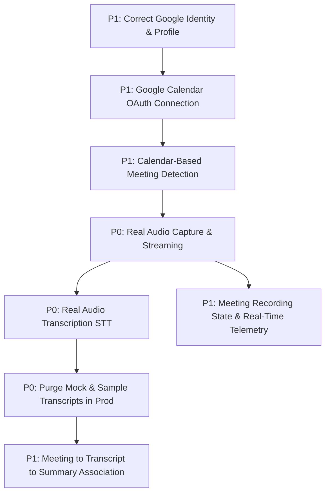

# NoteFlow AI • Product Integrity & Core Promise Plan

> **Core Product Promise:**  
> *"NoteFlow AI records the user's real meeting and converts the actual conversation into useful meeting intelligence."*

---

## 1. Executive Summary & Problem Matrix

NoteFlow AI's production infrastructure (Google OAuth, Desktop shell, Vercel frontend, Render backend) is operational. However, the core end-to-end product value loop is broken whenever mock/sample data is served in place of genuine meeting audio, real transcription, and actual LLM intelligence.

This Product Integrity Plan sequences all critical remediations by **dependency hierarchy** and **user impact** to transition the product from a prototype state into an authentic, production-grade meeting intelligence system.

---

## 2. Prioritized Integrity Breakdown

---

### Item 1: Real Audio Capture & Transcription Pipeline
- **Priority:** `P0` (Critical Path / Product Promise Blocker)
- **Problem:** Spoken meeting audio captured in the browser/desktop is either not streamed reliably to the backend or is intercepted and bypassed before reaching the STT (Speech-to-Text) transcription engine.
- **User Impact:** The user records a 30-minute meeting and expects an accurate transcript of their spoken words, but receives either an empty transcript, a failure, or a disconnected session. The core product promise fails completely.
- **Root Dependency:** Web Audio / MediaRecorder buffer chunking $\rightarrow$ Ingress streaming transport $\rightarrow$ STT engine (Deepgram Nova-2 / Whisper).
- **Technical Dependency:**
  - `navigator.mediaDevices.getUserMedia` & `MediaRecorder` in browser/desktop web view.
  - Chunk streaming endpoint (`POST /api/recording/chunk`) and audio buffer compilation.
  - Speech-to-Text API key configuration and buffer processing in `server/services/sttService.ts`.
- **UX Dependency:**
  - Mic permission prompt and hardware input validation.
  - Real-time audio waveform/RMS visual feedback indicating audio is actively being captured.
- **Acceptance Criteria:**
  1. Microphone audio streams real PCM/WebM/Opus bytes to backend without dropped buffers.
  2. Backend STT processes the audio buffer and returns real speech-to-text transcript segments with timestamps.
  3. Audio artifacts are persisted temporarily for processing and memory buffers are purged post-synthesis.
- **Testing Requirement:**
  - Automated integration test piping a known `.wav`/`.webm` audio file into the ingress endpoint and asserting $>90\%$ word accuracy against the ground truth text.
- **Definition of Done:**
  - When a user speaks into their microphone during a meeting, the transcript generated post-meeting reflects the exact spoken words of that session.

---

### Item 2: Removal of Mock/Sample Data from Production Flow
- **Priority:** `P0` (Integrity & Trust Blocker)
- **Problem:** Production flows silently fall back to `SAMPLE_ZOOM_TRANSCRIPT` or predefined seed transcripts ("Q3 Roadmap Alignment", "Sarah Chen", "Marcus Brody"), causing authentic meetings to show fake data.
- **User Impact:** The user records an authentic design critique or sales call, but the UI displays a hardcoded engineering roadmap discussion with synthetic speakers. Trust is immediately destroyed.
- **Root Dependency:** Real transcription completion (Item 1).
- **Technical Dependency:**
  - Complete isolation of sample data fixtures (`SAMPLE_ZOOM_TRANSCRIPT`, `DEMO_DETECTED_MEETINGS`) behind explicit `isDemoMode === true` guards.
  - Strict backend invariant: Non-demo API requests must return `EMPTY_TRANSCRIPT` or `NO_AUDIO_CAPTURED` error states rather than substituting mock text.
- **UX Dependency:**
  - Transparent error and empty states ("No speech detected in this recording", "Audio stream was too brief").
  - Clear visual demarcation between "Sandbox / Demo Mode" and "Live Production Workspace".
- **Acceptance Criteria:**
  1. A production user never sees `SAMPLE_ZOOM_TRANSCRIPT` under any circumstances.
  2. If a meeting had no audio or failed processing, the UI displays an authentic error/empty state with retry capability, never fake text.
  3. Sample meetings are only visible when explicitly launched inside the Sandbox demo mode.
- **Testing Requirement:**
  - Zero-mock regression test: Grep and assert that in a standard production session (`isDemoMode: false`), none of the synthetic seed strings appear in API responses or DOM snapshots.
- **Definition of Done:**
  - 100% of transcripts and summaries rendered in production originate from the user's recorded audio session or explicit manual inputs.

---

### Item 3: Correct Google Identity and Profile Mapping
- **Priority:** `P1` (User Identity & Multi-Tenancy Integrity)
- **Problem:** After Google OAuth login, user identity occasionally displays fallback default names (`"Workspace Member"`, `"Workspace User"`, `"Sarah Chen"`) or fails to extract Google Subject ID (`sub`) and profile avatar.
- **User Impact:** Users see incorrect account details in the header and cannot verify which Google account is linked, leading to confusion and fear of account cross-contamination.
- **Root Dependency:** Google OAuth token exchange payload & OpenID Connect `id_token` decoding.
- **Technical Dependency:**
  - JWT decoding of Google OpenID `id_token` for `sub`, `email`, `name`, `given_name`, `family_name`, `picture`.
  - Permanent subject ID mapping: `userId = usr_g_${sha256(googleSubjectId)}`.
  - Zero-random deterministic fallback when display name is omitted by Google.
- **UX Dependency:**
  - User profile menu in header displaying Google profile photo, full name, and authenticated email address.
  - Multi-tenant logout and re-authentication UI.
- **Acceptance Criteria:**
  1. User logging in with Account A sees Account A's verified Google name, email, and avatar.
  2. Logging out and logging in with Account B shows Account B's information.
  3. Accounts A and B remain strictly partitioned without data cross-leakage.
- **Testing Requirement:**
  - `test/google-identity-mapping.test.ts` validating multi-tenant cryptographic partitioning, OpenID decoding, and deterministic name fallbacks.
- **Definition of Done:**
  - Active header, settings menu, and session tokens consistently reflect the authenticated Google identity.

---

### Item 4: Google Calendar OAuth Connection & Incremental Scopes
- **Priority:** `P1` (Discovery & Automation Dependency)
- **Problem:** Calendar sync requires Google Calendar permission (`calendar.events.readonly`), but requesting over-privileged scopes during initial login triggers consent errors or fails verification.
- **User Impact:** Users cannot view their scheduled Google Meet events or must manually enter meeting URLs every time.
- **Root Dependency:** Correct Google OAuth session and refresh token persistence in Token Vault.
- **Technical Dependency:**
  - Incremental OAuth authorization flow requesting `https://www.googleapis.com/auth/calendar.events.readonly`.
  - Secure storage of encrypted Google access/refresh tokens in `TokenVault`.
  - Direct integration with Google Calendar v3 API (`GET https://www.googleapis.com/calendar/v3/calendars/primary/events`).
- **UX Dependency:**
  - "Connect Google Calendar" one-click action in feed and onboarding.
  - Connection status badge ("Connected to calendar: user@domain.com") with last sync timestamp.
- **Acceptance Criteria:**
  1. Clicking "Connect Google Calendar" initiates incremental consent for `calendar.events.readonly`.
  2. Backend securely stores tokens and fetches real upcoming calendar events.
  3. Re-opening the app restores calendar connectivity without forcing re-consent.
- **Testing Requirement:**
  - Integration test verifying Google Calendar v3 event query, token refresh handling, and unauthorized 401 handling.
- **Definition of Done:**
  - User can connect Google Calendar and see their live schedule synchronized with valid sync tokens.

---

### Item 5: Calendar-Based Meeting Detection & Google Meet Normalization
- **Priority:** `P1` (Meeting Schedule Automation)
- **Problem:** Calendar events containing Google Meet or Zoom links are not parsed into actionable recording entities with deduplication.
- **User Impact:** Upcoming meetings are missed; duplicate recordings could be spawned if multiple team members join the same meeting.
- **Root Dependency:** Google Calendar API event ingestion (Item 4).
- **Technical Dependency:**
  - Regex parser for Google Meet URLs (`https://meet.google.com/xxx-yyyy-zzz`), Zoom, and Teams.
  - Deduplication hash generator: `sha256(canonicalMeetingUrl)` to ensure multi-user deduplication.
  - Delta synchronization (`syncToken`) to fetch only modified/new calendar events.
- **UX Dependency:**
  - Meeting list showing upcoming schedule with start time, organizer, attendee count, and "Record" toggle.
  - T-5m pre-meeting notification badge when a scheduled meeting is about to start.
- **Acceptance Criteria:**
  1. Calendar events with Google Meet links automatically appear in the "Upcoming Meetings" feed.
  2. Non-meeting calendar events (e.g. personal focus blocks) are filtered out or categorized properly.
  3. Multiple users recording the same Google Meet link are mapped to the same canonical meeting ID.
- **Testing Requirement:**
  - Unit tests validating Google Meet URL extraction, canonical ID normalization, and dedup hash generation across varied URL formats.
- **Definition of Done:**
  - The feed accurately populates real upcoming meetings extracted from the user's primary Google Calendar.

---

### Item 6: Meeting Recording State Machine & Observability
- **Priority:** `P1` (Visibility & Operational Trust)
- **Problem:** Meeting recording lacks transparent lifecycle states, making it unclear whether audio is actually capturing or if processing has stalled.
- **User Impact:** The user has anxiety during a meeting because they cannot verify whether NoteFlow is actually recording or if the audio stream dropped.
- **Root Dependency:** Persistent Recording Session Service.
- **Technical Dependency:**
  - Server-side recording state machine: `INITIALIZING` $\rightarrow$ `RECORDING` $\rightarrow$ `STOPPING` $\rightarrow$ `COMPLETED` / `FAILED`.
  - Live audio chunk counter, byte counter, and duration timer in `recordingSessionService.ts`.
  - SSE telemetry stream (`GET /api/recording/events`) broadcasting state changes.
- **UX Dependency:**
  - Active Recording Banner displaying:
    - Status pill ("Recording live", "Paused", "Processing transcript").
    - Real-time elapsed time counter.
    - Live audio equalizer visualizer reacting to spoken audio.
    - Stop and Pause/Resume controls.
- **Acceptance Criteria:**
  1. Starting recording immediately updates UI to `RECORDING` with a ticking timer.
  2. Speaking into the mic produces visible RMS power activity on the waveform.
  3. Stopping recording updates UI to `STOPPING` $\rightarrow$ `PROCESSING` $\rightarrow$ `COMPLETED`.
  4. Any hardware/network error updates UI to `FAILED` with actionable recovery instructions.
- **Testing Requirement:**
  - `test/recording-session-state-machine.test.ts` testing state transitions, pause/resume, chunk counts, and telemetry.
- **Definition of Done:**
  - The recording banner provides unbroken, transparent visual feedback throughout the entire recording lifecycle.

---

### Item 7: Meeting $\rightarrow$ Transcript $\rightarrow$ AI Summary Association
- **Priority:** `P1` (End-to-End Value Delivery)
- **Problem:** Once transcription finishes, the resulting text, decisions, action items, and executive summary must be permanently linked to the specific meeting record.
- **User Impact:** After a meeting completes, the user cannot find the summary in their meeting history, or the summary is detached from the meeting details.
- **Root Dependency:** Real transcription (Item 1) and LLM summary generation service (`summaryService.ts`).
- **Technical Dependency:**
  - Meeting entity schema associating `meetingId`, `recordingSessionId`, `transcript`, `summary`, and `metadata`.
  - LLM grounded citation extractor linking each decision and action item to exact quote snippets from the transcript.
  - Persistent storage in `.data/meeting_history.json` or local database.
- **UX Dependency:**
  - Meeting Detail View featuring:
    - Tab 1: AI Summary (Executive Summary, Key Decisions with citations, Action Items with assignees).
    - Tab 2: Full Diarized Transcript with speaker labels and timestamps.
    - Tab 3: Meeting Meta (Attendees, Duration, Platform, Date).
- **Acceptance Criteria:**
  1. Stopping a recording generates an AI summary derived exclusively from that meeting's transcript.
  2. Decisions and action items contain clickable citation references back to the transcript.
  3. The completed meeting appears in the "Recorded Meetings" history and remains accessible on page reload.
- **Testing Requirement:**
  - End-to-end integration test validating meeting completion, transcript linking, AI summary generation, and citation grounding.
- **Definition of Done:**
  - Clicking any finished meeting opens its specific AI summary and transcript with 100% data consistency.

---

## 3. Implementation Sequence & Execution Roadmap

| Milestone | Target Area | Direct Artifact / Target | Integrity Criteria |
| :--- | :--- | :--- | :--- |
| **Milestone 1** | **P0 Real Audio & STT** | [`audioRecorder.ts`](file:///Users/yogendrasinghdanu/Downloads/Senior%20Product%20Designer/Meet%20Record/src/lib/audioRecorder.ts), [`sttService.ts`](file:///Users/yogendrasinghdanu/Downloads/Senior%20Product%20Designer/Meet%20Record/server/services/sttService.ts) | Mic streams real audio chunks to STT; returns diarized transcript. |
| **Milestone 2** | **P0 Zero Mock Invariant** | [`useMeetRecord.ts`](file:///Users/yogendrasinghdanu/Downloads/Senior%20Product%20Designer/Meet%20Record/src/hooks/useMeetRecord.ts), [`authRoutes.ts`](file:///Users/yogendrasinghdanu/Downloads/Senior%20Product%20Designer/Meet%20Record/server/routes/authRoutes.ts) | Mock fixtures strictly isolated in Sandbox demo mode; zero fake data in prod. |
| **Milestone 3** | **P1 Google Identity** | [`tokenVault.ts`](file:///Users/yogendrasinghdanu/Downloads/Senior%20Product%20Designer/Meet%20Record/server/security/tokenVault.ts), [`AppHeader.tsx`](file:///Users/yogendrasinghdanu/Downloads/Senior%20Product%20Designer/Meet%20Record/src/components/layout/AppHeader.tsx) | Google `sub` ID mapping, authentic user name, email, and avatar rendering. |
| **Milestone 4** | **P1 Calendar Sync** | [`calendarService.ts`](file:///Users/yogendrasinghdanu/Downloads/Senior%20Product%20Designer/Meet%20Record/server/services/calendarService.ts) | Incremental calendar consent; Google Meet URL extraction & dedup. |
| **Milestone 5** | **P1 Recording State Machine** | [`recordingSessionService.ts`](file:///Users/yogendrasinghdanu/Downloads/Senior%20Product%20Designer/Meet%20Record/server/services/recordingSessionService.ts) | Persistent `INITIALIZING` $\rightarrow$ `RECORDING` $\rightarrow$ `STOPPING` $\rightarrow$ `COMPLETED` state machine. |
| **Milestone 6** | **P1 Meeting $\leftrightarrow$ Summary** | [`summaryService.ts`](file:///Users/yogendrasinghdanu/Downloads/Senior%20Product%20Designer/Meet%20Record/server/services/summaryService.ts), Detail Views | Meeting entity linked to transcript, grounded AI summary, and action items. |

---

## 4. Definition of Full Product Integrity

The product is verified as having achieved **Full Product Integrity** when:
1. A user authenticates via Google and sees their real name, email, and avatar.
2. The user connects Google Calendar and sees their real scheduled Google Meet sessions.
3. The user records a live meeting; NoteFlow AI captures their spoken audio stream with visible live audio telemetry.
4. The backend STT transcribes the actual spoken conversation.
5. An AI summary with grounded quotes and action items is generated directly from that conversation.
6. Zero mock or sample data appears in the user's workspace.
7. All 51+ unit, integration, and E2E regression tests pass with 100% reliability.
