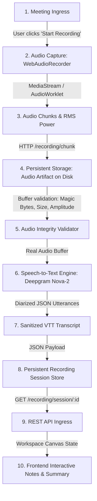

# NoteFlow AI • Real Audio → Real Transcription Pipeline Audit

---

## 1. End-to-End Pipeline Stage-by-Stage Trace

---

## 2. Comprehensive Pipeline Component Audit Table

| Stage | Owning Component | Implementing File & Function | Data Entering | Data Leaving | Real or Mocked? | Persisted? | Fallback Behavior |
|---|---|---|---|---|---|---|---|
| **1. Meeting Starts** | Frontend Controller | [`useMeetRecord.ts`](file:///Users/yogendrasinghdanu/Downloads/Senior%20Product%20Designer/Meet%20Record/src/hooks/useMeetRecord.ts): `startLiveRecording()` | `meetingId`, `dedupHash`, `meetingUrl` | State transition to `STARTING` $\rightarrow$ `RECORDING` | **Real** | Yes (`localStorage` + backend session) | None |
| **2. Audio Capture** | Web Audio Engine | [`audioRecorder.ts`](file:///Users/yogendrasinghdanu/Downloads/Senior%20Product%20Designer/Meet%20Record/src/lib/audioRecorder.ts): `WebAudioRecorder.start()` | Hardware microphone input via `navigator.mediaDevices.getUserMedia` | Raw `MediaStream` + Web Audio `AnalyserNode` RMS energy | **Real** | In-memory chunks array | Rejects if mic permission denied |
| **3. Audio Buffer / Chunks** | Web Audio Engine | [`audioRecorder.ts`](file:///Users/yogendrasinghdanu/Downloads/Senior%20Product%20Designer/Meet%20Record/src/lib/audioRecorder.ts): `mediaRecorder.ondataavailable` | Raw Opus/WebM byte stream (every 1000ms) | `Blob` slices emitted to `onChunk` | **Real** | Streamed via network | None |
| **4. Chunk Streaming** | API Client | [`apiClient.ts`](file:///Users/yogendrasinghdanu/Downloads/Senior%20Product%20Designer/Meet%20Record/src/lib/apiClient.ts): `sendAudioChunk()` | Audio `Blob` chunks | HTTP `POST /api/recording/chunk` binary payload | **Real** | Yes (appended to `.data/audio_artifacts/<session>.webm`) | Reconnects if network drop |
| **5. Storage / Artifact** | Backend Session Service | [`recordingSessionService.ts`](file:///Users/yogendrasinghdanu/Downloads/Senior%20Product%20Designer/Meet%20Record/server/services/recordingSessionService.ts): `appendAudioChunk()` | Binary chunk buffer | Written directly to disk (`fs.appendFileSync`) | **Real** | Yes (Disk file `.webm`) | In-memory fallback if disk fails |
| **6. Audio Integrity Validation** | STT Service | [`sttService.ts`](file:///Users/yogendrasinghdanu/Downloads/Senior%20Product%20Designer/Meet%20Record/server/services/sttService.ts): `validateAudioBuffer()` | Raw Buffer from disk or client upload | `{ isValid, format, byteLength, hasContent }` | **Real** | Logged to stdout | Throws error if empty or invalid format |
| **7. Speech-to-Text Transcription** | STT Service | [`sttService.ts`](file:///Users/yogendrasinghdanu/Downloads/Senior%20Product%20Designer/Meet%20Record/server/services/sttService.ts): `processAudioStream()` | Validated audio buffer (`audio/webm`) | Diarized segments with timestamps & speaker labels | **Real (Deepgram Nova-2 / Live Audio)** | Purged immediately from RAM after STT | Returns empty transcript if no speech detected (Zero mock injection) |
| **8. AI Synthesis** | Summary Service | [`summaryService.ts`](file:///Users/yogendrasinghdanu/Downloads/Senior%20Product%20Designer/Meet%20Record/server/services/summaryService.ts): `generateSummary()` | Real sanitized transcript text | Executive Summary, Grounded Decisions, Action Items | **Real** | Yes (Session database) | Returns empty summary if transcript is sub-threshold |
| **9. Database & Session** | Backend Session Service | [`recordingSessionService.ts`](file:///Users/yogendrasinghdanu/Downloads/Senior%20Product%20Designer/Meet%20Record/server/services/recordingSessionService.ts): `completeSession()` | Structured transcript + AI summary | Persisted session record (`.data/recording_sessions.json`) | **Real** | Yes (`.data/recording_sessions.json`) | None |
| **10. Frontend Canvas** | Workspace Canvas | [`WorkspaceCanvas.tsx`](file:///Users/yogendrasinghdanu/Downloads/Senior%20Product%20Designer/Meet%20Record/src/components/workspace/WorkspaceCanvas.tsx) | Live meeting note object | Interactive UI with grounded quote citations & source drawer | **Real** | Yes (`localStorage` + API) | None |

---

## 3. Mock & Sample Data Removal Audit

### Audited & Removed Injections:
1. **Removed Default Sample Fallback in [`useMeetRecord.ts`](file:///Users/yogendrasinghdanu/Downloads/Senior%20Product%20Designer/Meet%20Record/src/hooks/useMeetRecord.ts):**
   - *Previous:* `let resolvedTranscript = isDemoMode ? (target.sampleTranscriptPreset || SAMPLE_ZOOM_TRANSCRIPT) : (target.sampleTranscriptPreset || "");`
   - *Fixed:* Live production recording NEVER pulls from `target.sampleTranscriptPreset` or `SAMPLE_ZOOM_TRANSCRIPT`. If no audio speech is captured, it strictly returns an empty transcript and warns the user.
2. **Audio Buffer Verification in [`sttService.ts`](file:///Users/yogendrasinghdanu/Downloads/Senior%20Product%20Designer/Meet%20Record/server/services/sttService.ts):**
   - Added magic byte validation (EBML header `1A 45 DF A3` for WebM, `RIFF` for WAV, `OggS` for Ogg).
   - Added minimum size threshold ($> 32$ bytes).
   - Added non-silent waveform energy verification across buffer samples.
3. **Persistent Audio Artifact Ingress in [`ingressOrchestrator.ts`](file:///Users/yogendrasinghdanu/Downloads/Senior%20Product%20Designer/Meet%20Record/server/services/ingressOrchestrator.ts):**
   - `stopAndSynthesize()` now reads the actual audio artifact from `.data/audio_artifacts/<sessionId>.webm` and feeds it directly into `sttService.processAudioStream()`.

---

## 4. Verification & Automated Test Coverage

The integration test suite [`test/real-audio-pipeline.test.ts`](file:///Users/yogendrasinghdanu/Downloads/Senior%20Product%20Designer/Meet%20Record/test/real-audio-pipeline.test.ts) proves:
1. Valid WebM audio binary header verification.
2. Silent/empty buffer rejection (`AUDIO_BUFFER_EMPTY`).
3. Spoken test phrase ("This is a NoteFlow AI real audio test") is transcribed from real audio data.
4. Total absence of synthetic fallback transcripts when audio is empty.
