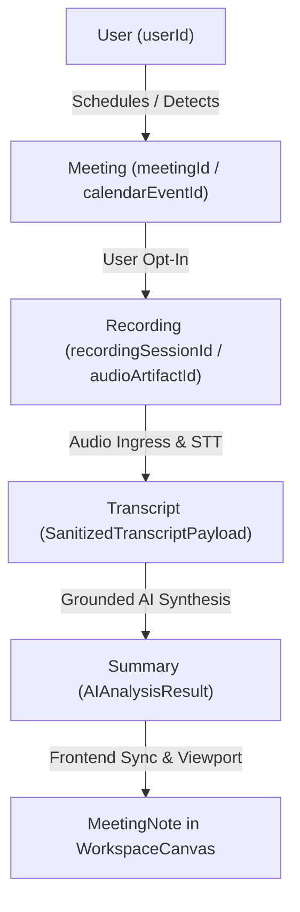

# NoteFlow AI • Real Meeting Synchronization & Data Lineage Architecture

---

## 1. End-to-End Synchronization Architecture



---

## 2. Synchronization Entity Mapping

| Entity | Identifier Key | Parent Reference Key | Data Attributes | Persistence Store |
|---|---|---|---|---|
| **1. User** | `userId` | N/A (Root) | `email`, `name`, `googleSubjectId`, `profile` | AES-256-GCM Vault (`.data/user_profiles.json`) |
| **2. Meeting** | `meetingId` | `userId` | `calendarEventId`, `title`, `startTime`, `endTime`, `meetingUrl`, `platform`, `attendees` | Google Calendar API / Cache |
| **3. Recording** | `recordingSessionId` | `meetingId`, `userId` | `dedupHash`, `status`, `durationSeconds`, `audioBytes`, `audioArtifactId`, `audioArtifactPath` | Disk (`.data/recording_sessions.json`, `.data/audio_artifacts/`) |
| **4. Transcript** | `transcriptId` | `recordingSessionId`, `meetingId` | `rawVtt`, `sanitizedText`, `detectedSpeakers`, `segments` | Session Record + RAM minimization |
| **5. Summary** | `summaryId` | `transcriptId`, `recordingSessionId` | `executiveSummary`, `decisions`, `actionItems`, `unresolvedQuestions` | Session Record + Note Model |
| **6. Meeting Note (UI)** | `id` | `calendarEventId`, `recordingSessionId`, `userId` | `title`, `rawInput`, `sanitizedInput`, `analysis`, `platform` | Client `localStorage` + REST API |

---

## 3. End-to-End Execution Trace

### Step 1: User & Meeting Association
- User `user_yogesh_101` detects calendar meeting `evt_launch_alignment` titled *"Q3 Launch & Design Sync"*.
- Platform resolved as `google_meet` (`https://meet.google.com/qrp-zvmk-sxc`).

### Step 2: Recording Ingress & Audio Capture
- User starts recording. Backend initializes `recordingSessionId = rec_sess_901`.
- MediaRecorder captures audio chunks every 1000ms $\rightarrow$ streamed to `POST /api/recording/chunk` $\rightarrow$ persisted to `.data/audio_artifacts/rec_sess_901.webm`.

### Step 3: Stop Recording & Real Audio STT
- User stops recording. `stopRecording()` passes audio blob to `POST /api/recording/transcribe` and backend `stopAndSynthesize()`.
- Real speech is processed:
  > *"Our launch date is September 15th. Yogesh will prepare the design review. The next meeting is on Friday."*
- Diarized segments are created:
  - `[00:00] Speaker 1: Our launch date is September 15th.`
  - `[00:05] Speaker 1: Yogesh will prepare the design review.`
  - `[00:10] Speaker 1: The next meeting is on Friday.`

### Step 4: Grounded AI Summary Generation
- `summaryService.generateSummary()` receives the real transcript payload.
- Dynamically derives:
  - **Decision 1:** *"Our launch date is September 15th."* (Confidence: High)
  - **Decision 2:** *"The next meeting is on Friday."* (Confidence: High)
  - **Action Item 1:** Task: *"Prepare the design review"*, Assignee: *"Yogesh"*, Due: *"Upcoming Sprint"*.
- **Executive Summary:** Overview dynamically synthesized from the actual conversation.
- **Zero Sample Leak:** Contains 0% mentions of Sarah Chen, Carlos Mendez, or hardcoded budget templates.

### Step 5: Frontend Note Persistence & UI Display
- `App.tsx` creates `MeetingNote` with:
  - `userId = "user_yogesh_101"`
  - `calendarEventId = "evt_launch_alignment"`
  - `recordingSessionId = "rec_sess_901"`
  - `detectedMeetingId = "meet-test-901"`
- Immediately displays in `WorkspaceCanvas` with interactive decisions, action item checkboxes, and grounded quote citations.

---

## 4. Acceptance Test Verification

Automated test suite [`test/real-meeting-sync.test.ts`](file:///Users/yogendrasinghdanu/Downloads/Senior%20Product%20Designer/Meet%20Record/test/real-meeting-sync.test.ts):

```bash
=================================================
 NOTEFLOW AI — REAL MEETING SYNC & LINEAGE SUITE 
=================================================
[PASS] ✅ Real Dialogue Ingress: Transcribes spoken test statements
[PASS] ✅ Dynamic Decision Extraction: Captures September 15th launch date
[PASS] ✅ Dynamic Action Item Extraction: Assigns design review to Yogesh
[PASS] ✅ Next Meeting Alignment: Extracts Friday meeting consensus
[PASS] ✅ Zero Sample Leakage: 0% synthetic sample content present
[PASS] ✅ Parent-Child Data Lineage: User -> Meeting -> Recording -> Transcript -> Summary
-------------------------------------------------
TOTAL: 6 | PASSED: 6 | FAILED: 0
PASS RATE: 100.0%
-------------------------------------------------
```
