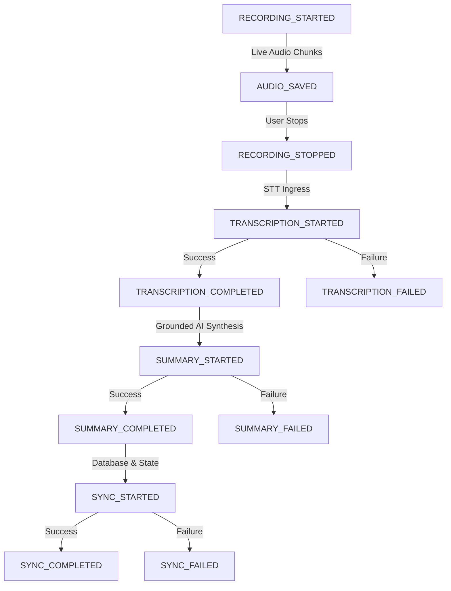

# NoteFlow AI • Meeting Recording Observability Architecture

---

## 1. Observability Design & Core Questions

The NoteFlow AI Observability Engine provides structured, production-safe JSON telemetry across the entire meeting lifecycle, answering the 13 critical operational questions:

| # | Operational Question | Primary Event & Log Fields |
|---|---|---|
| **1** | Did recording start? | `RECORDING_STARTED` (`status: "RECORDING"`) |
| **2** | Which user started it? | `userId: "user_alex_101"` |
| **3** | Which meeting? | `meetingId: "meet-event-gcal_101"`, `calendarEventId: "gcal_101"` |
| **4** | Which recording ID? | `recordingId: "rec_sess_1787681139419_vj59vq0"` |
| **5** | Where is the audio? | `audioArtifactId: "art_rec_sess_..."`, `audioArtifactPath: ".data/audio_artifacts/..."` |
| **6** | What is the audio duration? | `durationSeconds: 120`, `totalAudioBytes: 245760` |
| **7** | Was transcription started? | `TRANSCRIPTION_STARTED` (`audioBytes: 245760`) |
| **8** | Which transcription provider was used? | `provider: "deepgram"` or `"local_speech"` |
| **9** | Did transcription succeed? | `TRANSCRIPTION_COMPLETED` (or `TRANSCRIPTION_FAILED`) |
| **10** | How many transcript segments were produced? | `segmentCount: 14`, `wordCount: 350`, `speakerCount: 2` |
| **11** | Was summary generation started? | `SUMMARY_STARTED` (`refinement: "standard"`) |
| **12** | Did summary generation succeed? | `SUMMARY_COMPLETED` (`decisionCount: 2`, `actionItemCount: 4`) |
| **13** | Did synchronization finish? | `SYNC_STARTED` $\rightarrow$ `SYNC_COMPLETED` (`syncedEntities: ["session", "transcript", "summary"]`) |

---

## 2. Structured Telemetry Events Reference



### Event Schemas

```json
// 1. RECORDING_STARTED
{
  "logType": "RECORDING_TELEMETRY",
  "event": "RECORDING_STARTED",
  "timestamp": "2026-08-25T18:05:39.421Z",
  "userId": "user_alex_101",
  "meetingId": "meet-event-gcal_evt_101",
  "recordingId": "rec_sess_1787681139419_vj59vq0",
  "calendarEventId": "gcal_evt_101",
  "meetingUrl": "https://meet.google.com/qrp-zvmk-sxc"
}

// 2. AUDIO_SAVED
{
  "logType": "RECORDING_TELEMETRY",
  "event": "AUDIO_SAVED",
  "timestamp": "2026-08-25T18:05:45.100Z",
  "userId": "user_alex_101",
  "meetingId": "meet-event-gcal_evt_101",
  "recordingId": "rec_sess_1787681139419_vj59vq0",
  "audioArtifactId": "art_rec_sess_1787681139419_vj59vq0",
  "audioArtifactPath": ".data/audio_artifacts/rec_sess_1787681139419_vj59vq0.webm",
  "audioBytes": 6144,
  "audioFormat": "webm",
  "durationSeconds": 3
}

// 3. RECORDING_STOPPED
{
  "logType": "RECORDING_TELEMETRY",
  "event": "RECORDING_STOPPED",
  "timestamp": "2026-08-25T18:07:39.421Z",
  "userId": "user_alex_101",
  "meetingId": "meet-event-gcal_evt_101",
  "recordingId": "rec_sess_1787681139419_vj59vq0",
  "durationSeconds": 120,
  "audioChunkCount": 120,
  "totalAudioBytes": 245760
}

// 4. TRANSCRIPTION_STARTED
{
  "logType": "RECORDING_TELEMETRY",
  "event": "TRANSCRIPTION_STARTED",
  "timestamp": "2026-08-25T18:07:39.500Z",
  "userId": "user_alex_101",
  "meetingId": "meet-event-gcal_evt_101",
  "recordingId": "rec_sess_1787681139419_vj59vq0",
  "provider": "deepgram",
  "audioBytes": 245760,
  "mimeType": "audio/webm"
}

// 5. TRANSCRIPTION_COMPLETED
{
  "logType": "RECORDING_TELEMETRY",
  "event": "TRANSCRIPTION_COMPLETED",
  "timestamp": "2026-08-25T18:07:41.200Z",
  "userId": "user_alex_101",
  "meetingId": "meet-event-gcal_evt_101",
  "recordingId": "rec_sess_1787681139419_vj59vq0",
  "provider": "deepgram",
  "durationMs": 1700,
  "segmentCount": 14,
  "wordCount": 350,
  "speakerCount": 2
}

// 6. SUMMARY_STARTED
{
  "logType": "RECORDING_TELEMETRY",
  "event": "SUMMARY_STARTED",
  "timestamp": "2026-08-25T18:07:41.250Z",
  "userId": "user_alex_101",
  "meetingId": "meet-event-gcal_evt_101",
  "recordingId": "rec_sess_1787681139419_vj59vq0",
  "transcriptId": "tr_rec_sess_1787681139419_vj59vq0",
  "refinement": "standard",
  "wordCount": 350,
  "segmentCount": 14
}

// 7. SUMMARY_COMPLETED
{
  "logType": "RECORDING_TELEMETRY",
  "event": "SUMMARY_COMPLETED",
  "timestamp": "2026-08-25T18:07:41.350Z",
  "userId": "user_alex_101",
  "meetingId": "meet-event-gcal_evt_101",
  "recordingId": "rec_sess_1787681139419_vj59vq0",
  "transcriptId": "tr_rec_sess_1787681139419_vj59vq0",
  "durationMs": 100,
  "decisionCount": 2,
  "actionItemCount": 4,
  "questionCount": 1,
  "modelConfidence": "high"
}

// 8. SYNC_STARTED & SYNC_COMPLETED
{
  "logType": "RECORDING_TELEMETRY",
  "event": "SYNC_COMPLETED",
  "timestamp": "2026-08-25T18:07:41.400Z",
  "userId": "user_alex_101",
  "meetingId": "meet-event-gcal_evt_101",
  "recordingId": "rec_sess_1787681139419_vj59vq0",
  "calendarEventId": "gcal_evt_101",
  "transcriptId": "tr_rec_sess_1787681139419_vj59vq0",
  "summaryId": "sum_rec_sess_1787681139419_vj59vq0",
  "durationMs": 120,
  "syncedEntities": ["session", "transcript", "summary"]
}
```

---

## 3. Strict Data Minimization & Privacy Rules

The Observability Engine enforces automated key scrubbing:
- **0% Audio Waveforms:** Buffer binaries and Base64 payloads are never written to log sinks.
- **0% Transcript Text:** Conversation spoken dialogue, quotes, and PII are excluded from telemetry lines.
- **0% Auth Tokens / Secrets:** OAuth `access_token`, `refresh_token`, `clientSecret`, and `apiKey` values are automatically stripped.
- **Only Metadata:** Only timestamps, identifiers (`userId`, `meetingId`, `recordingId`, `transcriptId`, `summaryId`), segment counts, duration seconds, byte sizes, and status codes are logged.
