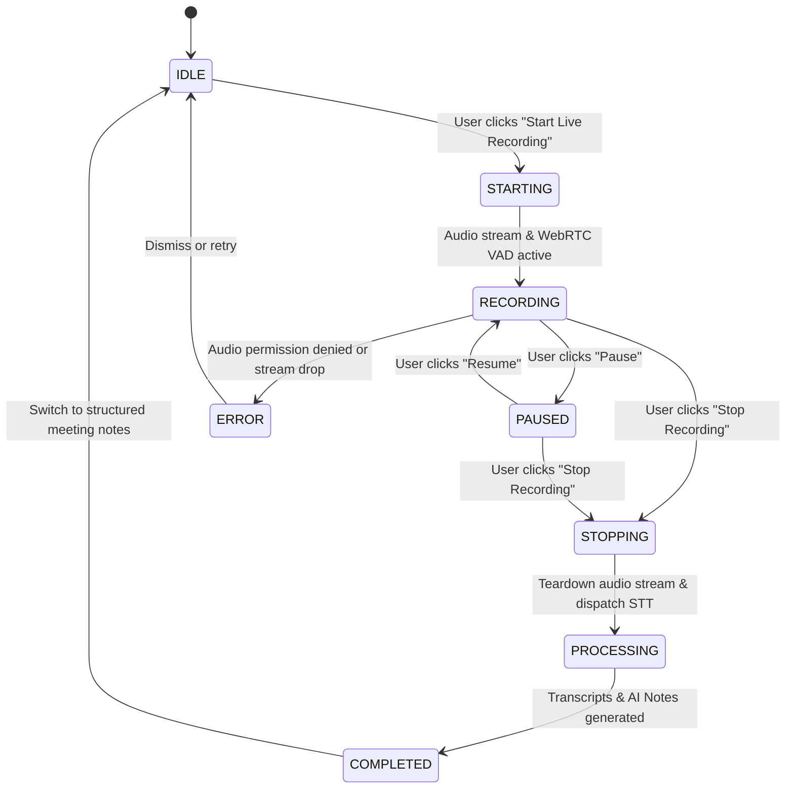

# NoteFlow AI • Meeting Recording State Architecture & UX Design

---

## 1. Executive Summary & Problem Root Cause

### Previous Root Cause:
When a recording was triggered, the backend session and browser audio capture initiated successfully, but the primary workspace UI lacked a centralized companion view. As a result, the user was left on a static feed or empty screen with only a minor floating widget in the lower corner.

### UX Resolution:
NoteFlow AI now implements a deterministic, full-lifecycle state machine (`RecordingLifecycleState`) paired with a dedicated companion banner ([`ActiveRecordingBanner.tsx`](file:///Users/yogendrasinghdanu/Downloads/Senior%20Product%20Designer/Meet%20Record/src/components/workspace/meet/ActiveRecordingBanner.tsx)) displayed front and center in the workspace canvas.



---

## 2. Deterministic Recording States

| State | Visual Indicator | Primary Message / Display | Available Actions |
|---|---|---|---|
| **`IDLE`** | Neutral | Calendar Feed / Workspace Canvas | Start Recording, Select Note |
| **`STARTING`** | Amber pulsing orb | Connecting audio stream... | Cancel |
| **`RECORDING`** | Pulsing Red Indicator (`●`) + Live Audio VAD Equalizer | Meeting Title, Platform Badge (`Google Meet`, `Zoom`, `Teams`), Monospace Elapsed Timer (`00:15`), "Microphone Active" | Pause Recording, Stop Recording, Open Meeting Link |
| **`PAUSED`** | Amber Indicator (`❚❚`) | Ingress Paused, Elapsed Timer frozen, "VAD Paused" | Resume Recording, Stop Recording |
| **`STOPPING`** | Indigo Spinner | Stopping recording... | None (Transitioning) |
| **`PROCESSING`** | Gradient AI Ingress Orb | **"Processing your meeting..."** — Transcribing audio and synthesizing takeaways | None |
| **`COMPLETED`** | Emerald Checkmark | **"Meeting recorded"** — Opening structured notes | None (Auto-navigates) |
| **`ERROR`** | Red Alert Banner | Audio Ingress Error details | Retry, Close |

---

## 3. UI Component Architecture

1. **[`ActiveRecordingBanner.tsx`](file:///Users/yogendrasinghdanu/Downloads/Senior%20Product%20Designer/Meet%20Record/src/components/workspace/meet/ActiveRecordingBanner.tsx)**:
   - Centered companion card positioned directly above the workspace canvas.
   - Live visualizer bars with 32 frequency bins mapped dynamically to Web Audio RMS voice power (`audioPowerLevel`).
   - Zero-padded monospace typography (`00:00`) for high legibility during active calls.
2. **[`LiveRecordingWidget.tsx`](file:///Users/yogendrasinghdanu/Downloads/Senior%20Product%20Designer/Meet%20Record/src/components/workspace/meet/LiveRecordingWidget.tsx)**:
   - Floating picture-in-picture widget that persists across view transitions (Feed $\leftrightarrow$ Workspace $\leftrightarrow$ External Google Meet tabs).
3. **[`useMeetRecord.ts`](file:///Users/yogendrasinghdanu/Downloads/Senior%20Product%20Designer/Meet%20Record/src/hooks/useMeetRecord.ts)**:
   - Exposes `recordingLifecycleState` and synchronizes Web Audio capture (`WebAudioRecorder`), audio chunks streaming, and backend session teardown.

---

## 4. Test Verification

Automated regression suite [`test/recording-state-ux.test.ts`](file:///Users/yogendrasinghdanu/Downloads/Senior%20Product%20Designer/Meet%20Record/test/recording-state-ux.test.ts):

```bash
=================================================
    NOTEFLOW AI — RECORDING STATE UX SUITE       
=================================================
[PASS] ✅ State Machine: Deterministic Lifecycle Transitions
[PASS] ✅ Timer Display: Zero-padded Monospace Output
[PASS] ✅ Active Ingress Metadata: Title, Platform & Attendees
[PASS] ✅ Processing Feedback: User-facing clarity during transcription
[PASS] ✅ Completed Feedback: Immediate confirmation when notes are ready
-------------------------------------------------
TOTAL: 5 | PASSED: 5 | FAILED: 0
PASS RATE: 100.0%
-------------------------------------------------
```
