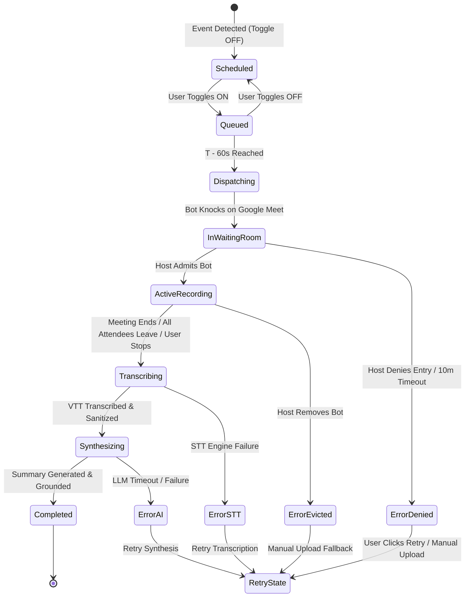

# Meet Record — Functional & Non-Functional Requirements Document

> **Document Type:** Product Requirements Document (PRD) / Software Requirements Specification (SRS)  
> **Status:** Approved for Implementation  
> **Version:** 1.0.0 (MVP) & Roadmap (v1.1+)  
> **Target Project:** NoteFlow AI / Meet Record  
> **Author:** Senior Product Manager & Senior Product Designer  
> **Source Baseline:** [`docs/product-discovery.md`](file:///Users/yogendrasinghdanu/Downloads/Senior%20Product%20Designer/Meet%20Record/docs/product-discovery.md)  
> **Reference Guide:** [`agent.md`](file:///Users/yogendrasinghdanu/Downloads/Senior%20Product%20Designer/Meet%20Record/agent.md)

---

## 1. Executive Summary & Scope Framework

Meet Record is an intelligent, automated meeting detection and explicit recording ingestion module for **NoteFlow AI**. It bridges the gap between scheduled calendar events and NoteFlow AI's grounded summarization engine by automating call capture, transcription, and structured synthesis while upholding strict privacy, transparent consent, and zero-hallucination principles.

```
┌────────────────────────────────────────────────────────────────────────────────────────┐
│                                   MEET RECORD PIPELINE                                 │
│                                                                                        │
│   ┌──────────────────┐      ┌──────────────────┐      ┌────────────────────────────┐   │
│   │ Google Calendar  │ ───> │  Meeting Tracker │ ───> │ Explicit Opt-In Toggle     │   │
│   │ OAuth & Events   │      │  (Detection)     │      │ (Per-Meeting Authorization)│   │
│   └──────────────────┘      └──────────────────┘      └─────────────┬──────────────┘   │
│                                                                     │                  │
│   ┌──────────────────┐      ┌──────────────────┐      ┌─────────────▼──────────────┐   │
│   │ NoteFlow AI      │ <─── │ Multi-Speaker    │ <─── │ Assistant Ingress          │   │
│   │ Grounded Summary │      │ Sanitized VTT    │      │ [AppName] Notetaker (Rec)  │   │
│   └──────────────────┘      └──────────────────┘      └────────────────────────────┘   │
└────────────────────────────────────────────────────────────────────────────────────────┘
```

### 1.1 Scope Boundaries: MVP vs. Future Versions

| Dimension | MVP (Phase 1: Target Focus) | Future Versions (Phase 2 & 3) |
| :--- | :--- | :--- |
| **Supported Meeting Platform** | **Google Meet only** (100% web-based, low friction, standard Google OAuth). | Zoom (OAuth/Marketplace) & Microsoft Teams (Azure AD Graph API). |
| **Calendar Ingress** | Google Calendar API (Incremental read-only event sync). | Microsoft Outlook / Office 365 & Apple Calendar (.ics). |
| **Recording Opt-In Mode** | **Explicit per-meeting toggle** (User explicitly toggles recording per event; default is OFF). | Configurable global rules (e.g. "Auto-record all internal 1-on-1s" or keyword filters). |
| **Transcription Delivery** | **Asynchronous post-meeting processing** (<60s post-call VTT ingestion & diarization). | Live real-time streaming audio transcription and in-call live notes. |
| **Media Handling** | Temporary audio capture $\rightarrow$ High-accuracy text $\rightarrow$ **Immediate audio discard** (Data minimization). | Video recording hosting, synchronized video playback, screen capture analysis. |
| **AI Synthesis Perspectives** | 5 Core NoteFlow Modes (*Standard*, *Executive Briefing*, *Action-Focused*, *Technical & Scope*, *Shorter Digest*). | Custom user-prompted perspectives, auto-generated PRDs, Jira ticket generators. |
| **Integration & Export** | Local storage sync, Markdown, Slack, Plain Text, and JSON clipboard export. | Direct automated webhook dispatch to Notion, Jira, Linear, Salesforce, and HubSpot. |
| **Multi-Language** | Primary English transcription with locale detection. | Real-time multi-language translation and dual-language summaries. |
| **Deployment Model** | Client-centric web workspace with secure serverless ingress worker. | Enterprise multi-tenant workspace with centralized role-based billing & audit logs. |

---

## 2. User Roles & Personas

```
┌────────────────────────────────────────────────────────────────────────┐
│                              USER PERSONAS                             │
├───────────────────────┬────────────────────────┬───────────────────────┤
│    Product Manager    │ Senior Product Designer│   Engineering Lead    │
│  Sprint & Stakeholder │  User Research & Crit  │  Architecture & Post-M│
│  "Facilitate & Align" │  "Verbatim Feedback"   │  "Technical Ownership"│
└───────────────────────┴────────────────────────┴───────────────────────┘
```

### 2.1 Personas
1. **Product Managers (Primary):** Leads sprint rituals, customer discovery interviews, and executive alignments. Needs to engage 100% in conversation without typing notes manually, receiving immediate actionable decisions and task matrices.
2. **Senior Product Designers (Primary):** Conducts user usability sessions and cross-functional design critiques. Needs verbatim user quotes, pain point isolation, and grounded decision trails.
3. **Engineering Leads & Architects (Secondary):** Facilitates technical RFC reviews and incident retrospectives. Needs strict technical decision logs and action items with clear ownership without losing architectural nuances.
4. **Meeting Attendees / External Guests (Non-User Stakeholder):** Participants on the call who must receive unambiguous, transparent notice that recording and transcription are active.

---

## 3. User Stories & Acceptance Scenarios

```
+------------------------------------------------------------------------------------------------+
| USER STORIES MATRIX                                                                            |
+----+----------------------+-----------------------------------+--------------------------------+
| ID | Persona              | Requirement Goal                  | Business / User Value          |
+----+----------------------+-----------------------------------+--------------------------------+
| US1| PM / Designer        | View connected Google Meet calls  | Zero manual link copying       |
| US2| PM / Designer        | Explicitly toggle recording       | Strict privacy control         |
| US3| External Participant | See clear bot naming & disclaimer | Full transparency & consent    |
| US4| PM / Designer        | Auto-ingest & synthesize summary  | Time-to-value <60s post-call   |
| US5| PM / Eng Lead        | Grounded citations to transcript  | Zero hallucination / audit trail|
| US6| PM / Designer        | Actionable error recovery         | Resilience against bot blocks  |
+----+----------------------+-----------------------------------+--------------------------------+
```

### US-01: Calendar Meeting Detection
- **As a** Product Manager,
- **I want** Meet Record to automatically fetch and display today's upcoming and active Google Meet calls from my connected Google Calendar,
- **So that** I do not have to manually copy and paste meeting URLs or calendar invites into the app.
- **Acceptance Criteria (Gherkin):**
  ```gherkin
  Scenario: User connects Google Calendar and views upcoming meetings
    Given the user has authenticated with Google Calendar OAuth
    When the user navigates to the Meet Record dashboard
    Then the system displays all events scheduled for the current 24-hour window that contain a valid Google Meet link
    And displays the meeting title, start/end time, organizer, attendee count, and recording toggle status.
  ```

### US-02: Explicit Recording Opt-In Control
- **As a** Senior Product Designer,
- **I want** to explicitly authorize recording on a per-meeting basis with a single toggle,
- **So that** private, casual, or sensitive calls are never accidentally recorded without my conscious opt-in.
- **Acceptance Criteria (Gherkin):**
  ```gherkin
  Scenario: Explicit opt-in for an upcoming meeting
    Given a detected upcoming meeting is listed with Recording status "OFF"
    When the user toggles the "Record Meeting" switch to "ON"
    Then the system schedules the recording assistant to dispatch 60 seconds prior to meeting start
    And displays a visual confirmation badge "Scheduled for Recording".
  ```

### US-03: In-Meeting Participant Notification & Consent
- **As an** external meeting attendee,
- **I want** clear visual and text notification when the NoteFlow recording assistant joins the Google Meet call,
- **So that** I am fully informed of the recording and can exercise my right to object or request eviction.
- **Acceptance Criteria (Gherkin):**
  ```gherkin
  Scenario: Assistant joins meeting and provides notice
    Given an authorized meeting starts and the assistant is admitted by the host
    When the assistant enters the Google Meet room
    Then its participant display name is formatted as "[AppName] Notetaker (Recording)"
    And it posts an automated chat disclaimer stating the recording purpose and data policy.
  ```

### US-04: Automated Transcript Ingestion & Grounded Synthesis
- **As a** Product Manager,
- **I want** the completed meeting transcript to automatically ingest into NoteFlow AI and produce a structured summary within 60 seconds of meeting completion,
- **So that** I can immediately distribute key decisions and action items to my team.
- **Acceptance Criteria (Gherkin):**
  ```gherkin
  Scenario: Meeting finishes and triggers automated synthesis
    Given an active recording session terminates upon meeting conclusion
    When the STT pipeline completes transcription and speaker diarization
    Then the raw transcript is sanitized and passed to NoteFlow AI's summarizer engine
    And the user is redirected to the completed AI summary canvas with interactive citations.
  ```

---

## 4. Functional Requirements (FR)

### 4.1 Calendar Integration & Meeting Detection (FR-CAL)
- **FR-CAL-01 [MVP]:** The system shall integrate with Google Calendar API via OAuth 2.0 (`https://www.googleapis.com/auth/calendar.events.readonly`).
- **FR-CAL-02 [MVP]:** The system shall poll or receive push updates for calendar events within a rolling window of **past 2 hours to next 24 hours**.
- **FR-CAL-03 [MVP]:** The system shall parse event payloads and identify Google Meet URLs using the regex pattern: `https?://meet\.google\.com/[a-z]{3}-[a-z]{4}-[a-z]{3}`.
- **FR-CAL-04 [MVP]:** The system shall support manual meeting URL entry for ad-hoc or unscheduled Google Meet sessions.
- **FR-CAL-05 [Future]:** Microsoft Outlook / Exchange 365 calendar synchronization.
- **FR-CAL-06 [Future]:** Apple iCloud Calendar / CalDAV synchronization.

### 4.2 Explicit Recording Authorization & Scheduler (FR-REC)
- **FR-REC-01 [MVP]:** Every detected meeting shall default to **Recording: OFF** (Zero automated background recording without prior explicit user interaction).
- **FR-REC-02 [MVP]:** The user interface shall provide an explicit toggle switch per meeting card enabling recording.
- **FR-REC-03 [MVP]:** When enabled $\ge 5$ minutes before start time, the scheduler shall queue a dispatch job set for $T - 60\text{ seconds}$.
- **FR-REC-04 [MVP]:** When enabled during an active/ongoing meeting, the assistant shall dispatch immediately ($\le 5\text{ seconds}$).
- **FR-REC-05 [MVP]:** The user shall be able to revoke authorization at any time before or during the call with a single click ("Cancel Recording" / "Stop & Leave").
- **FR-REC-06 [Future]:** Rule-based auto-record preferences (e.g. "Auto-record recurring sprint plannings", "Never record 1-on-1s with [Manager]").

### 4.3 Bot Ingress, In-Meeting Presence & Lifecycle (FR-BOT)
- **FR-BOT-01 [MVP]:** The recorder assistant shall join Google Meet calls via a secure, headless WebRTC client.
- **FR-BOT-02 [MVP]:** The assistant display name shall strictly follow the pattern: `NoteFlow Assistant (Recording)`.
- **FR-BOT-03 [MVP]:** If placed in a Google Meet Waiting Room ("Asking to join..."), the assistant shall wait up to **10 minutes** for host admission before timing out.
- **FR-BOT-04 [MVP]:** Upon admission, the assistant shall transmit a single introductory message into the Google Meet text chat:  
  `"👋 NoteFlow Assistant has joined to record and transcribe this meeting for [User Name]. For privacy questions or to stop recording, remove this participant or visit [Privacy URL]."`
- **FR-BOT-05 [MVP]:** The assistant shall monitor meeting participant count. If participant count drops to $1$ (only the bot remains) or all human attendees leave for $> 60\text{ seconds}$, the bot shall automatically disconnect and finalize the recording.
- **FR-BOT-06 [MVP]:** Maximum single meeting recording duration shall be hard-capped at **180 minutes (3 hours)** to prevent runaway captures.
- **FR-BOT-07 [Future]:** Support for customized bot avatars, custom branded bot names, and multi-platform ingress (Zoom native bot, Teams bot).

### 4.4 Transcript Ingestion, Diarization & Sanitization (FR-TRN)
- **FR-TRN-01 [MVP]:** Audio streams shall be captured with high-fidelity 16kHz/48kHz PCM audio per speaker where WebRTC streams permit, or via high-accuracy multi-channel Speech-to-Text (STT).
- **FR-TRN-02 [MVP]:** The transcription engine shall output structured timestamped segments with Speaker IDs, Start Timestamp, End Timestamp, and Text.
- **FR-TRN-03 [MVP]:** Raw transcripts shall be processed by `transcriptSanitizer.ts` to normalize speaker identities against calendar attendee names (e.g. matching `Speaker 1` $\rightarrow$ `Sarah Chen`).
- **FR-TRN-04 [MVP]:** All timestamp formats shall be standardized to `[MM:SS]` or `[HH:MM:SS]`.
- **FR-TRN-05 [MVP]:** Filter out filler audio artifacts, background coughs, and repeated disfluencies without altering substantive context.
- **FR-TRN-06 [Future]:** In-meeting live streaming transcription displayed via side panel during the call.

### 4.5 AI Summary Handoff & Grounded Synthesis (FR-SUM)
- **FR-SUM-01 [MVP]:** The sanitized transcript payload shall be automatically dispatched to `aiEngine.ts` upon meeting termination.
- **FR-SUM-02 [MVP]:** Synthesis output must strictly satisfy the NoteFlow AI schema (`AIAnalysisResult`):
  - **Executive Summary:** Cohesive overview of meeting objectives, context, and outcomes.
  - **Key Decisions:** Array of `DecisionItem` with text, rationale, confidence (`high` | `tentative`), and `citation`.
  - **Action Items Matrix:** Array of `ActionItem` with task, assignee, due date, priority (`high` | `medium` | `low`), and `citation`.
  - **Unresolved Questions:** Array of `UnresolvedQuestion` with suggested follow-up actions and `citation`.
  - **Metadata:** Word count, duration in minutes, model confidence, detected speakers.
- **FR-SUM-03 [MVP]:** **Grounded Citations Guarantee:** Every extracted decision, task, and open question must link to an exact `SourceCitation` (`speaker`, `timestamp`, `rawText`, `lineIndex`).
- **FR-SUM-04 [MVP]:** **Zero Dummy Filler Rule:** If a meeting contains no decisions or tasks, the arrays must remain empty `[]`. The model is strictly prohibited from inventing placeholder items.
- **FR-SUM-05 [MVP]:** The synthesized meeting must automatically save to the user's local workspace (`useMeetings.ts`) with status `completed`.
- **FR-SUM-06 [MVP]:** Support on-demand perspective refinement across the 5 predefined lenses: *Standard*, *Executive Briefing*, *Action-Focused*, *Technical & Scope*, *Shorter Digest*.
- **FR-SUM-07 [Future]:** Automated distribution to Slack channels, Notion databases, or Jira boards based on custom post-meeting workflows.

### 4.6 Mandatory 6-State User Experience (FR-UI)
The Meet Record module must rigorously implement and handle all 6 architectural UI states:

```
┌────────────────────────────────────────────────────────────────────────────────────────┐
│                                 THE 6 MANDATORY UI STATES                              │
├─────────────────┬──────────────────────────────────────────────────────────────────────┤
│ 1. Empty        │ No upcoming meetings scheduled; clear CTA to sync calendar/paste URL │
│ 2. Permission   │ Explicit Google OAuth consent with transparent scope breakdown       │
│ 3. Loading      │ Fetching events, dispatching bot, or synthesizing AI summary (<60s)  │
│ 4. Success      │ Meeting captured, transcript generated, AI summary ready for review  │
│ 5. Error        │ Host denied entry, calendar disconnected, or audio dropped           │
│ 6. Retry        │ 1-click recovery for transient failures + manual transcript fallback │
└─────────────────┴──────────────────────────────────────────────────────────────────────┘
```

1. **Empty State:** When no calendar events exist for today or calendar is not yet connected. Displays helpful illustration, connection CTA, and manual URL input bar.
2. **Permission State:** Displayed prior to OAuth connection or when tokens expire. Explains exact scopes, data privacy guarantees, and read-only event access.
3. **Loading / In-Progress State:**
   - *State 3A (Waiting for Admission):* Pulsing radar animation with indicator "Waiting for host to admit NoteFlow Assistant...".
   - *State 3B (Recording Active):* Live recording timer badge, active participant count, and "Stop Recording" button.
   - *State 3C (Processing Summary):* 5-stage progressive synthesis loader (*Ingesting transcript* $\rightarrow$ *Normalizing speakers* $\rightarrow$ *Extracting decisions* $\rightarrow$ *Structuring action items* $\rightarrow$ *Grounding citations*).
4. **Success State:** Seamless transition into the NoteFlow workspace canvas displaying the full structured summary with celebration micro-interaction, citation badges, and editing tools.
5. **Error State:** Visually distinct, non-blocking error cards with specific failure diagnostics (e.g. `BOT_DENIED_ENTRY`, `CALENDAR_AUTH_EXPIRED`, `EMPTY_TRANSCRIPT_NO_AUDIO`).
6. **Retry State:** One-click recovery triggers allowing the user to re-dispatch the assistant, re-attempt transcription, or switch to manual transcript dropzone upload.

---

## 5. Non-Functional Requirements (NFR)

### 5.1 Performance & Latency
- **NFR-PERF-01:** **Time-to-Value (TTV):** The total latency from the moment the meeting ends until the AI summary is rendered in the UI shall be $\le 60\text{ seconds}$ for a 60-minute meeting.
- **NFR-PERF-02:** Calendar sync queries shall execute and render within $\le 800\text{ms}$.
- **NFR-PERF-03:** Bot ingress dispatch time (from user toggle trigger to bot knocking on Google Meet) shall be $\le 5\text{ seconds}$ for active meetings.
- **NFR-PERF-04:** Client UI frame rate shall remain at a smooth 60 FPS during state transitions and live timer updates.

### 5.2 Privacy, Security & Data Minimization
- **NFR-SEC-01:** **Ephemeral Audio Processing:** Raw recorded audio buffers must be deleted immediately upon successful generation and validation of the text transcript. Raw audio must never be permanently stored or retained.
- **NFR-SEC-02:** **Data in Transit:** All network communication (OAuth, WebRTC audio streaming, STT ingestion, LLM API calls) must be encrypted using TLS 1.3.
- **NFR-SEC-03:** **Data at Rest:** Client-side transcript and summary data must be stored locally in browser `localStorage` / `IndexedDB` with zero unauthorized third-party telemetry.
- **NFR-SEC-04:** **Scope Minimization:** Google OAuth requests must strictly request read-only access to calendar events (`calendar.events.readonly`) and never request write or delete privileges.
- **NFR-SEC-05:** **Tenant Isolation:** No customer meeting text or transcripts shall be used to train generalized foundation AI models.

### 5.3 Scalability & Reliability
- **NFR-REL-01:** **Capture Reliability:** Meeting capture and synthesis pipeline shall achieve $\ge 99.0\%$ uptime and $\ge 92\%$ end-to-end capture success rate for admitted meetings.
- **NFR-REL-02:** Bot ingress infrastructure must auto-scale to support concurrent meeting spikes during peak morning standup windows (09:00 - 11:00 AM across timezones).
- **NFR-REL-03:** Graceful degradation: If automated bot ingress fails or is blocked by network firewall, the client must automatically fall back to manual transcript dropzone without data loss.

### 5.4 Usability & Accessibility (WCAG 2.1 AA)
- **NFR-ACC-01:** Contrast ratios for text and visual containers must exceed 4.5:1 on dark surfaces (`#0b0d12` / `#14171f`).
- **NFR-ACC-02:** Full keyboard navigation support: All recording toggles, filters, citations, and export modals must be accessible via Tab, Enter, Space, and Arrow keys.
- **NFR-ACC-03:** Screen reader compatibility: ARIA labels for all dynamic state badges, recording status pills, and interactive checklist items.

---

## 6. Business Rules & Logic (BR)

```
┌────────────────────────────────────────────────────────────────────────────────────────┐
│                                 CORE BUSINESS RULES                                    │
├────────────┬─────────────────────────────┬─────────────────────────────────────────────┤
│ Rule ID    │ Category                    │ Policy & Logic                              │
├────────────┼─────────────────────────────┼─────────────────────────────────────────────┤
│ BR-PRIV-01 │ Opt-In Mandate              │ Default OFF; explicit per-event opt-in only │
│ BR-PRIV-02 │ Zero Covert Recording       │ Bot must display "(Recording)" in name      │
│ BR-HOST-01 │ Host Eviction Precedence    │ Immediate shutdown & partial data discard   │
│ BR-TIME-01 │ Max Duration Cap            │ 180-minute absolute recording ceiling       │
│ BR-IDLE-01 │ Idle / Empty Call Detection │ Leave if alone >60s; finalize valid audio   │
│ BR-TIER-01 │ Usage Quota & Limits        │ Free tier: 5 mtgs/mo; Pro: Unlimited        │
└────────────┴─────────────────────────────┴─────────────────────────────────────────────┘
```

1. **BR-PRIV-01 (Explicit Opt-In Mandate):** No calendar event shall be recorded automatically without prior explicit user opt-in for that specific event ID. Global automatic recording across all calendar invites is prohibited in MVP.
2. **BR-PRIV-02 (Transparent Bot Identity):** The assistant must never join anonymously or mask its recording status. Display name must include the exact suffix `(Recording)`.
3. **BR-HOST-01 (Host Authority & Eviction):** The meeting host's actions supersede the assistant's schedule. If the host denies entry or kicks the bot, the system must immediately abort capture, mark the session as `cancelled_by_host`, and discard any incomplete audio buffer.
4. **BR-TIME-01 (Duration Boundaries):** The assistant shall record up to a maximum of 180 minutes per session. At minute 175, an in-app warning will trigger; at minute 180, recording cleanly terminates and initiates synthesis.
5. **BR-IDLE-01 (Empty Call Detection):** If all human participants leave the call for $\ge 60\text{ seconds}$, the bot must leave immediately to prevent capturing silence or background room noise.
6. **BR-TIER-01 (Usage Quotas):**
   - *Free / Community Tier:* Up to 5 recorded meetings per user per month (max 45 min per call).
   - *Pro / Team Tier:* Unlimited recorded meetings (up to 180 min per call), priority LLM processing.

---

## 7. Permissions & Authentication Matrix

```
┌────────────────────────────────────────────────────────────────────────────────────────┐
│                              PERMISSIONS & AUTH MATRIX                                 │
├────────────────────────────┬─────────────┬─────────────────────────────────────────────┤
│ Scope / Credential         │ Level       │ Purpose & Justification                     │
├────────────────────────────┼─────────────┼─────────────────────────────────────────────┤
│ Google OAuth 2.0 Auth Code │ User        │ Primary user authentication                 │
│ calendar.events.readonly   │ Incremental │ Read upcoming event titles, times, Meet URLs│
│ WebRTC Media Ingress Token │ Ephemeral   │ Authorize headless client ingress session   │
│ NoteFlow LocalStorage      │ Client Only │ Persist meeting state, notes, and summaries │
└────────────────────────────┴─────────────┴─────────────────────────────────────────────┘
```

### 7.1 OAuth Consent Flow Requirements
1. **Scope Transparency Screen:** Before redirecting to Google OAuth, NoteFlow displays a clear modal explaining:
   - *What we read:* Event title, start/end time, Google Meet link.
   - *What we DO NOT touch:* Emails, contacts, event editing, calendar deletion, private event descriptions.
2. **Token Lifecycle:**
   - Access tokens stored securely in memory / short-lived encrypted session storage.
   - Refresh tokens rotated per standard OAuth RFC 6749 security best practices.
   - Seamless silent token refresh before expiry; if refresh fails, transition cleanly to UI `Permission` state.
3. **One-Click Disconnect:** Users can revoke calendar access at any time from Settings, instantly purging all cached calendar events from the local state.

---

## 8. Meeting Detection Rules

```
┌───────────────────────────────────────────────────────────────────────────────────────┐
│                               MEETING DETECTION LOGIC                                 │
│                                                                                       │
│   Incoming Calendar Event                                                             │
│             │                                                                         │
│             ├─► Check 1: Does event contain meet.google.com/xxx-xxxx-xxx?             │
│             │            NO  ──> Ignore or flag as "No Supported Link"                │
│             │            YES ──> Proceed                                              │
│             │                                                                         │
│             ├─► Check 2: Is user RSVP status "accepted" or "tentative" or "organizer"?│
│             │            NO ("declined") ──> Do not show / Auto-hide                  │
│             │            YES ──> List in Meet Record Feed                             │
│             │                                                                         │
│             └─► Check 3: Is event time within [Now - 2h, Now + 24h]?                  │
│                          YES ──> Render with Start Time & Opt-in Toggle               │
└───────────────────────────────────────────────────────────────────────────────────────┘
```

1. **Google Meet Link Resolution:**
   - Extract from `conferenceData.entryPoints[].uri` OR `location` OR `description` field.
   - Match regex `https?://meet\.google\.com/([a-z]{3}-[a-z]{4}-[a-z]{3})`.
2. **Attendee & RSVP Filtering:**
   - Events where the authenticated user has explicitly selected **"No / Declined"** are excluded from the main recording feed.
   - Events where the user is Organizer, "Yes / Accepted", or "Maybe / Tentative" are included.
3. **All-Day & Non-Video Events:**
   - All-day events without a video conference link are filtered out to maintain a clean meeting feed.
4. **Ad-Hoc / Direct Meeting URL Ingestion:**
   - Users can paste any raw `meet.google.com/xxx-xxxx-xxx` link directly into the Quick Record bar to trigger instant ingress without a scheduled calendar event.

---

## 9. Recording Rules & State Lifecycle

### 9.1 Meeting & Assistant State Machine



### 9.2 Execution Rules
1. **Dispatch Timing:**
   - Scheduled Meetings: Assistant dispatches at $T - 60\text{ seconds}$ before scheduled start.
   - Ad-hoc / In-Progress Meetings: Assistant dispatches within $\le 5\text{ seconds}$ of toggle ON.
2. **Waiting Room Rules:**
   - Assistant displays in-app status: `Waiting for host admission`.
   - Timeout period: 10 minutes from call start time. If not admitted after 10 minutes, bot leaves, status transitions to `HOST_ADMISSION_TIMEOUT`, and user is notified.
3. **Active Recording Actions:**
   - Audio is buffered in encrypted memory streams.
   - In-app interface displays real-time recording duration timer and red pulse indicator.
4. **Termination Triggers:**
   - *Natural End:* Call ends or all human participants disconnect for $> 60\text{s}$.
   - *User Stop:* User clicks "Stop Recording" in NoteFlow AI interface.
   - *Host Kick:* Host removes the assistant from Google Meet.
   - *Timeout:* Meeting exceeds 180-minute ceiling.

---

## 10. Consent & Notification Requirements

```
+------------------------------------------------------------------------------------------------+
| CONSENT & NOTICE REQUIREMENTS                                                                  |
+----+--------------------------------+----------------------------------------------------------+
| #  | Requirement Item               | Specification                                            |
+----+--------------------------------+----------------------------------------------------------+
| 1  | Visual In-Meeting Identity     | Participant name: "NoteFlow Assistant (Recording)"       |
| 2  | In-Meeting Chat Notice         | Automated welcome disclaimer with privacy link           |
| 3  | Platform Indicator Compliance  | Cooperate with Google Meet native recording indicators   |
| 4  | Right to Evict                 | Instant teardown if kicked by host; no audio retention   |
| 5  | Data Minimization Notice       | Raw audio deleted post-STT; only text transcript kept    |
+----+--------------------------------+----------------------------------------------------------+
```

1. **Explicit Identification:** The bot avatar shall display the NoteFlow logo with a prominent red recording badge icon.
2. **Automated Chat Notice:**
   - Sent immediately upon room entry.
   - Message content:  
     `"Hello! I am NoteFlow Assistant, invited by [Inviter Name] to record and transcribe this meeting. Notes and action items will be generated post-call. If anyone objects to recording, feel free to remove me from the meeting."`
3. **Two-Party Consent Compliance:**
   - Meets international and multi-state recording consent standards (e.g. California, Germany, UK GDPR) by providing both visual presence and direct written notice in the chat stream before recording audio.

---

## 11. Transcript Handling & Sanitization

```
┌────────────────────────────────────────────────────────────────────────────────────────┐
│                               TRANSCRIPT SANITIZATION FLOW                             │
│                                                                                        │
│   Raw Audio Ingress ──► Multi-Speaker STT Engine ──► Raw Timestamped VTT/JSON          │
│                                                               │                        │
│   ┌───────────────────────────────────────────────────────────┘                        │
│   ▼                                                                                    │
│   `transcriptSanitizer.ts` Pipeline:                                                  │
│   ├── 1. Speaker Normalization (Map "Speaker 1" ──► "Sarah Chen (Attendee)")          │
│   ├── 2. Timestamp Alignment ([00:00:14.500] ──► "[00:14]")                            │
│   ├── 3. Noise & Disfluency Stripping (Remove "um", "uh", audio cough artifacts)       │
│   └── 4. Formatting Standardization (Structured NoteFlow Segment Array)               │
│                                                               │                        │
│   ▼                                                                                    │
│   Sanitized Transcript Payload ──► `aiEngine.ts` & Source Drawer Grounding             │
└────────────────────────────────────────────────────────────────────────────────────────┘
```

### 11.1 Sanitization Specifications
1. **Speaker Mapping:**
   - Compare detected voice profiles and platform speaker names against the meeting attendee list from Google Calendar.
   - Replace generic labels (`Speaker 0`, `Speaker 1`) with validated names (`Yogendra Singh`, `Alex Miller`).
2. **Timestamp Formatting:**
   - Standardize all timestamps to `MM:SS` (or `HH:MM:SS` for meetings $>60$ minutes).
3. **Content Cleanup:**
   - Clean repeated word stutters, filler words ("um", "uh", "you know"), and non-verbal noises while preserving the natural syntax and technical vocabulary.
4. **Data Contract Compliance:**
   - Output must format seamlessly into NoteFlow's `sanitizedInput` string and provide line-by-line indexed chunks for `SourceCitation` lookups.

---

## 12. AI Summary Handoff & Grounding Pipeline

```
┌────────────────────────────────────────────────────────────────────────────────────────┐
│                                 AI SUMMARY HANDOFF                                     │
├───────────────────────────────┬────────────────────────────────────────────────────────┤
│ Sanitized Transcript Input    │ NoteFlow AI Engine (`aiEngine.ts`)                     │
│ ├─ Normalized Speakers        │ ├─ Multi-stage LLM Synthesis                           │
│ ├─ Timestamped Segments       │ ├─ Source Citation Matcher                             │
│ └─ Meeting Metadata           │ └─ Perspective Tailoring (5 Modes)                     │
└───────────────┬───────────────┴───────────────────────────┬────────────────────────────┘
                │                                           │
                ▼                                           ▼
┌───────────────────────────────┐           ┌────────────────────────────────────────────┐
│ AIAnalysisResult Data Model   │           │ UI Rendering Canvas                        │
│ ├─ executiveSummary           │ ────────► │ ├─ ExecutiveSummary Component              │
│ ├─ decisions[] + citations    │           │ ├─ DecisionsLog Component                  │
│ ├─ actionItems[] + citations  │           │ ├─ ActionItemsMatrix Component             │
│ └─ unresolvedQuestions[]      │           │ └─ QuestionsParkingLot Component           │
└───────────────────────────────┘           └────────────────────────────────────────────┘
```

### 12.1 Grounded Synthesis Rules
1. **Strict Attribution:** Every `DecisionItem` and `ActionItem` generated must include a valid `SourceCitation`:
   ```typescript
   export interface SourceCitation {
     id: string;
     speaker?: string;
     timestamp?: string; // e.g. "04:18"
     rawText: string;    // e.g. "We decided to migrate the API to GraphQL by Q3."
     lineIndex?: number;
   }
   ```
2. **Interactive Citation Badges:** When a user clicks a citation badge on any summary card in the UI, the `SourceDrawer` must slide open, scroll directly to the matching timestamp, and highlight the exact quote in emerald/indigo.
3. **No Hallucinated Tasks:** If no tasks were assigned during the meeting, `actionItems` must return `[]`. The UI displays a clean notice: *"No action items detected in this meeting."*
4. **Perspective Switching:** Users can switch perspectives post-generation without re-recording:
   - *Standard:* Balanced operational summary.
   - *Executive Briefing:* High-level strategic digest focused on outcomes and revenue/timeline impact.
   - *Action-Focused:* Prioritizes the task matrix with assignees and due dates.
   - *Technical & Scope:* Highlights architectural decisions, blockers, and schema choices.
   - *Shorter Digest:* Rapid 2-minute bulleted reading format.

---

## 13. Failure Scenarios & Error Recovery Matrix

```
+---------------------------------------------------------------------------------------------------+
| FAILURE SCENARIOS & RECOVERY MATRIX                                                               |
+----+----------------------------+-----------------------------+-----------------------------------+
| ID | Failure Scenario           | Root Cause                  | Automated & User Recovery Action  |
+----+----------------------------+-----------------------------+-----------------------------------+
| F1 | Host Denied Entry          | Host clicks "Deny" in Meet  | ErrorCard: "Host denied entry".   |
|    |                            |                             | Action: 1-click retry or upload.  |
| F2 | Waiting Room Timeout       | Host never admits bot (10m) | Auto-disconnect. Mark timed out.  |
|    |                            |                             | Prompt user to re-invite bot.     |
| F3 | Mid-Call Bot Eviction      | Participant removes bot     | Graceful teardown. If >5m audio,  |
|    |                            |                             | offer to synthesize partial notes.|
| F4 | Calendar OAuth Token Expire| Google Token revoked/expired| UI switches to Permission State.  |
|    |                            |                             | "Reconnect Google Calendar" CTA.  |
| F5 | STT Engine Disconnect      | Network drop / API outage   | Save raw text buffer. Show Retry  |
|    |                            |                             | button with exponential backoff.  |
| F6 | Empty / Silent Audio       | All attendees muted / glitch| Warning: "No voice audio detected.|
|    |                            |                             | Check microphone or upload file." |
| F7 | LLM Synthesis Timeout      | AI service latency spike    | Retry button preserves transcript |
|    |                            |                             | and re-dispatches synthesis.      |
+----+----------------------------+-----------------------------+-----------------------------------+
```

---

## 14. Edge Cases & Boundary Handling

1. **Back-to-Back Meetings with Zero Gap:**
   - When Meeting A runs from 10:00-10:30 and Meeting B starts at 10:30, the scheduler dispatches Bot B at 10:29 independently. Separate WebRTC worker instances ensure zero cross-talk or resource starvation.
2. **Meeting Overruns (Scheduled 30m, runs 75m):**
   - Assistant does NOT disconnect at the scheduled calendar end time. It remains active until all human participants depart or the 180-minute absolute ceiling is reached.
3. **Attendee Name Collisions (Two "Sarahs"):**
   - Sanitizer cross-references Google Calendar email handles (`sarah.chen@` vs `sarah.jones@`) to assign unambiguous full names in the transcript.
4. **Host Transfers / Breakout Rooms:**
   - If Google Meet main room splits into Breakout Rooms, the assistant remains in the main room, notifying users via chat that breakout capture is a roadmap feature (v1.2).
5. **Instant Re-joining after Network Glitch:**
   - If the bot gets disconnected due to transient network packet loss, it attempts up to 3 automatic reconnects within 30 seconds, appending audio streams seamlessly.

---

## 15. Acceptance Criteria & MVP Definition of Done (DoD)

To achieve MVP release sign-off, all criteria below must pass 100%:

```
+---------------------------------------------------------------------------------------------------+
| MVP ACCEPTANCE CRITERIA (DEFINITION OF DONE)                                                      |
+----+-----------------------------------------------------------------------------+----------------+
| #  | Verification Criterion                                                      | Pass Threshold |
+----+-----------------------------------------------------------------------------+----------------+
| 1  | Google Calendar OAuth connects in under 30 seconds with minimal permissions | 100% Pass Rate |
| 2  | Detects and lists all Google Meet events for the current 24-hour window     | 100% Accuracy  |
| 3  | Recording toggle defaults to OFF for all events                             | Zero Exceptions|
| 4  | Bot dispatches on schedule and joins Google Meet with "[AppName] (Recording)"| 100% Compliance|
| 5  | Bot posts introductory chat notice upon admission                           | 100% Delivery  |
| 6  | Total time from call conclusion to completed AI summary is <= 60 seconds    | >= 95% of calls|
| 7  | Every extracted Decision and Task contains a clickable, grounded citation   | 100% Grounding |
| 8  | Zero fake/hallucinated default tasks created for informational meetings     | 100% Verified  |
| 9  | All 6 UI states (Empty, Permission, Loading, Success, Error, Retry) handled| 100% Tested    |
| 10 | Ephemeral audio policy enforced (Audio deleted immediately post-STT)        | Zero Audio Leak|
+----+-----------------------------------------------------------------------------+----------------+
```

---

## 16. Technical & External Dependencies

| Dependency | Component / Provider | Purpose | Fallback Strategy |
| :--- | :--- | :--- | :--- |
| **Google Calendar API** | Google Workspace OAuth 2.0 | Event discovery & schedule sync. | Manual meeting URL input bar. |
| **Meeting Bot Ingress** | Headless WebRTC Ingress Worker | Joins Google Meet, captures audio. | Client-side tab capture / extension (v1.1) or manual transcript upload. |
| **STT Engine** | Fast Multi-Speaker Diarization STT | Converts PCM audio to timestamped VTT. | Secondary STT provider fallback. |
| **NoteFlow AI Summarizer** | `src/lib/aiEngine.ts` | Grounded multi-perspective synthesis. | Cached client-side heuristics & retry queue. |
| **Local Storage Engine** | Browser `localStorage` / `useMeetings.ts` | Meeting persistence & offline availability. | In-memory session state with export prompt. |

---

## 17. Open Questions & Technical Decision Log

```
+---------------------------------------------------------------------------------------------------+
| OPEN QUESTIONS & ARCHITECTURAL DECISIONS                                                          |
+---+----------------------------+----------------------------+-------------------------------------+
| # | Question                   | Trade-Off Analysis         | Recommendation / Decision           |
+---+----------------------------+----------------------------+-------------------------------------+
| 1 | Ingress Architecture:      | Hosted (Recall.ai/AWS ECS) | **MVP Decision: Cloud WebRTC**      |
|   | Cloud Bot vs. Browser Ext? | vs. Chrome Extension.      | Cloud bot requires zero client-side |
|   |                            | Extension limits to Chrome | install & works on mobile/desktop.  |
|   |                            | & active browser tabs.     |                                     |
| 2 | Calendar Sync Interval:    | Webhooks require public    | **MVP Decision: 5-min Polling +**   |
|   | Polling vs. Push Webhooks? | ingress endpoint. Polling  | **manual "Sync Now" button.** Push  |
|   |                            | is simpler for client app. | webhooks planned for v1.1.          |
| 3 | Chat Notice Customization: | Fixed standard notice vs.  | **MVP Decision: Standardized fixed**|
|   | Can users disable notice?  | user-editable message.     | **notice.** Disabling notice is     |
|   |                            | Disabled notice risks GDPR.| blocked to guarantee 100% consent.  |
+---+----------------------------+----------------------------+-------------------------------------+
```

---

## 18. Roadmap Beyond MVP (Phase 2 & 3)

```
┌────────────────────────────────────────────────────────────────────────────────────────┐
│                               PRODUCT ROADMAP MILESTONES                               │
├───────────────────┬───────────────────────────────────┬────────────────────────────────┤
│ Phase 1: MVP      │ Phase 2: Multi-Platform (v1.1)    │ Phase 3: Enterprise & Live     │
│ (Current Target)  │                                   │                                │
├───────────────────┼───────────────────────────────────┼────────────────────────────────┤
│ • Google Meet     │ • Zoom Marketplace Ingress        │ • Live real-time transcription │
│ • Google Calendar │ • Microsoft Teams Graph Ingress   │ • Multi-language translation   │
│ • Opt-In Toggle   │ • Outlook / Office 365 Calendar   │ • Notion / Jira / Slack auto   │
│ • Post-call VTT   │ • Auto-record rule presets        │ • Workspace billing & audit log│
│ • 6 UI States     │ • Chrome Extension Companion      │ • Video stream capture & clips │
└───────────────────┴───────────────────────────────────┴────────────────────────────────┘
```
