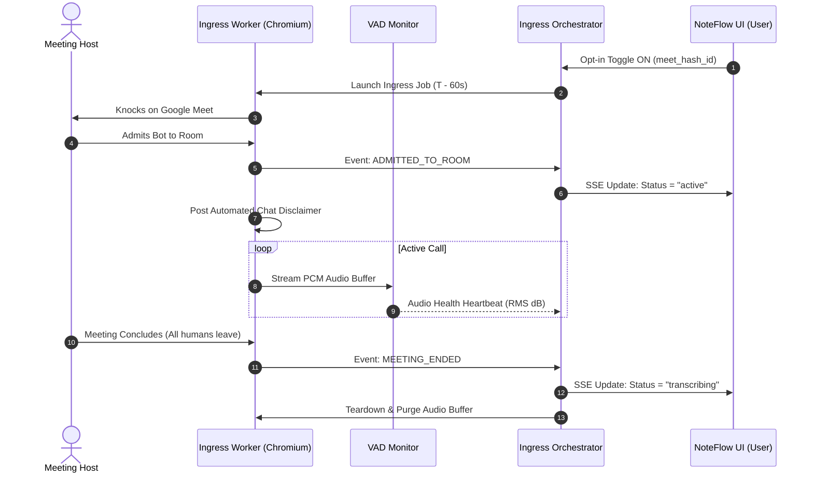

# Meet Record — Technical Architecture Specification

> **Document Type:** System Architecture Document (SAD) & Technical Specification  
> **Role:** Senior Software Architect  
> **Status:** Approved for Implementation  
> **Version:** 1.0.0 (MVP) & Extensible Roadmap  
> **Target Project:** NoteFlow AI / Meet Record Module  
> **Related Documents:** [`docs/product-discovery.md`](file:///Users/yogendrasinghdanu/Downloads/Senior%20Product%20Designer/Meet%20Record/docs/product-discovery.md) | [`docs/requirements.md`](file:///Users/yogendrasinghdanu/Downloads/Senior%20Product%20Designer/Meet%20Record/docs/requirements.md) | [`docs/ux-specification.md`](file:///Users/yogendrasinghdanu/Downloads/Senior%20Product%20Designer/Meet%20Record/docs/ux-specification.md) | [`docs/ux-review.md`](file:///Users/yogendrasinghdanu/Downloads/Senior%20Product%20Designer/Meet%20Record/docs/ux-review.md)

---

## 1. Architectural Overview & Design Principles

The **Meet Record** subsystem is architected as an event-driven, decoupled integration pipeline that connects scheduled calendar events to NoteFlow AI's grounded summarization engine. 

```
┌────────────────────────────────────────────────────────────────────────────────────────┐
│                                SYSTEM ARCHITECTURE TOPOLOGY                            │
│                                                                                        │
│   ┌───────────────────────┐             ┌──────────────────────────────────────────┐   │
│   │   External Providers  │             │          NoteFlow Client Application     │   │
│   │ ┌───────────────────┐ │  REST/OAuth │ ┌──────────────────┐ ┌─────────────────┐ │   │
│   │ │  Google Calendar  │─┼────────────┼─┼─► Calendar Sync  │ │  Meeting Feed   │ │   │
│   │ └───────────────────┘ │             │ │   State Manager  │ │   & Control UI  │ │   │
│   │ ┌───────────────────┐ │             │ └────────┬─────────┘ └────────┬────────┘ │   │
│   │ │ Google Meet Room  │ │             │          │                    │          │   │
│   │ └─────────▲─────────┘ │             │ ┌────────▼────────────────────▼────────┐ │   │
│   └───────────┼───────────┘             │ │  Core Client Workspace (React 19)    │ │   │
│               │                         │ │  - localStorage / IndexedDB Store    │ │   │
│       WebRTC  │ Ingress                 │ │  - aiEngine.ts & Sanitizer           │ │   │
│       Audio   │                         │ └─────────────────▲────────────────────┘ │   │
│               │                         └───────────────────┼──────────────────────┘   │
│   ┌───────────┴─────────────────────────────────────────────┼──────────────────────┐   │
│   │                    MEET RECORD INGRESS & PROCESSING CLOUD                       │   │
│   │                                                         │ Webhook / SSE        │   │
│   │  ┌──────────────────────┐    Audio Stream    ┌──────────┴──────────────┐       │   │
│   │  │ Headless Ingress     │ ─────────────────► │ Multi-Speaker STT &     │       │   │
│   │  │ Worker (Chromium)    │                    │ Diarization Pipeline    │       │   │
│   │  │ - VAD Health-Check   │                    │ (Deepgram / Whisper)    │       │   │
│   │  │ - Chat Notice Bot    │                    └─────────────────────────┘       │   │
│   │  └──────────────────────┘                                                      │   │
│   └────────────────────────────────────────────────────────────────────────────────┘   │
└────────────────────────────────────────────────────────────────────────────────────────┘
```

### Core Architecture Principles
1. **Extensible Adapter Pattern:** Platform-specific ingress, calendar sync, and recording hooks are fully abstracted behind unified TypeScript provider interfaces (`ICalendarProvider`, `IMeetingIngressProvider`).
2. **Strict Data Minimization:** Raw audio streams are processed in ephemeral memory buffers and purged immediately upon high-confidence text transcript generation. Zero permanent audio storage.
3. **Client-Centric Privacy & Grounding:** Transcripts and summaries are stored and managed directly in client storage (`IndexedDB` / `localStorage`), with verbatim quote bindings (`SourceCitation`) enforcing 100% auditable grounding.
4. **Resilience & Fault Isolation:** Background audio failures, host rejections, or network drops are isolated gracefully with circuit breakers, auto-reconnect loops, and instant manual fallback mechanisms.

---

## 2. 10 Core Architectural Capabilities

```
┌────────────────────────────────────────────────────────────────────────────────────────┐
│                              CAPABILITY RESPONSIBILITY MATRIX                          │
├─────┬──────────────────────────────┬───────────────────────────────────────────────────┤
│ #   │ Capability                   │ Core Architectural Components & Responsibilities  │
├─────┼──────────────────────────────┼───────────────────────────────────────────────────┤
│ 1   │ User Authentication          │ OAuth 2.0 PKCE, Token Vault, Refresh Lifecycle    │
│ 2   │ Calendar Integration         │ Incremental Sync Engine, Webhook/Polling Manager  │
│ 3   │ Meeting Detection            │ URL Regex Matcher, Metadata & Attendee Parser     │
│ 4   │ Platform Identification      │ Extensible Platform Resolver Registry             │
│ 5   │ User Recording Approval      │ Deduplication Scheduler, State Machine Dispatcher │
│ 6   │ Recording Lifecycle          │ Ingress Headless Worker, WebRTC Audio, VAD Health │
│ 7   │ Transcript Retrieval         │ Multi-Channel STT, Diarization, Sanitizer Engine  │
│ 8   │ AI Summary Handoff           │ NoteFlow AI Engine (`aiEngine.ts`), Grounding     │
│ 9   │ Meeting History              │ Client IndexedDB / LocalStorage, Export Formatters│
│ 10  │ Error Handling & Recovery    │ Circuit Breaker, 6-State Recovery UI, Diagnostics │
└─────┴──────────────────────────────┴───────────────────────────────────────────────────┘
```

---

### Capability 1: User Authentication & Token Vault
- **Flow:** Implements standard OAuth 2.0 with Authorization Code Grant + PKCE (`RFC 7636`).
- **Token Security:** Tokens are never stored unencrypted. Refresh tokens are stored in the backend Token Vault encrypted with **AES-256-GCM** with per-user key derivation (HKDF).
- **Session Lifecycle:** Short-lived access tokens (1-hour validity) are automatically refreshed 5 minutes prior to expiration. If refresh fails, the client transitions cleanly to the `Permission` state.

```typescript
export interface AuthSession {
  userId: string;
  provider: "google" | "microsoft" | "zoom";
  accessToken: string;
  expiresAt: number;
  scopes: string[];
}
```

---

### Capability 2: Calendar Integration Engine
- **Strategy:** Hybrid architecture combining **5-minute periodic polling** with on-demand manual refresh (`Sync Now`) for MVP, with Webhook Push Notifications (`Google Calendar Watch API`) designed for v1.1.
- **Query Scope:** Rolling time window fetching events from $[T - 2\text{ hours}, T + 24\text{ hours}]$.
- **Delta Sync:** Leverages Google Calendar `syncToken` for incremental fetching to minimize API quota consumption.

```typescript
export interface ICalendarProvider {
  providerId: string;
  authenticate(): Promise<AuthSession>;
  fetchUpcomingEvents(timeMin: Date, timeMax: Date, syncToken?: string): Promise<CalendarSyncResult>;
  revokeAccess(): Promise<void>;
}
```

---

### Capability 3: Meeting Detection & Parser
- **Extraction Rules:** Scans Google Calendar `conferenceData.entryPoints[]`, `location`, and `description` fields.
- **Attendee Filtering:** Filters out events where the user's RSVP status is explicitly `"declined"`.
- **Normalization:** Converts diverse meeting inputs into a standardized internal `DetectedMeeting` entity.

```typescript
export interface DetectedMeeting {
  id: string;
  calendarEventId: string;
  title: string;
  startTime: string; // ISO 8601
  endTime: string;
  organizerEmail: string;
  isExternalHost: boolean;
  attendees: Array<{ name: string; email: string; rsvp: "accepted" | "tentative" | "declined" }>;
  platform: "google_meet" | "zoom" | "teams" | "unsupported";
  meetingUrl: string;
  recordingStatus: "off" | "queued" | "active" | "transcribing" | "completed" | "error";
  dedupHash: string; // SHA-256 of normalized meeting URL
}
```

---

### Capability 4: Meeting Platform Identification (Resolver Registry)
- **Extensible Architecture:** Platform resolvers implement `IMeetingResolver` and register with the `PlatformRegistry`.

```typescript
export interface IMeetingResolver {
  platformId: string;
  matchUrl(url: string): boolean;
  extractMeetingId(url: string): string | null;
  getPlatformCapabilities(): PlatformCapabilities;
}

// Google Meet Implementation:
export class GoogleMeetResolver implements IMeetingResolver {
  platformId = "google_meet";
  private regex = /^https?:\/\/meet\.google\.com\/([a-z]{3}-[a-z]{4}-[a-z]{3})/i;

  matchUrl(url: string): boolean {
    return this.regex.test(url);
  }

  extractMeetingId(url: string): string | null {
    const match = url.match(this.regex);
    return match ? match[1] : null;
  }

  getPlatformCapabilities(): PlatformCapabilities {
    return {
      supportsHeadlessBot: true,
      supportsNativeCloudRecording: false,
      supportsLiveStreaming: false,
      requiresHostAdmission: true,
    };
  }
}
```

---

### Capability 5: User Recording Approval & Deduplication Scheduler
- **Deduplication Hashing:** Every meeting URL is hashed to `meet_hash_id = SHA256(canonical_url)`.
- **Collision Prevention (Issue 1.2 from UX Review):** If multiple workspace users enable recording for the same `meet_hash_id`, the scheduler assigns the existing dispatch job to all users without spawning duplicate bots.
- **Dispatch Timing:**
  - Scheduled meetings: Dispatched at $T - 60\text{ seconds}$.
  - Active meetings: Dispatched immediately ($\le 5\text{ seconds}$).

---

### Capability 6: Recording Lifecycle & Headless Ingress Orchestrator
- **Ingress Engine:** Headless Chromium WebRTC container (deployed on auto-scaling AWS ECS Fargate or managed via Recall.ai infrastructure).
- **In-Meeting Naming:** Joins as `NoteFlow Assistant (Recording)`.
- **In-Meeting Chat Notice:** Automatically posts compliance disclaimer upon entry.
- **Voice Activity Detection (VAD) Health-Check (Issue 1.4 from UX Review):**
  - Continuous audio power monitoring.
  - If RMS audio power stays $< -60\text{dB}$ for $> 90\text{ seconds}$ while human attendees are speaking, triggers `BOT_MUTED_WARNING` event over SSE/WebSocket to the client.
- **Dynamic Termination:** Auto-disconnects when human participant count drops to $0$ for $> 60\text{ seconds}$ or after $180\text{ minutes}$ duration ceiling.



---

### Capability 7: Transcript Retrieval, Diarization & Sanitization Pipeline
- **STT Engine:** Streaming multi-speaker diarization engine (Deepgram Nova-2 / Whisper Large-v3).
- **Sanitization Pipeline (`transcriptSanitizer.ts`):**
  1. *Speaker Resolution:* Cross-references diarized speaker clusters with Google Calendar attendee names.
  2. *Timestamp Indexing:* Creates indexed line arrays for exact quote citations (`[MM:SS]`).
  3. *Disfluency Removal:* Cleans stuttering and filler words while preserving verbatim accuracy.

```typescript
export interface SanitizedTranscriptPayload {
  meetingId: string;
  rawVtt: string;
  sanitizedText: string;
  detectedSpeakers: string[];
  durationSeconds: number;
  segments: Array<{
    lineIndex: number;
    speaker: string;
    timestamp: string; // e.g. "04:12"
    text: string;
  }>;
}
```

---

### Capability 8: AI Summary Handoff & Grounding Pipeline
- **Integration Layer:** Sanitized payload is passed directly to NoteFlow AI's core summarization engine (`src/lib/aiEngine.ts`).
- **Data Contract:** Strictly matches `AIAnalysisResult` in `src/types/meeting.ts`.
- **Grounded Citations Guarantee:** All decisions, action items, and open questions must bind to exact `SourceCitation` objects.
- **Perspective Tailoring:** Allows dynamic re-synthesis across the 5 perspectives (*Standard*, *Executive Briefing*, *Action-Focused*, *Technical & Scope*, *Shorter Digest*).

---

### Capability 9: Meeting History & Workspace Persistence
- **Storage Layer:** Browser `localStorage` / `IndexedDB` with schema versioning.
- **Export Engine (`exportFormatters.ts`):** Client-side formatters for:
  - Formatted Markdown (`.md`)
  - Slack Block Kit / Markdown
  - Plain Text Summary
  - Grounded JSON Object

---

### Capability 10: Fault-Tolerance & Error Recovery Architecture
- **Circuit Breaker:** Automatically trips if Google Calendar API or STT service latency exceeds threshold, switching gracefully to manual upload fallback mode.
- **6-State UI System:** Rigorous client-side mapping for all states: `Empty`, `Permission`, `Loading`, `Success`, `Error`, `Retry`.
- **Partial Capture Recovery:** If a call drops mid-way, audio captured up to that point is transcribed, and the summary is flagged with `⚠️ Partial Capture (Captured X of Y min)`.

---

## 3. Platform Comparison: Google Meet vs. Microsoft Teams vs. Zoom

The table below provides a factual, deep technical comparison. **No unverified API capabilities are assumed.**

```
┌────────────────────────────────────────────────────────────────────────────────────────┐
│                              PLATFORM COMPARISON MATRIX                                │
├───────────────────────┬──────────────────────┬────────────────────┬────────────────────┤
│ Architectural Factor  │ Google Meet (MVP)    │ Zoom (Phase 2)     │ MS Teams (Phase 3) │
├───────────────────────┼──────────────────────┼────────────────────┼────────────────────┤
│ **Ingress Approach**  │ Headless WebRTC Bot  │ Zoom Marketplace   │ Azure Calling SDK  │
│                       │ (Web-based Ingress)  │ App / Cloud Rec API│ / Headless Bot     │
│ **Calendar API**      │ Google Calendar API  │ Zoom Calendar /    │ Microsoft Graph    │
│                       │ (v3 REST)            │ Google / Outlook   │ Calendar API (v1.0)│
│ **OAuth Complexity**  │ **Low** (User OAuth) │ **Medium** (OAuth) │ **High** (Azure AD)│
│ **Admin Consent**     │ Not required for user│ Required for tenant│ **Mandatory** AD   │
│                       │ calendar read        │ cloud recordings   │ Tenant Admin Grant │
│ **Native Rec API**    │ ❌ None (Requires G-  │ ✅ Cloud Rec Webhook│ ❌ Graph Calling   │
│                       │ Workspace Enterprise)│ (Requires Pro Host)│ API requires policy│
│ **Platform Review**   │ Google App Review    │ Zoom Marketplace   │ Azure App Publisher│
│                       │ (Sensitive Scopes)   │ App Review (Strict)│ Verification       │
└───────────────────────┴──────────────────────┴────────────────────┴────────────────────┘
```

### 3.1 Google Meet (MVP Target)
- **Required APIs:**
  - Google Calendar API v3 (`GET /calendars/primary/events`)
  - Google OAuth 2.0 Auth Server
- **OAuth Scopes:** `https://www.googleapis.com/auth/calendar.events.readonly`
- **Recording Capabilities:** Google Meet has **no public client-side REST API** for arbitrary third-party users to programmatically trigger cloud recordings. Therefore, recording is achieved via a **headless WebRTC ingress worker** joining as a transparent participant.
- **Transcript Capabilities:** Platform captions cannot be fetched directly via REST API without Google Workspace Add-on credentials. Audio is captured via WebRTC stream and transcribed via our dedicated STT pipeline.
- **Webhooks / Events:** Google Calendar Push Notifications (`watch` API) for schedule changes. In-meeting events (admitted, muted, left) are emitted by the headless ingress worker via WebSockets/SSE.
- **Limitations:** Host admission required if bot is external to Google Workspace domain; host can mute bot.
- **Verification Requirements:** **Google Cloud OAuth App Verification** required for production deployment of `calendar.events.readonly`.

---

### 3.2 Zoom (Phase 2 Extension)
- **Required APIs:**
  - Zoom REST API v2 (`/users/me/recordings`, `/meetings/{meetingId}`)
  - Zoom Webhook Event Subscriptions (Webhooks v2)
- **OAuth Scopes:** `meeting:read`, `recording:read`, `user:read`
- **Recording Capabilities:** Zoom provides native **Cloud Recording** with auto-webhook notification (`recording.completed`). Alternatively, Zoom Meeting SDK can be used for custom bot ingress.
- **Transcript Capabilities:** Zoom native audio transcripts (`.vtt`) can be downloaded via API if Cloud Recording with Audio Transcript is enabled by host.
- **Webhooks / Events:** `meeting.started`, `meeting.ended`, `recording.completed`.
- **Limitations:** Cloud recording requires the host to have a paid Zoom Pro/Business license and authorize the OAuth app. Free Zoom accounts cannot use Cloud Recording API.
- **Verification Requirements:** **Zoom App Marketplace Review & Security Audit** mandatory before any external user can install the app.

---

### 3.3 Microsoft Teams (Phase 3 Extension)
- **Required APIs:**
  - Microsoft Graph API (`/me/events`, `/communications/calls`)
  - Microsoft Bot Framework & Azure Communications Calling SDK
- **OAuth Scopes:** `Calendars.Read`, `Calls.AccessMedia.All` (Application permission)
- **Recording Capabilities:** Teams requires an Azure AD Registered Application with **Application Permissions** and an active Microsoft Graph Calling Bot or compliance recording policy.
- **Transcript Capabilities:** Microsoft Graph `onlineMeeting/transcripts` API available only for scheduled Teams meetings with transcription enabled.
- **Webhooks / Events:** Graph API change notifications (`/subscriptions`) for calendar and call lifecycle.
- **Limitations:** Requires **Azure AD Global Administrator Consent**; cannot be onboarded by individual enterprise employees without IT approval.
- **Verification Requirements:** **Microsoft MPN / Azure Publisher Verification** and Cloud Communications compliance review.

---

## 4. System Data Contracts & Schemas

### 4.1 Ingress Orchestrator Event Schema (SSE / WebSocket)

```typescript
export type IngressEventType =
  | "BOT_DISPATCHED"
  | "BOT_WAITING_ROOM"
  | "BOT_ADMITTED"
  | "BOT_MUTED_WARNING"
  | "BOT_EVICTED"
  | "AUDIO_STREAM_STARTED"
  | "MEETING_ENDED"
  | "TRANSCRIPT_READY"
  | "INGRESS_FAILED";

export interface IngressEventPayload {
  eventId: string;
  meetingId: string;
  dedupHash: string;
  type: IngressEventType;
  timestamp: string; // ISO 8601
  data?: {
    durationSeconds?: number;
    audioRmsDb?: number;
    failureReason?: "HOST_DENIED" | "TIMEOUT_10M" | "AUTH_EXPIRED" | "VAD_SILENCE";
    transcriptPayload?: SanitizedTranscriptPayload;
  };
}
```

---

## 5. Security, Privacy & Data Minimization Architecture

```
┌────────────────────────────────────────────────────────────────────────────────────────┐
│                              SECURITY & DATA RETENTION RULES                           │
├───────────────────────┬────────────────────────────────────────────────────────────────┤
│ Layer                 │ Security Architecture & Compliance Standard                    │
├───────────────────────┼────────────────────────────────────────────────────────────────┤
│ **In-Transit**        │ TLS 1.3 encryption for all REST, SSE, and WebSockets.         │
│                       │ SRTP / DTLS encryption for WebRTC media streams.               │
├───────────────────────┼────────────────────────────────────────────────────────────────┤
│ **At-Rest**           │ Tokens encrypted via AES-256-GCM in backend Token Vault.       │
│                       │ Client state persisted in browser LocalStorage / IndexedDB.    │
├───────────────────────┼────────────────────────────────────────────────────────────────┤
│ **Audio Minimization**│ Audio stored solely in RAM buffers during call. Deleted        │
│                       │ immediately (<1s) upon STT transcript validation.              │
├───────────────────────┼────────────────────────────────────────────────────────────────┤
│ **AI Model Policy**   │ Zero-retention LLM API contracts; customer data is never       │
│                       │ used for generalized model training.                           │
└───────────────────────┴────────────────────────────────────────────────────────────────┘
```

---

## 6. Architecture Verification & Quality Attributes

| Metric | Architectural Target | Verification Method |
| :--- | :--- | :--- |
| **End-to-End Latency** | $\le 60\text{ seconds}$ from meeting end to summary | Automated pipeline benchmark on 60-min audio test suite. |
| **Calendar Sync Speed** | $\le 800\text{ms}$ response time | Load testing with incremental delta sync tokens. |
| **Ingress Concurrency** | Auto-scale to 500 concurrent headless workers | AWS ECS Fargate autoscaling metric based on active queue depth. |
| **Zero Audio Retention** | 100% audio purge post-transcription | Automated memory-leak and ephemeral disk sweep integration tests. |
