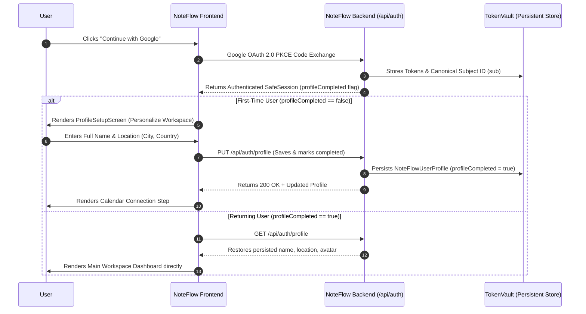

# NoteFlow AI • User Profile & First-Time Onboarding Specification

---

## 1. Product Principle & User Journey

### Identity vs. Profile Principle
- **Google OAuth Authentication** answers: *"Who is this authenticated identity?"* (identity provider verification via OpenID Connect).
- **NoteFlow User Profile** answers: *"How does NoteFlow represent and understand this user across shared meetings, notes, action items, and speaker diarization?"*

Google OAuth pre-populates initial defaults, but the NoteFlow User Profile is persisted as an independent, first-class entity in the backend database.



---

## 2. Profile Fields

| Field | Type | Mandatory? | Source / Mutability | Description |
| :--- | :--- | :--- | :--- | :--- |
| `fullName` | string | ✅ Yes ($\ge 2$ chars) | Pre-populated from Google; fully editable by user | Used in shared notes, action items, and UI headers |
| `email` | string | ✅ Yes | Google Verified Account (Readonly) | Primary authenticated communication address |
| `avatarUrl` | string | ⚪ Optional | Google Picture URL default; customizable | Displayed in AppHeader, notes, and profile modals |
| `city` | string | ⚪ Optional | User Input | Geographic location context |
| `country` | string | ⚪ Optional | User Input | Country context |
| `organization`| string | ⚪ Optional | Derived from email domain (e.g. `acme-corp.com`) | Workspace team pod |
| `profileCompleted` | boolean | ✅ Yes | System State | Distinguishes FTUX onboarding from returning users |

---

## 3. Database Model & Persistence

The user record in `server/security/tokenVault.ts` (stored in `.data/token_vault.enc.json`) is structured as follows:

```typescript
export interface NoteFlowUserProfile {
  fullName: string;
  email: string;
  avatarUrl?: string;
  city?: string;
  country?: string;
  organization?: string;
  profileCompleted: boolean;
  createdAt: string;
  updatedAt: string;
}

export interface StoredOAuthRecord {
  userId: string;                   // Derived: usr_g_${sha256(googleSubjectId)}
  googleSubjectId?: string;         // Immutable Google OIDC subject ID
  email: string;                    // Verified account email
  name: string;
  displayName?: string;
  avatarUrl?: string;
  profile: NoteFlowUserProfile;     // NoteFlow persistent profile
  encryptedAccessToken: string;     // AES-256-GCM encrypted
  encryptedRefreshToken?: string;    // AES-256-GCM encrypted
  expiresAt: number;
  scopes: string[];
  createdAt: number;
  lastUsedAt: number;
}
```

---

## 4. API Endpoints

### 1. `GET /api/auth/profile`
- **Authentication:** Required (`requireAuth` or `x-user-id` header).
- **Response (200 OK):**
  ```json
  {
    "success": true,
    "profile": {
      "fullName": "Yogesh Singh Danu",
      "email": "yogesh.danu@acme-corp.com",
      "avatarUrl": "https://lh3.googleusercontent.com/a/...",
      "city": "Bengaluru",
      "country": "India",
      "organization": "acme-corp.com",
      "profileCompleted": true,
      "createdAt": "2026-08-25T12:00:00.000Z",
      "updatedAt": "2026-08-25T12:45:00.000Z"
    }
  }
  ```

### 2. `PUT /api/auth/profile`
- **Authentication:** Required.
- **Request Body:**
  ```json
  {
    "fullName": "Yogesh Singh Danu",
    "city": "Bengaluru",
    "country": "India",
    "avatarUrl": "https://lh3.googleusercontent.com/a/..."
  }
  ```
- **Validation:** `fullName` must contain $\ge 2$ characters.
- **Response (200 OK):** Returns `{ "success": true, "message": "Profile updated successfully.", "profile": { ... } }`.

---

## 5. UX & UI States

1. **First-Time User Profile Setup ([`ProfileSetupScreen.tsx`](file:///Users/yogendrasinghdanu/Downloads/Senior%20Product%20Designer/Meet%20Record/src/components/auth/ProfileSetupScreen.tsx)):**
   - Clean, trustworthy onboarding card ("Welcome to NoteFlow AI").
   - Pre-populated Google photo and Name.
   - Readonly verified Google Workspace badge with lock icon.
   - City and Country location fields.
   - "Continue to Workspace" button with inline loader.

2. **Persistent User Profile & Settings Modal ([`UserProfileModal.tsx`](file:///Users/yogendrasinghdanu/Downloads/Senior%20Product%20Designer/Meet%20Record/src/components/modals/UserProfileModal.tsx)):**
   - Accessible at any time via AppHeader user avatar menu $\rightarrow$ *"Profile & Settings"*.
   - **Personal Information Section:** Edit Name, City, Country, Avatar with instant feedback.
   - **Connected Services Section:**
     - Google Account: `✓ Connected`
     - Google Calendar: `✓ Connected` or `Not connected` (with Connect / Disconnect actions).
   - Sign Out action.

---

## 6. Verification & E2E Test Results

Automated regression suite [`test/user-profile-onboarding.test.ts`](file:///Users/yogendrasinghdanu/Downloads/Senior%20Product%20Designer/Meet%20Record/test/user-profile-onboarding.test.ts):

```bash
=================================================
  NOTEFLOW AI — USER PROFILE & ONBOARDING SUITE  
=================================================
[PASS] ✅ First-Time User: Profile initialized with profileCompleted = false
[PASS] ✅ Onboarding Completion: PUT /api/auth/profile persists custom details and marks profileCompleted = true
[PASS] ✅ Returning User: Second Google login preserves custom profile & does not reset to incomplete
[PASS] ✅ Validation: Rejects empty or single-character full name with HTTP 400
[PASS] ✅ Multi-User Isolation: User B receives distinct, isolated profile
[PASS] ✅ Security: Missing authentication credentials returns HTTP 401
-------------------------------------------------
TOTAL: 6 | PASSED: 6 | FAILED: 0
PASS RATE: 100.0%
-------------------------------------------------
```
