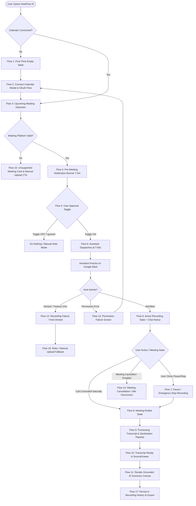

# Meet Record — UX Specification & Design System

> **Document Type:** Complete UX / UI Specification & Design System  
> **Role:** Senior Product Designer  
> **Status:** Ready for Engineering Hand-off  
> **Target Feature:** Meet Record (Automated Detection, Ingress & Grounded Synthesis)  
> **Companion Documents:** [`docs/product-discovery.md`](file:///Users/yogendrasinghdanu/Downloads/Senior%20Product%20Designer/Meet%20Record/docs/product-discovery.md) | [`docs/requirements.md`](file:///Users/yogendrasinghdanu/Downloads/Senior%20Product%20Designer/Meet%20Record/docs/requirements.md) | [`agent.md`](file:///Users/yogendrasinghdanu/Downloads/Senior%20Product%20Designer/Meet%20Record/agent.md)

---

## 1. Information Architecture (IA)

The Information Architecture integrates the automated **Meet Record** engine directly into NoteFlow AI's existing workspace structure without cluttering the canvas.

```
┌────────────────────────────────────────────────────────────────────────────────────────┐
│                              NOTEFLOW AI — WORKSPACE IA                                │
├────────────────────────────────────────────────────────────────────────────────────────┤
│                                                                                        │
│  [AppHeader]                                                                           │
│  ├── Workspace Logo & Brand ("NoteFlow AI")                                            │
│  ├── Active Calendar Connection Indicator (Google Workspace • Synchronized)          │
│  ├── Global Status Badge (Idle | Recording Active | Ingesting)                         │
│  └── Settings & Profile Modal Trigger                                                  │
│                                                                                        │
│  ┌───────────────────────────┬──────────────────────────────────────────────────────┐  │
│  │ SIDEBAR NAVIGATION        │ MAIN WORKSPACE CANVAS                                │  │
│  ├───────────────────────────┼──────────────────────────────────────────────────────┤  │
│  │ [Quick Action]            │ [View Mode Switcher: "Meet Record" | "Manual Note"]  │  │
│  │ ├── "+ New Note"          │                                                      │  │
│  │ └── "Paste Meeting Link"  │ ── IF MEET RECORD ACTIVE ──                          │  │
│  │                           │ ├── Section A: Live Meeting Banner (If Active)       │  │
│  │ [Section 1: Live & Today] │ ├── Section B: Today's Scheduled Meetings Feed       │  │
│  │ ├── Live Recording Card   │ └── Section C: Direct Ingress Dropzone Bar           │  │
│  │ └── Upcoming (Next 24h)   │                                                      │  │
│  │                           │ ── IF MEETING SELECTED / COMPLETED ──                │  │
│  │ [Section 2: Past Records] │ ├── Meeting Header Toolbar (Title, Date, Export CTA) │  │
│  │ ├── Today's Processed     │ ├── Executive Summary Card (Inline Editable)         │  │
│  │ ├── Yesterday             │ ├── Key Decisions Log (Citations + Confidence)       │  │
│  │ └── Older Sessions        │ ├── Action Items Matrix (Assignee, Due, Priority)    │  │
│  │                           │ ├── Questions Parking Lot (Follow-ups)               │  │
│  │ [Section 3: Storage/Sync] │ └── Perspective Refinement Chips                     │  │
│  │ └── Storage count / stats │                                                      │  │
│  └───────────────────────────┴──────────────────────────────────────────────────────┘  │
│                                                                                        │
│  [Slide-Over Drawers & Modals]                                                         │
│  ├── [SourceDrawer] Full Timestamped Transcript with Interactive Citation Highlighting │
│  ├── [PreMeetingModal] Explicit 1-Click Opt-In & Assistant Configuration Dialog        │
│  ├── [OAuthConsentModal] Transparent Scopes & Privacy Guarantee Explainer              │
│  ├── [LiveRecordingFloatingWidget] Global Mini-dock with Timer & Emergency Stop        │
│  ├── [ExportModal] Multi-Format Dispatch (Markdown, Slack, JSON, Clipboard)            │
│  └── [ErrorRecoveryModal] Actionable Diagnostics & Manual Upload Fallback              │
└────────────────────────────────────────────────────────────────────────────────────────┘
```

---

## 2. End-to-End User Journeys

```
┌────────────────────────────────────────────────────────────────────────────────────────┐
│                              PRIMARY USER JOURNEY (PM/DESIGNER)                        │
│                                                                                        │
│  [Step 1: Discover] ──► [Step 2: Connect] ──► [Step 3: Detect] ──► [Step 4: Opt-In]    │
│  Empty Dashboard        OAuth 2.0 Screen      Live Calendar Feed   Explicit Toggle ON  │
│  "Connect Calendar"     <30s Setup            Auto-parses Meet URL Scheduled T-60s     │
│                                                                                        │
│                                           │                                            │
│                                           ▼                                            │
│                                                                                        │
│  [Step 8: Synthesize] ◄── [Step 7: Conclude] ◄── [Step 6: In-Call] ◄── [Step 5: Ingress]│
│  Grounded AI Summary      All Humans Leave /     Bot Displays Name    Bot Knocks /     │
│  5 Perspective Views      Stop Triggered         Chat Notice Sent     Host Admits Bot  │
└────────────────────────────────────────────────────────────────────────────────────────┘
```

### Detailed Journey Breakdown

| Stage | User Emotional State | Primary Action | System Response & UI Feedback | Friction / Risk Mitigation |
| :--- | :--- | :--- | :--- | :--- |
| **1. First-Time Setup** | Curious, Cautious | Clicks "Connect Google Calendar" on empty state card. | Launches transparent scope modal explaining read-only access. | Clear "Zero email/contact sniffing" privacy pledge. |
| **2. Calendar Sync** | Reassured | Approves Google OAuth screen in popup. | Instant sync animation ($\le 800\text{ms}$); transitions to populated feed. | Clear visual checkmark and account email pill. |
| **3. Detection** | Delighted | Views today's meetings automatically organized by time. | Displays Google Meet badge, attendee avatars, and toggle switch. | Detects only valid `meet.google.com` links; filters out declined invites. |
| **4. Pre-Call Opt-in** | In Control | Toggles "Record Meeting" switch to ON for 11:00 AM Sprint. | Toggle flips to emerald; schedule pill reads `Scheduled for 10:59 AM`. | Default is always OFF; zero accidental auto-recording. |
| **5. Assistant Ingress** | Confident | Starts Google Meet call; admits `NoteFlow Assistant`. | In-app card transitions to `In Waiting Room` $\rightarrow$ `Recording Active`. | In-meeting chat notice sent automatically upon entry. |
| **6. Active Call** | Focused (Hands-free) | Conducts conversation naturally without taking manual notes. | Live recording widget shows duration timer, audio waveform, and stop button. | Non-distracting ambient UI; 1-click stop at any time. |
| **7. Meeting End** | Expectant | Ends Google Meet call; attendees disconnect. | Assistant auto-leaves within 60s of last human departure. | Dynamic departure detection prevents recording room silence. |
| **8. Synthesis** | Amazed (WOW Moment) | Returns to NoteFlow AI dashboard. | 5-stage progressive loader delivers grounded summary in $<60\text{s}$. | 100% citation grounding; interactive click to jump to exact audio quote. |

---

## 3. Comprehensive Task Flows (All 17 Scenarios)



---

## 4. Complete Screen List & Layouts

```
┌────────────────────────────────────────────────────────────────────────────────────────┐
│                                 SCREEN SPECIFICATIONS                                  │
├─────┬──────────────────────────────┬────────────────────────┬──────────────────────────┤
│ ID  │ Screen Name                  │ Path / Trigger         │ Primary Content / State  │
├─────┬──────────────────────────────┬────────────────────────┼──────────────────────────┤
│ SC01│ Welcome & Connect Dashboard  │ `/` (No Calendar)      │ Empty State + OAuth CTA  │
│ SC02│ Calendar Permission Modal    │ Modal Overlay          │ Scope Explainer & Consent│
│ SC03│ Meet Record Feed (Default)   │ `/` (Connected)        │ Today's Scheduled Events │
│ SC04│ Active Ingress Dock / Widget │ Floating (Bottom-Right)│ Live Timer, Wave, Stop   │
│ SC05│ Progressive Synthesis Canvas │ Workspace Canvas       │ 5-Stage Animated Loader  │
│ SC06│ Grounded Summary View        │ `/meeting/:id`         │ 4 Output Cards + Toolbar │
│ SC07│ Source Transcript Drawer     │ Slide-over Right (480px)│ Timestamped Quotes & VTT │
│ SC08│ Failure & Recovery Screen    │ Inline Workspace Card  │ Diagnostic + Retry / Drop│
│ SC09│ Meeting History & Archive    │ Sidebar List           │ Filterable Past Sessions │
│ SC10│ Export & Share Dialog        │ Modal Overlay          │ Markdown, Slack, JSON    │
└─────┴──────────────────────────────┴────────────────────────┴──────────────────────────┘
```

### Detailed Screen Anatomy & Wireframe Layouts

#### Screen SC03: Meet Record Feed (Default Connected View)
```text
┌──────────────────────────────────────────────────────────────────────────────────────────┐
│ [Logo] NoteFlow AI       [Google Workspace: yogendra@team.com ●]       [Settings] [?]    │
├──────────────────────────┬───────────────────────────────────────────────────────────────┤
│ 🔍 Search meetings...    │  TODAY'S MEETINGS — WEDNESDAY, AUG 19                         │
│                          │  ┌─────────────────────────────────────────────────────────┐ │
│ 📅 TODAY (3)             │  │ 🟢 10:00 AM - 10:30 AM (NOW ACTIVE)                     │ │
│ • Sprint Retro & Demo    │  │ Product & Design Weekly Sync                            │ │
│ • User Interview: Sarah  │  │ 👥 Sarah C., Alex M., +3 others   [Google Meet Link ↗]  │ │
│ • Arch RFC Discussion    │  │                                                         │ │
│                          │  │ Assistant: [  Ready to Join  ]     Record: [ [ON]  ]    │ │
│ 📁 PAST SESSIONS (12)    │  └─────────────────────────────────────────────────────────┘ │
│ • Yesterday (4)          │  ┌─────────────────────────────────────────────────────────┐ │
│ • Last Week (8)          │  │ ⚪ 02:00 PM - 02:45 PM (Starts in 3h 20m)               │ │
│                          │  │ Usability Critique: Mobile V2 Onboarding               │ │
│ ⚙️ Storage: 15 / 50 MB   │  │ 👥 Robin K., Elena R.             [Google Meet Link ↗]  │ │
│                          │  │ Assistant: [ Scheduled T-60s ]     Record: [  OFF  ]    │ │
│                          │  └─────────────────────────────────────────────────────────┘ │
│                          │  ┌─────────────────────────────────────────────────────────┐ │
│                          │  │ 🔗 Quick Record: [ Paste Google Meet URL... ] [Join Bot]│ │
│                          │  └─────────────────────────────────────────────────────────┘ │
└──────────────────────────┴───────────────────────────────────────────────────────────────┘
```

#### Screen SC04 & SC06: Live Recording Widget & Summary View
```text
┌──────────────────────────────────────────────────────────────────────────────────────────┐
│ [← Back to Feed]  Sprint Retro & Demo — Aug 19, 10:00 AM               [Export] [Share]  │
├──────────────────────────────────────────────────────────────────────────────────────────┤
│ ┌──────────────────────────────────────────────────────────────────────────────────────┐ │
│ │ 📄 EXECUTIVE SUMMARY                                           [Edit] [Copy Markdown]│ │
│ │ The team finalized the migration to the new Tailwind CSS v4 design token pipeline... │ │
│ └──────────────────────────────────────────────────────────────────────────────────────┘ │
│ ┌──────────────────────────────────────────────────────────────────────────────────────┐ │
│ │ 🎯 KEY DECISIONS (3)                                                                 │ │
│ │ 1. Migrate core component library to headless tokens by Sprint 42.                   │ │
│ │    Rationale: Eliminates duplicate CSS builds and reduces bundle size by 35%.         │ │
│ │    [Robin K. • 12:40] ──► (Clicks opens SourceDrawer directly at line 14)            │ │
│ └──────────────────────────────────────────────────────────────────────────────────────┘ │
│ ┌──────────────────────────────────────────────────────────────────────────────────────┐ │
│ │ ✅ ACTION ITEMS (4)                                                    [+ Add Action]│ │
│ │ [ ] 1. Draft RFC for Token Migration   👤 Alex M.   📅 Aug 24   [High]  [08:15]      │ │
│ │ [ ] 2. Update Figma Design System Specs 👤 Yogendra  📅 Aug 22   [Med]   [14:02]      │ │
│ └──────────────────────────────────────────────────────────────────────────────────────┘ │
└──────────────────────────────────────────────────────────────────────────────────────────┘
  [ FLOATING DOCK (When Active): 🔴 Recording: 18:42 | 👥 4 Attendees | [ ⏸ Pause ] [ ⏹ Stop & Synthesize ] ]
```

---

## 5. Design System & Component Hierarchy

### 5.1 Design Tokens (Tailwind v4 / CSS Variables)
- **Surfaces:**
  - Background Canvas: `--bg-base: #0b0d12`
  - Elevated Card: `--surface-card: #14171f / 80%` with `backdrop-blur-md`
  - Subtle Border: `--border-subtle: rgba(255, 255, 255, 0.08)`
  - Active Border: `--border-focus: rgba(99, 102, 241, 0.40)`
- **Accents & Status:**
  - Primary Brand: `--accent-primary: #6366f1` (Indigo 500)
  - Success / Live Recording: `--accent-live: #10b981` (Emerald 500)
  - Warning / Waiting: `--accent-warning: #f59e0b` (Amber 500)
  - Danger / Error: `--accent-danger: #f43f5e` (Rose 500)
  - Information: `--accent-info: #38bdf8` (Sky 400)
- **Typography Tokens:**
  - Font Family: `Inter`, `-apple-system`, `BlinkMacSystemFont`, `sans-serif`
  - Code / Timestamps: `JetBrains Mono`, `ui-monospace`, `monospace`

### 5.2 Component Breakdown (Atomic Design)

```
┌────────────────────────────────────────────────────────────────────────────────────────┐
│                              COMPONENT SPECIFICATION MATRIX                            │
├────────────┬─────────────────────────────┬─────────────────────────────────────────────┤
│ Level      │ Component Name              │ Responsibilities & Props                    │
├────────────┼─────────────────────────────┼─────────────────────────────────────────────┤
│ **Atoms**  │ `StatusPill`                │ State badge: `variant` (live, idle, error)  │
│            │ `RecordToggle`              │ Accessible toggle switch: `checked`, `on`   │
│            │ `CitationBadge`             │ Clickable quote token: `speaker`, `time`    │
│            │ `LiveWaveform`              │ Canvas audio visualizer micro-animation     │
│            │ `TimeCounter`               │ Monospace timer display (`MM:SS`)           │
├────────────┼─────────────────────────────┼─────────────────────────────────────────────┤
│ **Molecules│ `MeetingCard`               │ Calendar row with title, avatars, & toggle  │
│            │ `DecisionRow`               │ Decision text, rationale, & citation tag    │
│            │ `ActionItemRow`             │ Checkbox, assignee pill, date, priority tag │
│            │ `QuickIngressBar`           │ URL input with instant "Send Bot" trigger   │
│            │ `RefinementChipGroup`       │ 5 perspective switcher buttons              │
├────────────┼─────────────────────────────┼─────────────────────────────────────────────┤
│ **Organisms│ `MeetingFeedList`           │ Grouped list of today's detected calls      │
│            │ `LiveRecordingWidget`       │ Floating dock for active in-call controls   │
│            │ `ProgressiveSynthesisCanvas`│ 5-step animated loader state machine        │
│            │ `SourceDrawer`              │ Right slide-over containing full transcript │
│            │ `ErrorRecoveryCard`         │ Diagnostic box with 1-click retry CTA       │
└────────────┴─────────────────────────────┴─────────────────────────────────────────────┘
```

---

## 6. Interaction States Matrix

Every component must implement explicit, accessible visual cues for all 8 interaction states:

```
+-------------------------------------------------------------------------------------------------------+
| INTERACTION STATES MATRIX                                                                             |
+---------------+---------------------+--------------------+--------------------+-----------------------+
| Component     | Default             | Hover              | Active / Focus     | Loading / Disabled    |
+---------------+---------------------+--------------------+--------------------+-----------------------+
| `RecordToggle`| Gray track `#27272a`| Subtle glow ring   | Emerald track `#10b981` | Opacity 40%, cursor-  |
|               | White thumb knob    | border-white/20    | focus-visible: ring 2px| not-allowed           |
+---------------+---------------------+--------------------+--------------------+-----------------------+
| `MeetingCard` | `#14171f`/80 card   | translateY(-1px)   | Border indigo-500  | Shimmer skeleton      |
|               | border-white/8      | border-white/15    | ring-1 indigo-500  | during calendar sync  |
+---------------+---------------------+--------------------+--------------------+-----------------------+
| `CitationBadge`| Slate-800 bg       | Emerald-500/20 bg  | Scale(0.98), opens | Opacity 50%, non-     |
|               | text-slate-300      | text-emerald-300   | SourceDrawer       | interactive           |
+---------------+---------------------+--------------------+--------------------+-----------------------+
| `StopButton`  | Rose-500/20 bg      | Rose-500/30 bg     | Rose-600 bg        | Spinner icon inside   |
|               | text-rose-300       | text-rose-200      | Scale(0.97)        | "Finalizing..."       |
+---------------+---------------------+--------------------+--------------------+-----------------------+
```

---

## 7. Complete UX Copy & Microcopy Dictionary

```
┌────────────────────────────────────────────────────────────────────────────────────────┐
│                              UX MICROCOPY & MESSAGING DICTIONARY                       │
├──────────────────────┬─────────────────────────────────────────────────────────────────┤
│ Context / Scenario   │ Exact Copy String                                               │
├──────────────────────┼─────────────────────────────────────────────────────────────────┤
│ **Empty State Header**│ "No meetings scheduled for today"                               │
│ **Empty State Body** │ "Connect your Google Calendar to automatically detect upcoming   │
│                      │ Google Meet calls, or paste a meeting link below."              │
│ **OAuth Modal Title**│ "Connect Google Calendar"                                       │
│ **OAuth Privacy Note**│ "🔒 Privacy Guarantee: NoteFlow AI only reads event titles,     │
│                      │ times, and meeting links. We never read emails, edit events,    │
│                      │ or share your schedule."                                        │
│ **Toggle Tooltip OFF**│ "Click to enable NoteFlow Assistant for this meeting"           │
│ **Toggle Tooltip ON** │ "Assistant scheduled to join 60 seconds before start"           │
│ **In-Meeting Chat**  │ "👋 NoteFlow Assistant has joined to record and transcribe this │
│                      │ meeting for [Name]. Notes and action items will be generated    │
│                      │ post-call. To stop recording, remove this bot from the call."   │
│ **Waiting Room Pill**│ "Waiting for host admission..."                                 │
│ **Live Rec Pill**    │ "Recording in progress • [00:14:22]"                            │
│ **Synthesis Step 1** │ "Ingesting multi-speaker audio stream..."                       │
│ **Synthesis Step 2** │ "Normalizing speaker identities against calendar attendees..."  │
│ **Synthesis Step 3** │ "Synthesizing executive decisions & rationales..."              │
│ **Synthesis Step 4** │ "Structuring action items & priority matrix..."                 │
│ **Synthesis Step 5** │ "Grounding citations and indexing source transcript..."         │
│ **Error: Host Denied**│ "NoteFlow Assistant was denied entry by the meeting host."      │
│ **Error: Denied Action│ "You can still generate notes by dropping a transcript file."   │
│ **Error: Expired Auth│ "Google Calendar connection expired. Please reconnect."         │
│ **Toast: Success**   │ "✨ Meeting synthesized! 3 decisions and 4 action items ready."  │
└──────────────────────┴─────────────────────────────────────────────────────────────────┘
```

---

## 8. Accessibility Requirements (WCAG 2.1 AA / AAA)

### 8.1 Visual & Contrast Standards
- **Contrast Ratios:**
  - Normal text ($<18\text{pt}$): $\ge 5.2:1$ against surface background (`#14171f`).
  - Large text ($\ge 18\text{pt}$) & interactive UI components: $\ge 4.5:1$.
  - Focus indicators: Solid 2px outline with $3:1$ contrast against adjacent surfaces (`outline: 2px solid #6366f1; outline-offset: 2px`).

### 8.2 Keyboard Navigation & Shortcuts
- **Tab Flow Order:**
  1. Quick Search $\rightarrow$ 2. Sync Calendar Button $\rightarrow$ 3. Today's Meeting Cards (Toggle switch accessible directly via Spacebar) $\rightarrow$ 4. Quick Record Input $\rightarrow$ 5. Past Meeting History.
- **Global Keybindings:**
  - `Cmd / Ctrl + K`: Focus Meeting Search / Ingress Bar.
  - `Cmd / Ctrl + N`: Create blank manual note.
  - `Cmd / Ctrl + Shift + R`: Emergency Stop active recording session.
  - `Esc`: Close open modal, slide-over `SourceDrawer`, or dismiss toast.

### 8.3 Screen Reader Announcements (ARIA Live Regions)
- **Live Recording Status:**
  ```html
  <div role="status" aria-live="polite" class="sr-only">
    NoteFlow Assistant is currently recording. Meeting duration is 14 minutes and 20 seconds.
  </div>
  ```
- **Synthesis Progress:**
  ```html
  <div role="progressbar" aria-valuenow="60" aria-valuemin="0" aria-valuemax="100" aria-label="Synthesis progress: Structuring action items">
  </div>
  ```
- **Citation Badges:**
  ```html
  <button aria-label="View source quote from Sarah Chen at 12 minutes 40 seconds">
    Sarah C. • 12:40
  </button>
  ```

---

## 9. Responsive Breakpoints & Viewport Adaptations

```
┌────────────────────────────────────────────────────────────────────────────────────────┐
│                              RESPONSIVE BEHAVIOR MATRIX                                │
├─────────────────┬──────────────────────────────────────────────────────────────────────┤
│ Viewport        │ Layout Adaptations & Interaction Modifications                       │
├─────────────────┼──────────────────────────────────────────────────────────────────────┤
│ **Desktop**     │ • Dual-column layout (Sidebar 280px + Main Canvas flex-1).           │
│ ($\ge 1280\text{px}$)│ • Slide-over `SourceDrawer` occupies 480px on the right without      │
│                 │   obscuring the main summary canvas.                                 │
├─────────────────┼──────────────────────────────────────────────────────────────────────┤
│ **Tablet**      │ • Collapsible sidebar into compact icon rail (64px).                 │
│ ($768 - 1279\text{px}$)│ • `SourceDrawer` displays as an overlay modal with backdrop scrim.   │
├─────────────────┼──────────────────────────────────────────────────────────────────────┤
│ **Mobile**      │ • Stacked single-column view. Sidebar accessible via bottom sheet.   │
│ ($< 768\text{px}$)│ • Floating recording widget collapses into a compact top status bar. │
│                 │ • Swipe gestures enabled to toggle between Summary and Transcript.   │
└─────────────────┴──────────────────────────────────────────────────────────────────────┘
```

---

## 10. Design-to-Engineering Handoff Checklist

- [x] **Component Architecture:** Strict mapping of all components to existing NoteFlow React modules (`src/components/workspace/*`).
- [x] **State Machine Alignment:** All 17 user flows map directly to `MeetingNote.status` (`draft` | `generating` | `completed` | `error`).
- [x] **Data Contract Consistency:** All citation and decision UI widgets consume `SourceCitation` and `DecisionItem` from `src/types/meeting.ts`.
- [x] **Zero Hallucination UI:** Fallback states for empty decisions and empty action item arrays verified.
- [x] **WCAG AA Compliance:** Keyboard, focus rings, contrast, and ARIA live regions specified.
